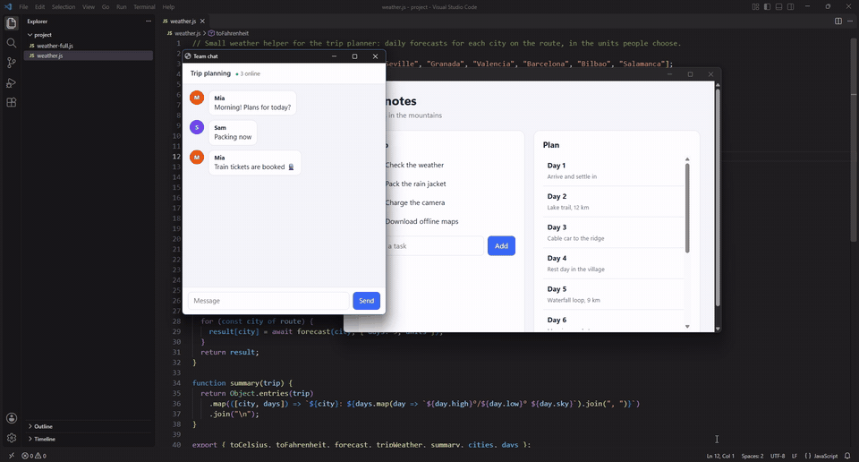
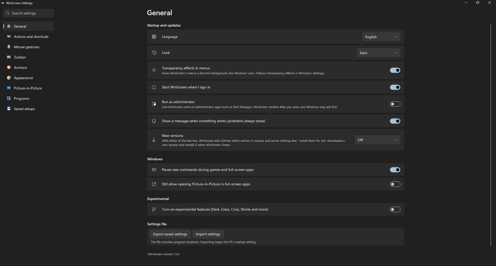
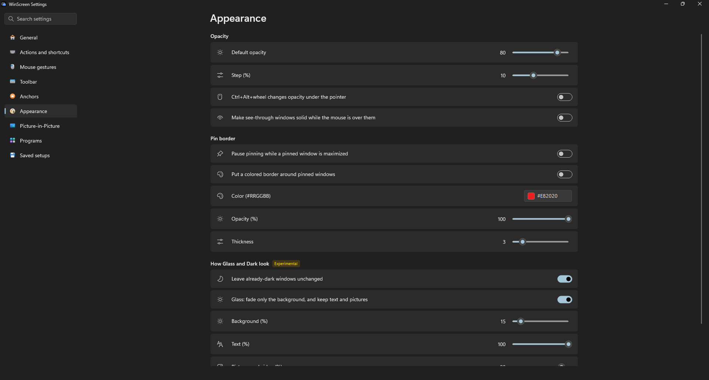
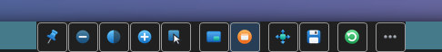
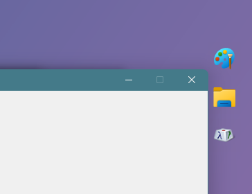

<p align="center">
  
</p>

<h1 align="center">WinScreen</h1>

<p align="center">
  <strong>Stabil.</strong> Als <em>experimentell</em> markierte Funktionen können sich noch ändern. Dein Feedback hilft gerade am meisten.
</p>

<p align="center">
  
  <a href="https://github.com/DarkLian/WinScreen/actions/workflows/build.yml"></a>
  <a href="https://github.com/DarkLian/WinScreen/releases"></a>
  
  
  <a href="LICENSE"></a>
</p>

<p align="center">
  <a href="README.md">English</a> · <a href="README.zh-CN.md">简体中文</a> · <a href="README.zh-TW.md">繁體中文</a> · <a href="README.ja.md">日本語</a> · <a href="README.ko.md">한국어</a> · <a href="README.de.md">Deutsch</a> · <a href="README.fr.md">Français</a> · <a href="README.es.md">Español</a> · <a href="README.pt-BR.md">Português (Brasil)</a> · <a href="README.ru.md">Русский</a> · <a href="README.uk.md">Українська</a>
</p>

Die App und die Anleitung gibt es bisher nur auf Englisch und Chinesisch.

## So sieht es aus

Zwei Ansichten über einem Code-Editor: Eine spielt ein Video ab, die andere benutzt du direkt in der Ansicht. Auch auf einem anderen virtuellen Desktop bleiben sie bei dir.

<p align="center">
  
</p>

Die Symbolleiste auf der Titelleiste eines Fensters: die Befehle des Fensters, einen Klick entfernt.

<p align="center">
  
</p>

Anker holen Fenster mit einem Klick zurück, von jedem Desktop aus. Zieh eine Datei auf einen Anker, um sie in sein Fenster abzulegen.

<p align="center">
  
</p>

Schneide eine Ansicht auf den Teil zu, den du brauchst, und zoome hinein. Eine Ansicht eines Bildschirmausschnitts funktioniert genauso.

<p align="center">
  
</p>

Glas blendet nur den Hintergrund aus. Richte ein Fenster einmal ein, drück Strg+Alt+Umschalt+S, und es öffnet sich beim nächsten Mal genauso.

<p align="center">
  
</p>

## Menüs

<p align="center">
  
</p>
<p align="center">
  
</p>
<p align="center">
  
</p>

## Symbolleiste und Anker

<p align="center">
  
  
</p>

## Apps über eine kleine Ansicht benutzen

Drück **Strg+Alt+P** auf einem Fenster, und du bekommst eine kleine Live-Ansicht davon, die immer im Vordergrund bleibt.
Schalte im Menü der Ansicht **Interactive** ein, und du kannst die App direkt in der Ansicht benutzen: klicken, tippen,
scrollen, Text markieren und Menüs öffnen. Das klappt mit Chrome, Edge, Brave, Vivaldi, Firefox, Electron-Apps und dem
Datei-Explorer; für andere Apps ist es *(experimentell)*. Das echte Fenster bleibt versteckt und aus dem Weg, so bleiben
ein Video, ein Chat oder ein Dokument in einer Ecke griffbereit, während du arbeitest.

**Enhanced hover** sorgt dafür, dass Hover-Effekte in Browsern und Apps wie VS Code und Discord weiter funktionieren.
Bei einer App, die über eine Ansicht nicht gut läuft, etwa einem Spiel, kann ein Klick auf die Ansicht stattdessen das
echte Fenster zurückholen, und es versteckt sich wieder, sobald du wegwechselst.
[Was wo funktioniert](docs/FEATURE_COMPATIBILITY.md) (auf Englisch) listet die Details auf.

## Funktionen

**Fenster**
- Im Vordergrund fixieren, wahlweise mit farbigem Rahmen
- Durchsichtig, mit einer Standardstufe, Strg+Alt+Mausrad unter dem Zeiger und wieder deckend, solange die Maus darüber ist
- Klicks durchlassen
- Rahmenlos, Bildschirm ausfüllen, dunkle Titelleiste
- Die Einstellungen eines Programms für seine Fenster merken, erkannt an Titel oder Klasse, einmal oder jedes Mal

**Bild im Bild**
- Live-Ansichten eines Fensters, eines ganzen Bildschirms oder eines Bildschirmausschnitts
- Zuschneiden, zoomen, Größe ändern, feste Größen, Vorlagen und gespeicherte Quellen
- Auf einen angeklickten Teil eines Fensters zuschneiden, auch wenn das Fenster seine Größe ändert
- Das Original versteckt halten und die Ansicht trotzdem aktualisieren
- Den Ton des Originals aus der Ansicht stummschalten
- Apps über eine Ansicht benutzen: Chrome, Edge, Brave, Vivaldi, Firefox, Electron-Apps und Datei-Explorer, dazu andere Apps, Enhanced hover und Scrollen mit der mittleren Maustaste *(experimentell)*
- Bildraten-Grenze, Deckkraft, Positionssperre und Klick-Durchlass pro Ansicht
- Ansichten in die Taskleiste minimieren, Vorschau beim Darüberfahren und eine Leselupe
- Ansichten, die Text und Bildern ausweichen *(experimentell)*

**Anker**
- Schwebende Schaltflächen, die ein Fenster mit einem Klick zurückholen
- Dateien darauf ziehen, den Zeiger darauf ruhen lassen für eine Live-Vorschau
- Werden automatisch hinzugefügt und entfernt, wenn Fenster verdeckt werden
- Ein Fenster in seinen Anker minimieren
- Ihre Fenster aus der Taskleiste nehmen oder vorübergehend alle verstecken
- Auf jedem virtuellen Desktop anzeigen oder nur auf dem ihres Fensters

**Anordnen**
- Neun Stellen auf dem Bildschirm, der nächste Bildschirm, eine genaue Position und Größe, die vorherige Position
- Verschieben und Größe ändern mit gedrückter Alt- oder Win-Taste beim Ziehen, mit Einrasten an Kanten
- Bis zur Titelleiste aufrollen *(experimentell)*, nach hinten schicken

**Effekte** *(experimentell)*
- Dunkelmodus, der Bilder und Videos lässt, wie sie sind, oder ein einfacher Filter
- Glas, das nur den Hintergrund ausblendet
- Ein Fenster zuschneiden oder zu einer Live-Kachel verkleinern

**Im Alltag**
- Eine Symbolleiste auf Titelleisten, ein Fenstermenü per Strg+Rechtsklick und ein vollständiges Infobereich-Menü
- Tastenkürzel, die du ändern kannst, und eine durchsuchbare Liste aller Aktionen
- Eine Befehlszeile für Skripte
- Einstellungen und Menüs, die allein mit der Tastatur funktionieren
- Einstellungen im Stil von Windows 11, hell oder dunkel
- Programme, die in Ruhe gelassen werden, oder die einzigen, mit denen gearbeitet wird
- Pausiert bei Spielen und Vollbild-Apps
- Läuft als Administrator, wenn du willst, für Apps wie den Task-Manager
- Alles zurücksetzen mit Strg+Alt+R; Fenster kommen zurück, selbst wenn WinScreen unerwartet beendet wird
- Automatische Updates und Einstellungen, die du auf einen anderen PC mitnehmen kannst
- English, 简体中文 und 繁體中文

## Installation

Lade **WinScreen-…-x64-Setup.exe** unter [Releases](https://github.com/DarkLian/WinScreen/releases) herunter und führe
es aus. Es läuft auf Windows 10 (Version 2004 oder neuer) und Windows 11, auf 64-Bit-PCs mit Intel oder AMD (x64).
In [Was wo funktioniert](docs/FEATURE_COMPATIBILITY.md) (auf Englisch) steht, wie es auf anderen Systemen aussieht und
was jede Funktion kann und nicht kann.

Du musst nichts anderes installieren, und es läuft ohne Administratorrechte. WinScreen lebt im Infobereich der Taskleiste.

Das Installationsprogramm ist nicht signiert, daher sagt Windows vielleicht, dass es die App nicht erkennt. Wähle
**Weitere Informationen** und dann **Trotzdem ausführen**. Zum Entfernen gehst du in Windows zu
**Einstellungen → Apps → Installierte Apps**.

Mit [Scoop](https://scoop.sh) ist es in zwei Zeilen installiert (die portable Version, von Scoop aktualisiert):

```
scoop bucket add winscreen https://github.com/DarkLian/WinScreen
scoop install winscreen
```

## Schnellstart

1. Klick auf das Fenster, das du ändern willst.
2. Drück **Strg+Alt+T**, um es im Vordergrund zu fixieren, **Strg+Alt+P** für eine Live-Ansicht oder **Strg+Alt+A** für einen Anker.
3. Klick auf das Symbol im Infobereich für die Einstellungen, oder mit der rechten Maustaste für alle Befehle.
4. Drück **Strg+Alt+R**, um jedes Fenster wieder so herzustellen, wie es war.

| Das tun | Tastenkürzel |
| --- | --- |
| Im Vordergrund fixieren oder lösen | Strg+Alt+T |
| Live-Ansicht öffnen oder schließen | Strg+Alt+P |
| Anker hinzufügen oder entfernen | Strg+Alt+A |
| Mehr oder weniger durchsichtig | Strg+Alt+Unten / Oben |
| Standard-Durchsichtigkeit ein oder aus | Strg+Alt+O |
| Klick-Durchlass ein oder aus | Strg+Alt+C |
| Dieses Fenster zurücksetzen | Strg+Alt+U |
| Alle Fenster zurücksetzen | Strg+Alt+R |

Die **[Anleitung](docs/USER_GUIDE.md)** (auf Englisch) erklärt jede Funktion.

## Fragen und Antworten

### Ist das KI-Schrott?

WinScreen ist aus Leidenschaft entstanden, um Probleme zu lösen, die ich selbst hatte, und es wird mit viel Hilfe von
KI-Agenten gebaut. Das sage ich lieber gleich vorneweg.

Was ich tun kann, ist die Arbeit zu prüfen: Jede Version wird unter Windows 10 und Windows 11 getestet, Funktionen, die
noch nicht zuverlässig sind, sind als *experimentell* markiert, und gemeldete Fehler werden behoben statt liegen
gelassen. Was ich allein nicht schaffe, ist jede Windows-Version, jeden PC und jede App abzudecken. Genau da helfen deine
Meldungen am meisten: Wenn etwas bei dir nicht funktioniert, [eröffne bitte ein Issue](https://github.com/DarkLian/WinScreen/issues).

### Warum nicht einfach bestehende, ausgereifte Tools verwenden?

[PowerToys](https://github.com/microsoft/powertoys) wird aktiv gepflegt, setzt aber auf viele Funktionen und weniger
auf gezielte Verbesserungen. WinScreen ergänzt es, indem es sich auf bestimmte Windows-Werkzeuge spezialisiert. Es soll
PowerToys nicht nachbauen, das wäre sinnlos.

[WindowTop](https://windowtop.info/) hat dieses Projekt inspiriert. Es ist allerdings geschlossen und kostenpflichtig.
WinScreen will eine kostenlose, quelloffene Möglichkeit für Leute (und mich) sein, die Funktionen wollen, die hinter
einer Bezahlschranke liegen. Dazu kommt: Ohne die Zwänge eines Geschäfts kann WinScreen schnell und unbelastet
aktualisiert werden. Ich will also schnell reagieren und nachbessern, Fehler beheben und Funktionen hinzufügen, die
wirklich gebraucht werden (mit gründlichen Tests, hoffe ich).

Viele andere Projekte, die ich gefunden habe, sind eingestellt, kostenpflichtig oder echter KI-Schrott, der nicht
aktualisiert wird, Probleme, die ich am ersten Tag gefunden habe, offen lässt, und deren GitHub ein Chaos ist.
**Eine Möglichkeit, die kostenlos und quelloffen ist, gezielte Verbesserungen bietet und dauerhaft gepflegt wird, gibt
es derzeit einfach nicht.**

### Wird das Projekt dauerhaft gepflegt?

Ich gebe mein Bestes. Als leidenschaftsgetriebenes, nicht kommerzielles Projekt ist Unterstützung aus der Community
aber ein großer Ansporn für mich. Ich kann nicht garantieren, dass es immer gepflegt wird, aber selbst dann steht es
unter der MIT-Lizenz, also kann es jeder forken und am Leben halten. Das ist der Geist von Open Source!

### Ist es sicher?

Das Projekt ist vollständig quelloffen. Jeder kann den Code prüfen (oder ihn von einer KI analysieren lassen) und ihn
selbst bauen. Schalte automatische Updates aus und lass den Code von einer KI analysieren, wenn du extra Sicherheit
willst.

Quelloffen heißt nicht absolut sicher, aber alles liegt offen, damit jeder es prüfen, hinterfragen oder auf Probleme
hinweisen kann. Sicherheitsbedenken, die du meldest, sind mir willkommen.

## Updates

In den Einstellungen (Settings) wählst du, was WinScreen bei neuen Versionen tut: nichts (die Voreinstellung), dir
Bescheid geben oder sie für dich installieren, wenn du es schließt. Eine portable Kopie kann sich nicht selbst
aktualisieren, daher sagt sie dir Bescheid und öffnet die Seite der neuen Version. Zum Aktualisieren von Hand schließt
du WinScreen und führst das neuere Installationsprogramm aus. Deine Einstellungen bleiben, wie sie sind.

## Sag uns, was du denkst

WinScreen wird von DarkLian mit Hilfe von KI-Agenten entwickelt. Am meisten hilfst du, wenn du erzählst, wie es bei dir
läuft. [Eröffne ein Issue](https://github.com/DarkLian/WinScreen/issues), um eine Idee zu teilen, ein Problem zu
melden oder etwas Kleines zu erwähnen, das dich stört. In **[Contributing](CONTRIBUTING.md)** (auf Englisch) steht,
was am meisten hilft.

Wenn dir WinScreen nützt, kannst du es [auf Ko-fi unterstützen](https://ko-fi.com/darklian).

## Selbst bauen

Du brauchst das .NET 10 SDK, das in `global.json` steht. Führe `.\build.ps1 -SkipInteractive` aus, und das
Installationsprogramm erscheint in `dist\release`.

Wie sich jede Funktion bei jeder Art von Fenster verhält und wo der Code das entscheidet, steht in
[Funktionskompatibilität](docs/FEATURE_COMPATIBILITY.md) (auf Englisch).

## Richtlinie zur Code-Signierung

**WinScreen ist nicht signiert.** Kostenlose Code-Signierung von der [SignPath Foundation](https://signpath.org/) setzt
voraus, dass ein Projekt schon weiter verbreitet ist, also bewerben wir uns später noch einmal.

- **Wer beteiligt ist:** [DarkLian](https://github.com/DarkLian) schreibt und prüft den Code von WinScreen, mit Hilfe
  von KI-Agenten, und gibt jede Version frei. Niemand sonst kann den Code ändern oder eine Version veröffentlichen.
- **Datenschutz:** WinScreen sendet nichts über dich oder deinen PC irgendwohin. Es geht nur online, wenn du von neuen
  Versionen hören oder sie installieren lassen willst oder **Check for updates** wählst, und fragt dann nur GitHub, welche
  Version die neueste ist. Es führt ein kurzes Protokoll auf deinem PC, um Probleme zu beheben, das deinen PC nie
  verlässt, außer du schickst es selbst.

## Lizenz

[MIT](LICENSE)
