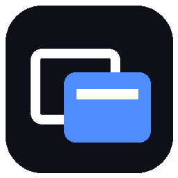

<p align="center">
  
</p>

<h1 align="center">WinScreen</h1>

<p align="center">
  <strong>Estable.</strong> Las funciones marcadas como <em>experimentales</em> todavía pueden cambiar. Ahora mismo, lo que más ayuda son tus comentarios.
</p>

<p align="center">
  
  <a href="https://github.com/DarkLian/WinScreen/actions/workflows/build.yml"></a>
  <a href="https://github.com/DarkLian/WinScreen/releases"></a>
  
  
  <a href="LICENSE"></a>
</p>

<p align="center">
  <a href="README.md">English</a> · <a href="README.zh-CN.md">简体中文</a> · <a href="README.zh-TW.md">繁體中文</a> · <a href="README.ja.md">日本語</a> · <a href="README.ko.md">한국어</a> · <a href="README.de.md">Deutsch</a> · <a href="README.fr.md">Français</a> · <a href="README.es.md">Español</a> · <a href="README.pt-BR.md">Português (Brasil)</a> · <a href="README.ru.md">Русский</a> · <a href="README.uk.md">Українська</a>
</p>

Por ahora, la aplicación y la guía solo están en inglés y chino.

## En acción

Dos vistas sobre un editor de código: una reproduce un video y la otra se usa dentro de la propia vista. Te acompañan en otro escritorio virtual.

<p align="center">
  
</p>

La barra de herramientas en la barra de título de una ventana: los comandos de la ventana, a un clic.

<p align="center">
  
</p>

Las anclas traen una ventana de vuelta con un clic, desde cualquier escritorio. Arrastra un archivo sobre una para soltarlo en su ventana.

<p align="center">
  
</p>

Recorta una vista a la parte que quieres y amplíala. Una vista de parte de la pantalla funciona igual.

<p align="center">
  
</p>

Cristal difumina solo el fondo. Configura una ventana una vez, pulsa Ctrl+Alt+Mayús+S y se abrirá así la próxima vez.

<p align="center">
  
</p>

## Usa aplicaciones desde una vista pequeña

Pulsa **Ctrl+Alt+P** sobre una ventana para tener una pequeña vista en vivo de ella que se queda encima. Activa
**Interactive** en el menú de la vista y podrás usar la aplicación dentro de la propia vista: hacer clic, escribir,
desplazarte, seleccionar texto y abrir menús. Está lista para Chrome, Edge, Brave, Vivaldi, Firefox, aplicaciones
Electron y el Explorador de archivos; para otras aplicaciones es *(experimental)*. La ventana real se queda oculta y
fuera del camino, así que un vídeo, un chat o un documento siguen a mano en una esquina mientras trabajas.

**Enhanced hover** hace que los efectos al pasar el ratón sigan funcionando en navegadores y en aplicaciones como
VS Code y Discord. Para una aplicación que no funciona bien a través de una vista, como un juego, un clic en su vista
puede traer de vuelta la ventana real, que se vuelve a ocultar cuando cambias a otra.
[Qué funciona dónde](docs/FEATURE_COMPATIBILITY.md) (en inglés) tiene los detalles.

## Funciones

**Ventanas**
- Fijar encima, con un borde de color opcional
- Transparencia, con un nivel predeterminado, Ctrl+Alt+rueda bajo el puntero, y opaca de nuevo mientras el ratón está encima
- Dejar pasar los clics
- Sin bordes, llenar la pantalla, barra de título oscura
- Recordar la configuración de un programa para sus ventanas, reconocidas por título o clase, una vez o siempre

**Pantalla en pantalla**
- Vistas en vivo de una ventana, de una pantalla entera o de parte de la pantalla
- Recortar, ampliar, cambiar el tamaño, tamaños fijos, ajustes guardados y fuentes guardadas
- Recortar a la parte de una ventana en la que haces clic, y mantenerlo aunque la ventana cambie de tamaño
- Mantener oculta la original y la vista actualizándose
- Silenciar el sonido de la original desde la vista
- Usar aplicaciones desde una vista: Chrome, Edge, Brave, Vivaldi, Firefox, aplicaciones Electron y el Explorador de archivos, y otras aplicaciones, Enhanced hover y desplazamiento con el botón central *(experimental)*
- Límite de fotogramas, opacidad, bloqueo de posición y paso de clics para cada vista
- Minimizar vistas a la barra de tareas, vista previa al pasar el ratón y lupa de lectura
- Vistas que se apartan del texto y las imágenes *(experimental)*

**Anclas**
- Botones flotantes que traen de vuelta una ventana con un clic
- Suelta archivos en ellas, o deja el puntero encima para ver una vista previa en vivo
- Se añaden y se quitan solas a medida que las ventanas quedan tapadas
- Minimizar una ventana a su ancla
- Quitar sus ventanas de la barra de tareas, u ocultarlas todas por ahora
- Mostrarlas en todos los escritorios virtuales, o solo en el de su ventana

**Organizar**
- Nueve posiciones en la pantalla, la siguiente pantalla, una posición y un tamaño exactos, la posición anterior
- Mover y cambiar el tamaño manteniendo Alt o Win y arrastrando, con ajuste a los bordes
- Enrollar hasta la barra de título *(experimental)*, enviar al fondo

**Efectos** *(experimental)*
- Modo oscuro que deja las imágenes y los vídeos como están, o un filtro sencillo
- Cristal que difumina solo el fondo
- Recortar una ventana, o reducirla a un mosaico en vivo

**Uso diario**
- Una barra de herramientas en las barras de título, un menú de ventana con Ctrl+clic derecho y un menú completo en la bandeja
- Atajos que puedes cambiar, y una lista de todas las acciones en la que puedes buscar
- Una línea de comandos para scripts
- Configuración y menús que funcionan solo con el teclado
- Una configuración con el aspecto de la de Windows 11, en claro u oscuro
- Programas que dejar en paz, o los únicos con los que trabajar
- Se pausa durante juegos y aplicaciones a pantalla completa
- Se ejecuta como administrador cuando quieras, para aplicaciones como el Administrador de tareas
- Devuelve todo a su estado con Ctrl+Alt+R; las ventanas vuelven aunque WinScreen se cierre de forma inesperada
- Actualizaciones automáticas, y una configuración que puedes llevar a otro PC
- English, 简体中文 y 繁體中文

## Instalación

Descarga **WinScreen-…-x64-Setup.exe** desde [Releases](https://github.com/DarkLian/WinScreen/releases) y ejecútalo.
Funciona en Windows 10 (versión 2004 o posterior) y Windows 11, en PC de 64 bits con Intel o AMD (x64). Consulta
[qué funciona dónde](docs/FEATURE_COMPATIBILITY.md) (en inglés) para otros sistemas y para lo que cada función puede y
no puede hacer.

No necesitas instalar nada más, y funciona sin permisos de administrador. WinScreen vive en la bandeja del sistema.

El instalador no está firmado, así que Windows puede decir que no lo reconoce. Elige **Más información** y luego
**Ejecutar de todas formas**. Para quitarlo, ve a **Configuración → Aplicaciones → Aplicaciones instaladas** en Windows.

Con [Scoop](https://scoop.sh) se instala en dos líneas (la versión portable, que Scoop mantiene actualizada):

```
scoop bucket add winscreen https://github.com/DarkLian/WinScreen
scoop install winscreen
```

## Primeros pasos

1. Haz clic en la ventana que quieres cambiar.
2. Pulsa **Ctrl+Alt+T** para fijarla encima, **Ctrl+Alt+P** para una vista en vivo o **Ctrl+Alt+A** para un ancla.
3. Haz clic en el icono de la bandeja para abrir la configuración, o con el botón derecho para ver todos los comandos.
4. Pulsa **Ctrl+Alt+R** para dejar todas las ventanas como estaban.

| Para hacer esto | Atajo |
| --- | --- |
| Fijar o soltar encima | Ctrl+Alt+T |
| Abrir o cerrar una vista en vivo | Ctrl+Alt+P |
| Añadir o quitar un ancla | Ctrl+Alt+A |
| Más o menos transparente | Ctrl+Alt+Abajo / Arriba |
| Activar o desactivar la transparencia predeterminada | Ctrl+Alt+O |
| Activar o desactivar el paso de clics | Ctrl+Alt+C |
| Devolver esta ventana a su estado | Ctrl+Alt+U |
| Devolver todas las ventanas a su estado | Ctrl+Alt+R |

La **[guía del usuario](docs/USER_GUIDE.md)** (en inglés) explica todas las funciones.

## Preguntas y respuestas

### ¿Es basura hecha con IA?

WinScreen nació de la pasión, para resolver problemas que yo tenía de verdad, y se construye con mucha ayuda de agentes
de IA. Prefiero decirlo desde el principio.

Lo que sí puedo hacer es comprobar el trabajo: cada versión se prueba en Windows 10 y Windows 11, las funciones que aún
no son fiables están marcadas como *experimentales*, y los errores que se reportan se corrigen en lugar de quedarse
abiertos. Lo que no puedo hacer solo es cubrir cada versión de Windows, cada PC y cada aplicación. Ahí es donde más
ayudan tus reportes: si algo no te funciona, [abre un issue](https://github.com/DarkLian/WinScreen/issues).

### ¿Por qué no usar herramientas maduras que ya existen?

[PowerToys](https://github.com/microsoft/powertoys) se mantiene activamente, pero da prioridad a la variedad de
funciones y le faltan mejoras específicas. WinScreen existe como complemento, especializado en ciertas utilidades de
Windows. No está aquí para copiar PowerToys, lo que no tendría sentido.

[WindowTop](https://windowtop.info/) es lo que inspiró este proyecto. Sin embargo, es cerrado y de pago. WinScreen
quiere ofrecer una opción gratuita y de código abierto para quienes (yo incluido) quieren funciones que están detrás de
un muro de pago. Además, sin las limitaciones de un negocio, WinScreen puede actualizarse rápido y sin cargas, así que
mi objetivo es responder y mejorar deprisa, corrigiendo errores y añadiendo las funciones que la gente de verdad
necesita (con pruebas a fondo, espero).

Muchos otros proyectos que he encontrado están abandonados, son de pago o son auténtica basura hecha con IA que no se
actualiza, deja abiertos problemas que encontré el primer día y tiene un GitHub hecho un desastre.
**Ahora mismo simplemente no existe una opción gratuita y de código abierto, con mejoras específicas y soporte
continuo.**

### ¿Se mantendrá el proyecto de forma continua?

Haré todo lo que pueda. Pero, al ser un proyecto sin ánimo de lucro movido por la pasión, el apoyo de la comunidad me
da mucho impulso. No puedo garantizar que se mantenga siempre, pero aun así tiene licencia MIT, así que cualquiera
puede hacer un fork y mantenerlo vivo. ¡Ese es el espíritu del código abierto!

### ¿Es seguro?

El proyecto es completamente de código abierto. Cualquiera puede revisar el código (o pedirle a una IA que lo analice)
y compilarlo por su cuenta. Desactiva las actualizaciones automáticas y analiza el código con IA si quieres más
seguridad.

Código abierto no significa absolutamente seguro, pero todo está a la vista para que cualquiera lo revise, lo cuestione
o señale problemas. Agradezco cualquier problema de seguridad que reportes.

## Actualizaciones

En la configuración (Settings), elige qué hace WinScreen con las nuevas versiones: nada (lo predeterminado), avisarte o
instalarlas por ti cuando lo cierres. Una copia portable no puede actualizarse sola, así que te avisa y abre la página
de la nueva versión. Para actualizar a mano, cierra WinScreen y ejecuta el instalador más nuevo. Tu configuración se
queda como está.

## Cuéntanos qué te parece

WinScreen lo hace DarkLian con la ayuda de agentes de IA. La mejor forma de ayudar es contarnos cómo te funciona.
[Abre un issue](https://github.com/DarkLian/WinScreen/issues) para compartir una idea, informar de un problema o
mencionar algo pequeño que te moleste. Consulta **[Contributing](CONTRIBUTING.md)** (en inglés) para ver qué ayuda más.

Si WinScreen te resulta útil, puedes [apoyarlo en Ko-fi](https://ko-fi.com/darklian).

## Compílalo tú mismo

Necesitas el SDK de .NET 10 indicado en `global.json`. Ejecuta `.\build.ps1 -SkipInteractive` y el instalador
aparecerá en `dist\release`.

Cómo se comporta cada función con cada tipo de ventana, y en qué parte del código se decide, está en
[Compatibilidad de funciones](docs/FEATURE_COMPATIBILITY.md) (en inglés).

## Política de firma de código

**WinScreen no está firmado.** La firma de código gratuita de [SignPath Foundation](https://signpath.org/) requiere que
un proyecto se use más ampliamente primero, así que volveremos a solicitarla más adelante.

- **Quién participa:** [DarkLian](https://github.com/DarkLian) escribe y revisa el código de WinScreen, con ayuda de
  agentes de IA, y aprueba cada versión. Nadie más puede cambiar el código ni publicar una versión.
- **Privacidad:** WinScreen no envía nada sobre ti ni sobre tu PC a ningún sitio. Solo se conecta a internet cuando
  pides que te avise de nuevas versiones o que las instale, o cuando eliges **Check for updates**, y entonces solo
  pregunta a GitHub cuál es la versión más reciente. Guarda un registro breve en tu PC para ayudar a resolver problemas,
  que nunca sale de tu PC a menos que lo envíes tú.

## Licencia

[MIT](LICENSE)
