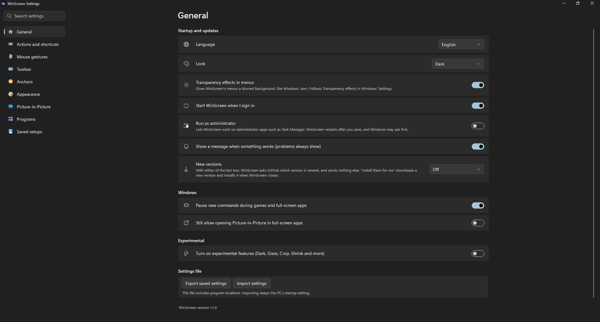
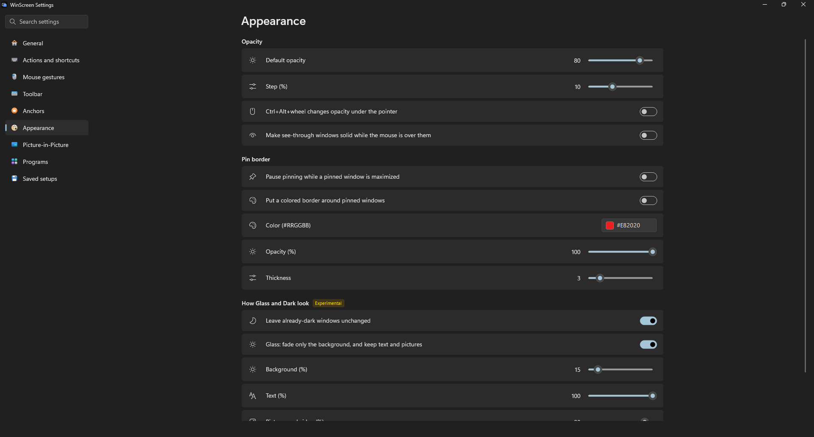
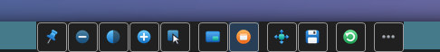
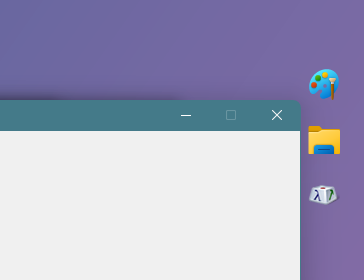

<p align="center">
  
</p>

<h1 align="center">WinScreen</h1>

<p align="center">
  <strong>Version stable.</strong> Les fonctions marquées <em>expérimentales</em> peuvent encore changer. En ce moment, ce sont vos retours qui aident le plus.
</p>

<p align="center">
  
  <a href="https://github.com/DarkLian/WinScreen/actions/workflows/build.yml"></a>
  <a href="https://github.com/DarkLian/WinScreen/releases"></a>
  
  
  <a href="LICENSE"></a>
</p>

<p align="center">
  <a href="README.md">English</a> · <a href="README.zh-CN.md">简体中文</a> · <a href="README.zh-TW.md">繁體中文</a> · <a href="README.ja.md">日本語</a> · <a href="README.ko.md">한국어</a> · <a href="README.de.md">Deutsch</a> · <a href="README.fr.md">Français</a> · <a href="README.es.md">Español</a> · <a href="README.pt-BR.md">Português (Brasil)</a> · <a href="README.ru.md">Русский</a> · <a href="README.uk.md">Українська</a>
</p>

Pour l'instant, l'application et le guide n'existent qu'en anglais et en chinois.

## Menus

<p align="center">
  
</p>
<p align="center">
  
</p>
<p align="center">
  
</p>

## Barre d'outils et ancres

<p align="center">
  
  
</p>

## Utilisez vos applications dans une petite vue

Appuyez sur **Ctrl+Alt+P** sur une fenêtre pour en obtenir une petite vue en direct qui reste au premier plan. Activez
**Interactive** dans le menu de la vue et vous pouvez utiliser l'application directement dans la vue : cliquer, taper,
faire défiler, sélectionner du texte et ouvrir des menus. C'est prêt pour Chrome, Edge, Brave, Vivaldi, Firefox, les
applications Electron et l'Explorateur de fichiers ; pour les autres applications, c'est *(expérimental)*. La vraie
fenêtre reste cachée, à l'écart : une vidéo, une discussion ou un document reste ainsi à portée de main dans un coin
pendant que vous travaillez.

**Enhanced hover** fait fonctionner les effets de survol dans les navigateurs et dans des applications comme VS Code et
Discord. Pour une application qui fonctionne mal dans une vue, comme un jeu, un clic sur sa vue peut plutôt ramener la
vraie fenêtre, qui se cache à nouveau quand vous passez à autre chose.
[Ce qui fonctionne où](docs/FEATURE_COMPATIBILITY.md) (en anglais) donne les détails.

## Fonctions

**Fenêtres**
- Toujours au premier plan, avec une bordure colorée en option
- Transparence, avec un niveau par défaut, Ctrl+Alt+molette sous le pointeur, et de nouveau opaque tant que la souris est dessus
- Laisser passer les clics
- Sans bordure, plein écran, barre de titre sombre
- Mémoriser la configuration d'un programme pour ses fenêtres, reconnues par titre ou par classe, une fois ou à chaque fois

**Image dans l'image**
- Vues en direct d'une fenêtre, d'un écran entier ou d'une partie de l'écran
- Rogner, zoomer, redimensionner, tailles prédéfinies, préréglages et sources enregistrées
- Rogner sur la partie d'une fenêtre sur laquelle vous cliquez, et la garder quand la fenêtre est redimensionnée
- Garder l'original caché et la vue à jour
- Couper le son de l'original depuis la vue
- Utiliser des applications dans une vue : Chrome, Edge, Brave, Vivaldi, Firefox, applications Electron et Explorateur de fichiers, ainsi que les autres applications, Enhanced hover et le défilement par clic du milieu *(expérimental)*
- Limite d'images par seconde, opacité, verrouillage de position et clics traversants pour chaque vue
- Réduire les vues dans la barre des tâches, aperçu au survol et loupe de lecture
- Des vues qui s'écartent du texte et des images *(expérimental)*

**Ancres**
- Des boutons flottants qui ramènent une fenêtre d'un clic
- Déposez-y des fichiers, laissez le pointeur dessus pour un aperçu en direct
- Ajoutées et retirées pour vous quand des fenêtres sont recouvertes
- Réduire une fenêtre dans son ancre
- Retirer leurs fenêtres de la barre des tâches, ou les cacher toutes pour le moment
- Affichées sur tous les bureaux virtuels, ou seulement sur celui de leur fenêtre

**Disposition**
- Neuf emplacements à l'écran, l'écran suivant, une position et une taille exactes, la position précédente
- Déplacer et redimensionner en maintenant Alt ou Win et en faisant glisser, avec aimantation aux bords
- Enrouler jusqu'à la barre de titre *(expérimental)*, envoyer à l'arrière-plan

**Effets** *(expérimental)*
- Un mode sombre qui laisse les images et les vidéos telles quelles, ou un simple filtre
- Un effet verre qui n'atténue que l'arrière-plan
- Rogner une fenêtre, ou la réduire en vignette en direct

**Au quotidien**
- Une barre d'outils sur les barres de titre, un menu de fenêtre par Ctrl+clic droit et un menu complet dans la zone de notification
- Des raccourcis modifiables, et une liste de toutes les actions où chercher
- Une ligne de commande pour les scripts
- Des paramètres et des menus utilisables au clavier seul
- Des paramètres qui ressemblent à ceux de Windows 11, en clair ou en sombre
- Des programmes à laisser tranquilles, ou les seuls sur lesquels agir
- Se met en pause pendant les jeux et les applications en plein écran
- S'exécute en tant qu'administrateur quand vous le voulez, pour des applications comme le Gestionnaire des tâches
- Tout remettre en place avec Ctrl+Alt+R ; les fenêtres reviennent même si WinScreen s'arrête de façon inattendue
- Mises à jour automatiques, et des paramètres que vous pouvez emporter sur un autre PC
- English, 简体中文 et 繁體中文

## Installation

Téléchargez **WinScreen-…-x64-Setup.exe** depuis [Releases](https://github.com/DarkLian/WinScreen/releases) et
lancez-le. Il fonctionne sous Windows 10 (version 2004 ou ultérieure) et Windows 11, sur les PC 64 bits Intel ou AMD
(x64). Consultez [ce qui fonctionne où](docs/FEATURE_COMPATIBILITY.md) (en anglais) pour les autres systèmes et pour ce
que chaque fonction peut et ne peut pas faire.

Vous n'avez rien d'autre à installer, et il fonctionne sans droits d'administrateur. WinScreen vit dans la zone de
notification.

Le programme d'installation n'est pas signé, donc Windows peut dire qu'il ne le reconnaît pas. Choisissez
**Informations complémentaires**, puis **Exécuter quand même**. Pour le désinstaller, allez dans
**Paramètres → Applications → Applications installées** dans Windows.

Avec [Scoop](https://scoop.sh), il s'installe en deux lignes (la version portable, mise à jour par Scoop) :

```
scoop bucket add winscreen https://github.com/DarkLian/WinScreen
scoop install winscreen
```

## Prise en main

1. Cliquez sur la fenêtre que vous voulez modifier.
2. Appuyez sur **Ctrl+Alt+T** pour la garder au premier plan, **Ctrl+Alt+P** pour une vue en direct, ou **Ctrl+Alt+A** pour une ancre.
3. Cliquez sur l'icône de la zone de notification pour les paramètres, ou faites un clic droit pour toutes les commandes.
4. Appuyez sur **Ctrl+Alt+R** pour remettre chaque fenêtre comme elle était.

| Pour faire ceci | Raccourci |
| --- | --- |
| Mettre ou retirer du premier plan | Ctrl+Alt+T |
| Ouvrir ou fermer une vue en direct | Ctrl+Alt+P |
| Ajouter ou retirer une ancre | Ctrl+Alt+A |
| Plus ou moins transparent | Ctrl+Alt+Bas / Haut |
| Activer ou désactiver la transparence par défaut | Ctrl+Alt+O |
| Activer ou désactiver les clics traversants | Ctrl+Alt+C |
| Remettre cette fenêtre en place | Ctrl+Alt+U |
| Remettre toutes les fenêtres en place | Ctrl+Alt+R |

Le **[guide d'utilisation](docs/USER_GUIDE.md)** (en anglais) explique chaque fonction.

## Questions et réponses

### Du « AI slop » !?

Le projet existe par pure passion, et pour résoudre de vrais problèmes : il propose des alternatives gratuites et
spécialisées à des applications fermées et payantes, créées avec l'aide d'agents d'IA. La compatibilité et la fiabilité
peuvent laisser à désirer, mais c'est justement là que l'aide de la communauté compte le plus. Je ne peux pas découvrir
tous les problèmes avec ma seule utilisation et mes agents, même si l'IA est puissante et rapide pour corriger. Et si
vous pensez quand même que c'est du « AI slop », alors c'en est. Je ne peux pas changer votre avis et je ne m'en
donnerai pas la peine. Trouvez simplement une autre alternative fiable (s'il en existe une faite sans IA).

### Pourquoi ne pas simplement utiliser des outils existants et éprouvés ?

[PowerToys](https://github.com/microsoft/powertoys) est activement maintenu, mais mise sur l'étendue des fonctions et
manque d'améliorations ciblées. WinScreen existe en complément, spécialisé dans certains utilitaires Windows. Il n'est
pas là pour reproduire PowerToys, ce qui n'aurait aucun sens.

[WindowTop](https://windowtop.info/) est ce qui a inspiré ce projet. Mais il est fermé et payant. WinScreen veut offrir
une option gratuite et open source à ceux (moi compris) qui veulent des fonctions réservées aux versions payantes. En
plus, sans les contraintes d'une entreprise, WinScreen peut évoluer vite et sans lourdeur : je compte donc réagir et
améliorer rapidement, corriger les bogues et ajouter les fonctions dont les gens ont vraiment besoin (avec des tests
complets, j'espère).

Beaucoup d'autres projets que j'ai trouvés sont abandonnés, payants, ou du vrai « AI slop » jamais mis à jour, qui
laisse ouverts des problèmes trouvés dès le premier jour, avec un GitHub en désordre.
**Il n'existe tout simplement pas, pour l'instant, d'option gratuite et open source qui offre des améliorations ciblées
avec un suivi continu.**

### Le projet sera-t-il maintenu dans la durée ?

Je ferai de mon mieux. Mais pour un projet à but non lucratif porté par la passion, le soutien de la communauté est un
énorme coup de pouce. Je ne peux pas garantir qu'il sera toujours maintenu, mais même dans ce cas, il est sous licence
MIT : n'importe qui peut le forker et le garder en vie. C'est l'esprit de l'open source !

### Est-ce sûr ?

Le projet est entièrement open source. Tout le monde peut examiner le code (ou demander à une IA de l'analyser) et le
compiler soi-même. Désactivez les mises à jour automatiques et faites analyser le code par une IA si vous voulez plus
de sécurité.

Open source ne veut pas dire absolument sûr, mais tout est à découvert pour que chacun puisse vérifier, questionner ou
signaler des problèmes. Tout problème de sécurité que vous signalez est le bienvenu.

## Mises à jour

Dans les paramètres (Settings), choisissez ce que fait WinScreen pour les nouvelles versions : rien (par défaut), vous
prévenir, ou les installer pour vous quand vous le fermez. Une copie portable ne peut pas se mettre à jour seule, elle
vous prévient donc et ouvre la page de la nouvelle version. Pour mettre à jour à la main, fermez WinScreen et lancez le
programme d'installation plus récent. Vos paramètres restent tels quels.

## Dites-nous ce que vous en pensez

WinScreen est fait par DarkLian avec l'aide d'agents d'IA. La meilleure façon d'aider est de nous dire comment il
fonctionne pour vous. [Ouvrez une issue](https://github.com/DarkLian/WinScreen/issues) pour partager une idée,
signaler un problème ou mentionner un petit détail qui vous gêne. Voir **[Contributing](CONTRIBUTING.md)** (en anglais)
pour ce qui aide le plus.

Si WinScreen vous est utile, vous pouvez [le soutenir sur Ko-fi](https://ko-fi.com/darklian).

## Le compiler vous-même

Il vous faut le SDK .NET 10 indiqué dans `global.json`. Lancez `.\build.ps1 -SkipInteractive`, et le programme
d'installation apparaît dans `dist\release`.

## Politique de signature du code

**WinScreen n'est pas signé.** La signature de code gratuite de la [SignPath Foundation](https://signpath.org/)
demande qu'un projet soit d'abord plus largement utilisé, nous referons donc une demande plus tard.

- **Qui participe :** [DarkLian](https://github.com/DarkLian) écrit et relit le code de WinScreen, avec l'aide
  d'agents d'IA, et approuve chaque version. Personne d'autre ne peut modifier le code ni publier une version.
- **Confidentialité :** WinScreen n'envoie rien sur vous ou votre PC nulle part. Il ne se connecte que lorsque vous
  demandez à être prévenu des nouvelles versions ou à les faire installer, ou quand vous choisissez
  **Check for updates**, et il demande alors seulement à GitHub quelle version est la plus récente. Il garde un court
  journal sur votre PC pour aider à résoudre les problèmes, qui ne quitte jamais votre PC à moins que vous ne
  l'envoyiez vous-même.

## Licence

[MIT](LICENSE)
