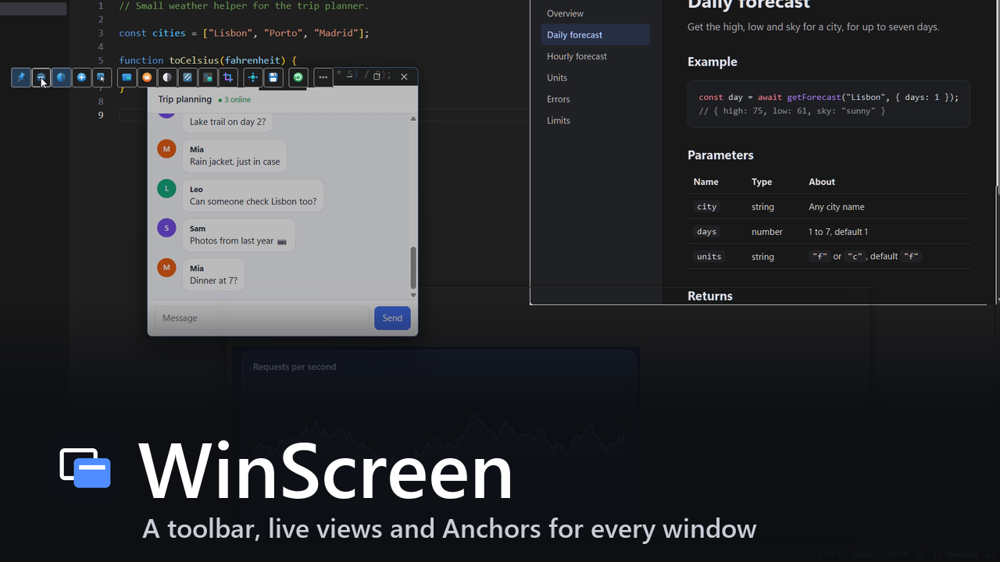
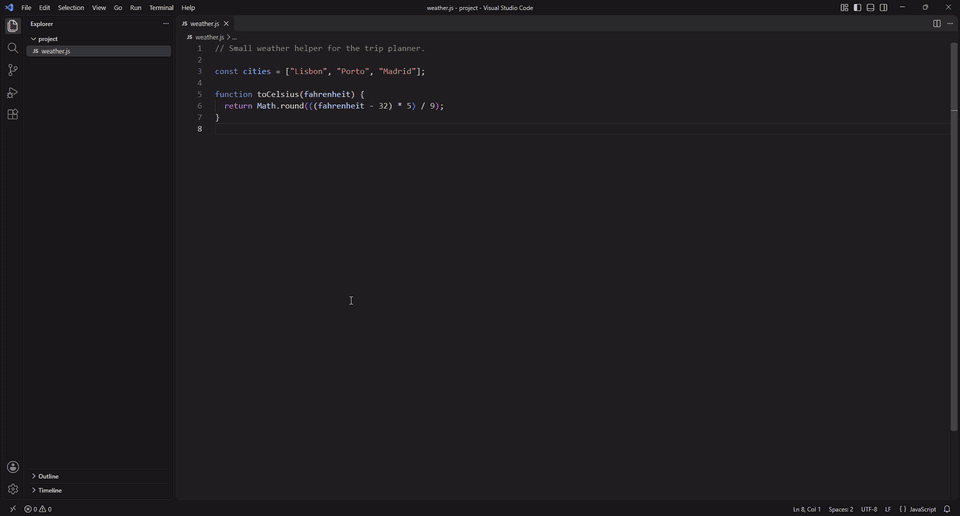
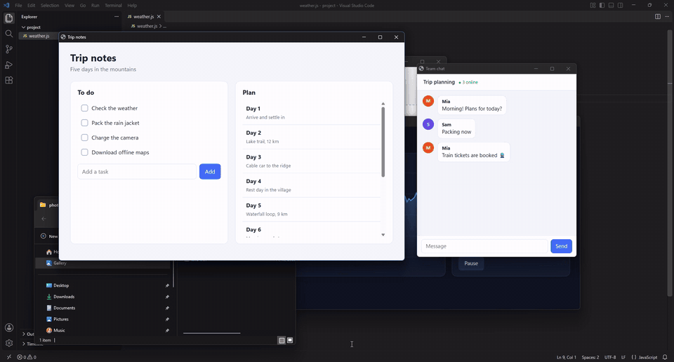
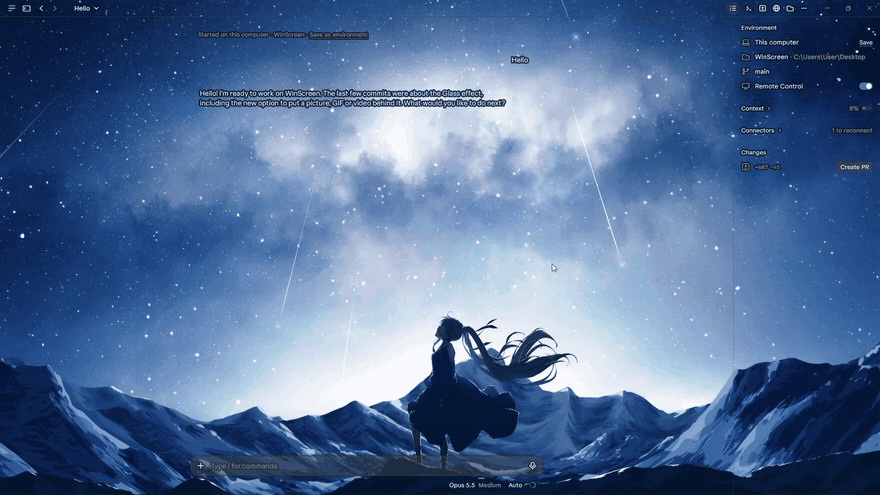

<p align="center">
  
</p>

<h1 align="center">WinScreen</h1>

<p align="center">
  <strong>安定版。</strong><em>実験的</em>と書かれた機能は、まだ変わることがあります。今いちばん役に立つのは、皆さんのフィードバックです。
</p>

<p align="center">
  
  <a href="https://github.com/DarkLian/WinScreen/actions/workflows/build.yml"></a>
  <a href="https://github.com/DarkLian/WinScreen/releases"></a>
  
  
  <a href="LICENSE"></a>
</p>

<p align="center">
  <a href="README.md">English</a> · <a href="README.zh-CN.md">简体中文</a> · <a href="README.zh-TW.md">繁體中文</a> · <a href="README.ja.md">日本語</a> · <a href="README.ko.md">한국어</a> · <a href="README.de.md">Deutsch</a> · <a href="README.fr.md">Français</a> · <a href="README.es.md">Español</a> · <a href="README.pt-BR.md">Português (Brasil)</a> · <a href="README.ru.md">Русский</a> · <a href="README.uk.md">Українська</a>
</p>

WinScreen のアプリとユーザーガイドは、英語と中国語のみです。

## 動作の様子

<p align="center">
  <a href="https://www.youtube.com/watch?v=FncLMB3cYDQ"></a>
</p>

<p align="center"><a href="https://www.youtube.com/watch?v=FncLMB3cYDQ"><strong>YouTube で 5 分間のデモを見る</strong></a></p>

コードエディターの上に 2 つのビュー。1 つは動画を再生し、もう 1 つはビューの中でそのまま使えます。別の仮想デスクトップに切り替えても表示されたままです。

<p align="center">
  
</p>

ウィンドウのタイトルバーに出るツールバー。ウィンドウのコマンドをワンクリックで使えます。

<p align="center">
  
</p>

アンカーをクリックするとウィンドウが戻ります。どのデスクトップからでも使えます。ファイルをアンカーにドラッグすると、そのウィンドウにドロップできます。

<p align="center">
  
</p>

ビューを必要な部分だけに切り抜いて拡大できます。画面の一部のビューも同じように使えます。

<p align="center">
  
</p>

ガラス効果は背景だけを薄くします。ウィンドウを一度整えて Ctrl+Alt+Shift+S を押せば、次からその状態で開きます。

<p align="center">
  
</p>

ガラス効果の後ろに動画を流せば、どのアプリのウィンドウにも自分だけの動く背景を付けられます。

<p align="center">
  
</p>

## 小さなビューからアプリを使う

ウィンドウで **Ctrl+Alt+P** を押すと、そのウィンドウの小さなライブビューが常に手前に表示されます。ビューのメニューで
**Interactive** をオンにすると、ビューの中でそのままアプリを使えます。クリック、入力、スクロール、テキストの選択、
メニューを開くこともできます。Chrome、Edge、Brave、Vivaldi、Firefox、Electron アプリ、エクスプローラーに対応しています。
ほかのアプリでは*（実験的）*です。本物のウィンドウは邪魔にならないよう隠れたままなので、動画やチャット、文書を画面の隅に
置いたまま作業できます。

**Enhanced hover** を使うと、ブラウザーや VS Code、Discord のようなアプリでホバー効果がそのまま働きます。ゲームのように
ビューではうまく動かないアプリは、ビューをクリックすると本物のウィンドウを呼び戻し、ほかへ切り替えるとまた隠すこともできます。
詳しくは[対応状況](docs/FEATURE_COMPATIBILITY.md)（英語）をご覧ください。

## どのアプリにも画像や動画の背景を

ウィンドウでガラス効果をオンにすると（**Ctrl+Alt+G**）、文字の後ろに画像、GIF アニメ、動画を表示できます。
**Settings → Backgrounds** で、すべてのアプリ共通の背景を選ぶことも、アプリごとに設定することもできます。
動画は音も出せます。ウィンドウを最小化したときや別のデスクトップにあるときは一時停止します。

## 機能

**ウィンドウ**
- 常に手前に固定、色付きの枠も選べます
- 半透明：既定の濃さ、ポインターの下で Ctrl+Alt+ホイール、マウスを乗せている間は不透明に戻す
- クリックを透過
- 枠なし、ディスプレイいっぱいに表示、ダークなタイトルバー
- プログラムごとの設定をタイトルやクラスで覚え、一度だけ、または毎回適用

**ピクチャー・イン・ピクチャー**
- ウィンドウ、ディスプレイ全体、画面の一部のライブビュー
- 切り抜き、拡大、サイズ変更、決まったサイズ、プリセット、保存したソース
- クリックしたウィンドウの一部に切り抜き、ウィンドウのサイズが変わってもそのまま保つ
- 元のウィンドウを隠したまま、ビューを更新し続ける
- 元のウィンドウの音をビューから消音
- ビューからアプリを使う：Chrome、Edge、Brave、Vivaldi、Firefox、Electron アプリ、エクスプローラー。ほかのアプリ、Enhanced hover、中クリックスクロールは*（実験的）*
- ビューごとのフレームレート上限、不透明度、位置の固定、クリックの透過
- ビューをタスクバーに最小化、ホバーでプレビュー、読み取り用の拡大鏡
- 文字や画像を避けて動くビュー*（実験的）*

**アンカー**
- クリックひとつでウィンドウを呼び戻す、浮かんだボタン
- ファイルをドロップしたり、ポインターを置いてライブプレビューを見たり
- ウィンドウが隠れると自動で追加、自動で削除
- ウィンドウをアンカーに最小化
- ウィンドウをタスクバーから外す、または一時的にすべて隠す
- すべての仮想デスクトップに表示、またはウィンドウのあるデスクトップだけに表示

**配置**
- 画面の 9 か所、次のディスプレイ、正確な位置とサイズ、前の位置
- Alt または Win を押しながらドラッグして移動とサイズ変更、端に吸着
- タイトルバーまで巻き上げる*（実験的）*、いちばん後ろへ送る

**効果** *（実験的）*
- 画像や動画はそのままのダークモード、またはシンプルなフィルター
- 背景だけを薄くするガラス効果
- ガラス効果の強さを、アプリごとやウィンドウ 1 つだけに設定
- 動画などアプリのウィンドウの一部を、ガラス効果やダークモードの対象外にできます
- ウィンドウの切り抜き、ライブタイルへの縮小

**背景** *（実験的）*
- ガラス効果で、ウィンドウの文字の後ろに画像、GIF アニメ、動画を表示
- すべてのアプリ共通の背景に加えて、アプリごとの背景や背景なしも設定可能
- 塗りつぶし、全体表示、引き伸ばし、並べて表示、中央に表示
- 大きなプレビュー：クリックしてファイルを選ぶか、ファイルをドロップ
- 動画の音は専用の音量で、最後に使ったウィンドウから再生
- ウィンドウが最小化されているときや別のデスクトップにあるときは、動画を一時停止

**ふだんの使い方**
- タイトルバーのツールバー、Ctrl+右クリックのウィンドウメニュー、すべてそろったトレイメニュー
- 変更できるショートカットと、すべての操作を検索できる一覧
- スクリプト用のコマンドライン
- キーボードだけで使える設定画面とメニュー
- Windows 11 の設定に似た見た目、ライトとダーク
- 手を付けないプログラム、または対象にするプログラムだけを指定
- ゲームや全画面アプリの間は一時停止
- タスクマネージャーのようなアプリのために、必要なときは管理者として実行
- Ctrl+Alt+R ですべて元どおり。WinScreen が突然止まってもウィンドウは戻ります
- 自動更新、ほかの PC に移せる設定
- English、简体中文、繁體中文

## インストール

[Releases](https://github.com/DarkLian/WinScreen/releases) から **WinScreen-…-x64-Setup.exe** をダウンロードして実行します。
Windows 10（バージョン 2004 以降）と Windows 11 の、64 ビットの Intel または AMD の PC（x64）で動きます。
ほかの環境や、各機能でできること・できないことは[対応状況](docs/FEATURE_COMPATIBILITY.md)（英語）をご覧ください。

ほかに何もインストールする必要はなく、管理者権限なしで動きます。WinScreen はシステムトレイに常駐します。

インストーラーには署名がないため、Windows が「認識されないアプリ」と表示することがあります。**詳細情報**を選び、
**実行**を押してください。削除するには、Windows の **設定 → アプリ → インストールされているアプリ** を開きます。

[Scoop](https://scoop.sh) なら 2 行でインストールできます（ポータブル版、Scoop が更新します）：

```
scoop bucket add winscreen https://github.com/DarkLian/WinScreen
scoop install winscreen
```

## はじめかた

1. 変えたいウィンドウをクリックします。
2. **Ctrl+Alt+T** で手前に固定、**Ctrl+Alt+P** でライブビュー、**Ctrl+Alt+A** でアンカーです。
3. トレイアイコンをクリックすると設定、右クリックするとすべてのコマンドが出ます。
4. **Ctrl+Alt+R** を押すと、すべてのウィンドウが元に戻ります。

| すること | ショートカット |
| --- | --- |
| 手前に固定・解除 | Ctrl+Alt+T |
| ライブビューを開く・閉じる | Ctrl+Alt+P |
| アンカーを追加・削除 | Ctrl+Alt+A |
| 透明度を上げる・下げる | Ctrl+Alt+Down / Up |
| 既定の半透明をオン・オフ | Ctrl+Alt+O |
| クリックの透過をオン・オフ | Ctrl+Alt+C |
| このウィンドウを元に戻す | Ctrl+Alt+U |
| すべてのウィンドウを元に戻す | Ctrl+Alt+R |

すべての機能は **[ユーザーガイド](docs/USER_GUIDE.md)**（英語）で説明しています。

## Q&A

### AI スロップなのでは？

WinScreen は、自分が実際に困っていた問題を解決したいという情熱から始まり、AI エージェントの力を大いに借りて作っています。
そのことは最初にお伝えしておきます。

私にできるのは、仕上がりをきちんと確かめることです。リリースごとに Windows 10 と Windows 11 でテストし、まだ安定して
いない機能には*実験的*と書き、報告されたバグは放置せずに直します。一方で、あらゆる Windows のバージョン、PC、アプリを
一人で確かめることはできません。そこで皆さんの報告がいちばん役に立ちます。うまく動かないことがあれば、ぜひ
[Issue を作成](https://github.com/DarkLian/WinScreen/issues)してください。

### 実績のある既存のツールを使えばいいのでは？

[PowerToys](https://github.com/microsoft/powertoys) は活発に保守されていますが、機能の幅を重視していて、特定の用途に
絞った強化はありません。WinScreen は、Windows の一部のユーティリティに特化して、それを補うために存在します。
PowerToys をまねるためのものではありません。それでは意味がありません。

[WindowTop](https://windowtop.info/) は、このプロジェクトのきっかけになったアプリです。ただ、クローズドソースで有料です。
WinScreen は、有料の壁の向こうにある機能を使いたい人（と私自身）のために、無料でオープンソースの選択肢を目指しています。
さらに、ビジネスの制約がないので、身軽にすばやく更新できます。バグの修正や、本当に必要とされる機能の追加に、すばやく
応えて改良を重ねていくつもりです（しっかりしたテストとともに、そうありたいと思っています）。

ほかに見つけた多くのプロジェクトは、開発が止まっているか、有料か、あるいは本物の AI スロップで、更新されず、私が初日に
見つけた問題も放置され、GitHub も散らかっています。
**無料で、オープンソースで、特定の用途に絞った強化を、継続的なサポートとともに提供する選択肢は、今のところ存在しません。**

### このプロジェクトは継続的に保守されますか？

できる限り努力します。ただ、情熱で動いている非営利のプロジェクトなので、コミュニティの支えが大きな励みになります。
常に保守し続けると約束はできませんが、そうなっても MIT ライセンスなので、誰でもフォークして存続させられます。
それがオープンソースの精神です！

### 安全ですか？

このプロジェクトは完全にオープンソースです。誰でもコードを確認でき（AI に分析させることもできます）、自分でビルドできます。
さらに安全を重視するなら、自動更新をオフにして、AI でコードを分析してください。

オープンソースだから絶対に安全というわけではありませんが、すべてが公開されていて、誰でも確認し、疑問を持ち、問題を
指摘できます。セキュリティ上の懸念は、ぜひ報告してください。

## 更新

設定（Settings）で、新しいバージョンについて WinScreen がすることを選べます：何もしない（既定）、知らせる、または
WinScreen を閉じるときにインストールする、のいずれかです。ポータブル版は自分で更新できないので、知らせたうえで新しい
バージョンのページを開きます。手動で更新するには、WinScreen を閉じてから新しいインストーラーを実行します。設定はそのまま残ります。

## ご意見をお聞かせください

WinScreen は DarkLian が AI エージェントの力を借りて作っています。いちばんの助けは、使ってみてどうだったかを教えて
もらうことです。アイデアの共有、問題の報告、ちょっと気になることでも、[Issue を作成](https://github.com/DarkLian/WinScreen/issues)
してください。何がいちばん役に立つかは **[Contributing](CONTRIBUTING.md)**（英語）をご覧ください。

WinScreen が役に立ったら、[Ko-fi で支援](https://ko-fi.com/darklian)していただけます。

## 自分でビルドする

`global.json` に書かれた .NET 10 SDK が必要です。`.\build.ps1 -SkipInteractive` を実行すると、`dist\release` にインストーラーができます。

各機能があらゆる種類のウィンドウでどう動くか、そしてそれをコードのどこで決めているかは、
[機能の対応表](docs/FEATURE_COMPATIBILITY.md)（英語）にまとめています。

## コード署名のポリシー

**WinScreen には署名がありません。** [SignPath Foundation](https://signpath.org/) の無料のコード署名は、プロジェクトが
もっと広く使われてからでないと受けられないため、あとで改めて申請します。

- **関わる人：** [DarkLian](https://github.com/DarkLian) が AI エージェントの助けを借りて WinScreen のコードを書いて
  レビューし、すべてのリリースを承認します。ほかの誰もコードを変更したり、リリースを公開したりできません。
- **プライバシー：** WinScreen は、あなたやあなたの PC についての情報をどこにも送りません。オンラインになるのは、新しい
  バージョンについて知らせるかインストールするよう選んだときか、**Check for updates** を選んだときだけで、そのときも
  GitHub にいちばん新しいバージョンを尋ねるだけです。問題の解決に役立つ短いログを PC に残しますが、あなたが自分で送らない限り、
  PC の外に出ることはありません。

## ライセンス

[MIT](LICENSE)
