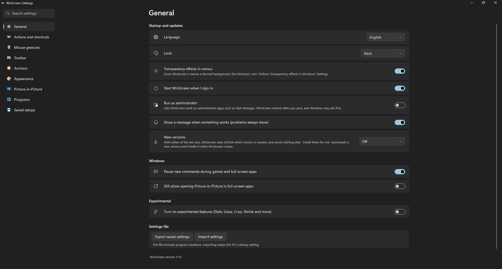
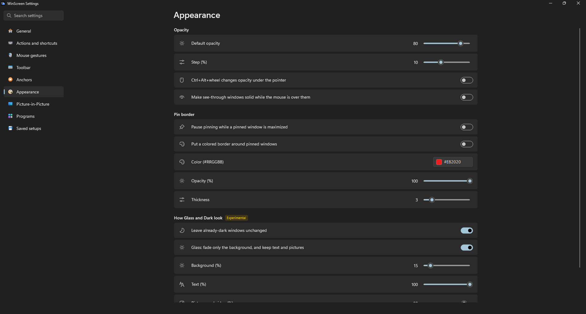
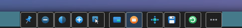
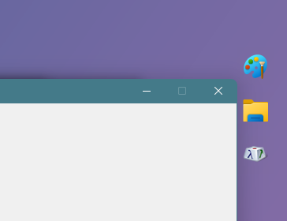

<p align="center">
  
</p>

<h1 align="center">WinScreen</h1>

<p align="center">
  <strong>정식 버전.</strong> <em>실험적</em>으로 표시된 기능은 아직 바뀔 수 있습니다. 지금 가장 큰 도움이 되는 건 여러분의 의견입니다.
</p>

<p align="center">
  
  <a href="https://github.com/DarkLian/WinScreen/actions/workflows/build.yml"></a>
  <a href="https://github.com/DarkLian/WinScreen/releases"></a>
  
  
  <a href="LICENSE"></a>
</p>

<p align="center">
  <a href="README.md">English</a> · <a href="README.zh-CN.md">简体中文</a> · <a href="README.zh-TW.md">繁體中文</a> · <a href="README.ja.md">日本語</a> · <a href="README.ko.md">한국어</a> · <a href="README.de.md">Deutsch</a> · <a href="README.fr.md">Français</a> · <a href="README.es.md">Español</a> · <a href="README.pt-BR.md">Português (Brasil)</a> · <a href="README.ru.md">Русский</a> · <a href="README.uk.md">Українська</a>
</p>

앱과 사용자 가이드는 아직 영어와 중국어로만 제공됩니다.

## 메뉴

<p align="center">
  
</p>
<p align="center">
  
</p>
<p align="center">
  
</p>

## 도구 모음과 앵커

<p align="center">
  
  
</p>

## 작은 화면으로 앱 사용하기

창에서 **Ctrl+Alt+P**를 누르면 항상 위에 떠 있는 작은 실시간 화면이 생깁니다. 화면 메뉴에서 **Interactive**를 켜면
그 화면 안에서 바로 앱을 쓸 수 있습니다. 클릭, 입력, 스크롤, 텍스트 선택, 메뉴 열기까지 됩니다. Chrome, Edge, Brave,
Vivaldi, Firefox, Electron 앱, 파일 탐색기에서 쓸 수 있고, 다른 앱에서는 *(실험적)* 기능입니다. 실제 창은 방해되지
않게 숨겨져 있어서, 동영상이나 채팅, 문서를 화면 구석에 띄워 둔 채 작업할 수 있습니다.

**Enhanced hover**를 쓰면 브라우저나 VS Code, Discord 같은 앱에서 마우스를 올렸을 때의 효과가 그대로 동작합니다.
게임처럼 화면을 통해서는 잘 동작하지 않는 앱은, 화면을 클릭하면 대신 실제 창을 불러오고 다른 곳으로 전환하면 다시
숨기게 할 수도 있습니다. 자세한 내용은 [기능별 지원 현황](docs/FEATURE_COMPATIBILITY.md)(영어)을 참고하세요.

## 기능

**창**
- 항상 위에 고정, 원하면 색깔 테두리도 표시
- 반투명: 기본 투명도, 포인터 아래에서 Ctrl+Alt+휠, 마우스를 올린 동안에는 다시 불투명하게
- 클릭 통과
- 테두리 없애기, 화면 가득 채우기, 어두운 제목 표시줄
- 프로그램별 설정을 제목이나 클래스로 기억해 한 번만 또는 매번 적용

**PIP(화면 속 화면)**
- 창 하나, 디스플레이 전체, 화면 일부의 실시간 화면
- 자르기, 확대, 크기 조절, 정해진 크기, 프리셋, 저장한 소스
- 클릭한 창의 일부로 자르고, 창 크기가 바뀌어도 그대로 유지
- 원래 창은 숨긴 채로 화면은 계속 갱신
- 화면에서 원래 창의 소리 끄기
- 화면으로 앱 사용: Chrome, Edge, Brave, Vivaldi, Firefox, Electron 앱, 파일 탐색기. 그 밖의 앱, Enhanced hover, 가운데 버튼 스크롤은 *(실험적)*
- 화면별 프레임 제한, 불투명도, 위치 고정, 클릭 통과
- 화면을 작업 표시줄로 최소화, 마우스를 올리면 미리 보기, 읽기용 돋보기
- 글자나 그림을 피해 움직이는 화면 *(실험적)*

**앵커**
- 클릭 한 번으로 창을 다시 불러오는 떠 있는 버튼
- 파일을 끌어다 놓거나, 포인터를 올려 실시간 미리 보기
- 창이 가려지면 알아서 추가하고 제거
- 창을 앵커로 최소화
- 앵커의 창을 작업 표시줄에서 빼거나, 잠시 모두 숨기기
- 모든 가상 데스크톱에 표시하거나, 창이 있는 데스크톱에만 표시

**배치**
- 화면의 9곳, 다음 디스플레이, 정확한 위치와 크기, 이전 위치
- Alt나 Win을 누른 채 끌어서 이동과 크기 조절, 가장자리에 맞춤
- 제목 표시줄까지 말아 올리기 *(실험적)*, 맨 뒤로 보내기

**효과** *(실험적)*
- 사진과 동영상은 그대로 두는 다크 모드, 또는 간단한 필터
- 배경만 흐리게 하는 유리 효과
- 창 자르기, 또는 실시간 타일로 줄이기

**일상 사용**
- 제목 표시줄의 도구 모음, Ctrl+오른쪽 클릭으로 여는 창 메뉴, 모든 기능이 담긴 트레이 메뉴
- 바꿀 수 있는 단축키와, 모든 동작을 검색할 수 있는 목록
- 스크립트용 명령줄
- 키보드만으로 쓸 수 있는 설정과 메뉴
- Windows 11 설정과 닮은 모습, 밝은 테마와 어두운 테마
- 건드리지 않을 프로그램, 또는 대상으로 할 프로그램만 지정
- 게임이나 전체 화면 앱 중에는 일시 중지
- 작업 관리자 같은 앱을 위해 원할 때 관리자 권한으로 실행
- Ctrl+Alt+R로 모두 원래대로. WinScreen이 갑자기 멈춰도 창은 돌아옵니다
- 자동 업데이트, 다른 PC로 옮길 수 있는 설정
- English, 简体中文, 繁體中文

## 설치

[Releases](https://github.com/DarkLian/WinScreen/releases)에서 **WinScreen-…-x64-Setup.exe**를 내려받아 실행하세요.
Windows 10(버전 2004 이상)과 Windows 11의 64비트 Intel 또는 AMD PC(x64)에서 동작합니다. 다른 환경과 각 기능으로 할 수
있는 것과 없는 것은 [기능별 지원 현황](docs/FEATURE_COMPATIBILITY.md)(영어)을 참고하세요.

따로 설치할 것은 없고, 관리자 권한 없이 실행됩니다. WinScreen은 시스템 트레이에 있습니다.

설치 파일에 서명이 없어서 Windows가 인식할 수 없는 앱이라고 표시할 수 있습니다. **추가 정보**를 누른 다음
**실행**을 누르세요. 제거하려면 Windows의 **설정 → 앱 → 설치된 앱**으로 가세요.

[Scoop](https://scoop.sh)을 쓴다면 두 줄로 설치할 수 있습니다(포터블 버전, Scoop이 업데이트합니다):

```
scoop bucket add winscreen https://github.com/DarkLian/WinScreen
scoop install winscreen
```

## 빠른 시작

1. 바꾸고 싶은 창을 클릭합니다.
2. **Ctrl+Alt+T**로 항상 위에 고정, **Ctrl+Alt+P**로 실시간 화면, **Ctrl+Alt+A**로 앵커를 만듭니다.
3. 트레이 아이콘을 클릭하면 설정이, 오른쪽 클릭하면 모든 명령이 나옵니다.
4. **Ctrl+Alt+R**을 누르면 모든 창이 원래대로 돌아갑니다.

| 할 일 | 단축키 |
| --- | --- |
| 항상 위에 고정 또는 해제 | Ctrl+Alt+T |
| 실시간 화면 열기 또는 닫기 | Ctrl+Alt+P |
| 앵커 추가 또는 제거 | Ctrl+Alt+A |
| 더 투명하게 또는 덜 투명하게 | Ctrl+Alt+Down / Up |
| 기본 반투명 켜기 또는 끄기 | Ctrl+Alt+O |
| 클릭 통과 켜기 또는 끄기 | Ctrl+Alt+C |
| 이 창을 원래대로 | Ctrl+Alt+U |
| 모든 창을 원래대로 | Ctrl+Alt+R |

모든 기능은 **[사용자 가이드](docs/USER_GUIDE.md)**(영어)에서 설명합니다.

## Q&A

### AI 슬롭 아닌가요?

WinScreen은 제가 실제로 겪던 문제를 해결하고 싶다는 열정에서 시작했고, AI 에이전트의 도움을 많이 받아 만들고 있습니다.
이 점은 먼저 밝혀 두고 싶습니다.

제가 할 수 있는 건 결과물을 꼼꼼히 확인하는 것입니다. 릴리스마다 Windows 10과 Windows 11에서 테스트하고, 아직 안정적이지
않은 기능은 *실험적*으로 표시하며, 보고된 버그는 방치하지 않고 고칩니다. 하지만 모든 Windows 버전과 PC, 앱을 저 혼자
확인할 수는 없습니다. 바로 그 부분에서 여러분의 제보가 가장 큰 도움이 됩니다. 잘 동작하지 않는 게 있다면
[이슈를 열어](https://github.com/DarkLian/WinScreen/issues) 주세요.

### 이미 있는 성숙한 도구를 쓰면 되지 않나요?

[PowerToys](https://github.com/microsoft/powertoys)는 활발히 관리되고 있지만, 기능의 폭을 중시해서 특정 용도에 맞춘
개선은 부족합니다. WinScreen은 일부 Windows 유틸리티에 특화해 이를 보완하려고 존재합니다. PowerToys를 따라 하려는 게
아닙니다. 그건 의미가 없으니까요.

[WindowTop](https://windowtop.info/)은 이 프로젝트에 영감을 준 앱입니다. 하지만 폐쇄형이고 유료입니다. WinScreen은
유료로 막혀 있는 기능을 원하는 사람들(그리고 저 자신)을 위해 무료 오픈 소스 선택지를 제공하려 합니다. 게다가 사업의
제약이 없으니 WinScreen은 부담 없이 빠르게 업데이트할 수 있습니다. 그래서 버그를 고치고 사람들이 정말 필요로 하는
기능을 더하면서 빠르게 대응하고 개선해 나가려 합니다(철저한 테스트와 함께, 그러길 바랍니다).

제가 찾은 다른 프로젝트들은 대부분 중단됐거나, 유료이거나, 업데이트도 없이 제가 첫날 발견한 문제를 그대로 방치하고
GitHub도 엉망인 진짜 AI 슬롭이었습니다.
**무료이고, 오픈 소스이며, 특정 용도에 맞춘 개선을 꾸준한 지원과 함께 제공하는 선택지는 현재로서는 없습니다.**

### 프로젝트는 계속 관리되나요?

최선을 다하겠습니다. 다만 열정으로 움직이는 비영리 프로젝트라서, 커뮤니티의 응원이 큰 힘이 됩니다. 늘 관리된다고
약속할 수는 없지만, 그렇게 되더라도 MIT 라이선스이므로 누구나 포크해서 이어 갈 수 있습니다. 그게 오픈 소스의
정신이죠!

### 안전한가요?

이 프로젝트는 완전한 오픈 소스입니다. 누구나 코드를 살펴보고(AI에게 분석을 맡겨도 됩니다) 직접 빌드할 수 있습니다.
더 안전하게 쓰고 싶다면 자동 업데이트를 끄고 AI로 코드를 분석해 보세요.

오픈 소스라고 절대 안전한 건 아니지만, 모든 게 공개되어 있어 누구나 확인하고, 질문하고, 문제를 지적할 수 있습니다.
보안 문제를 알려 주시면 언제든 환영합니다.

## 업데이트

설정(Settings)에서 새 버전이 나왔을 때 WinScreen이 할 일을 고를 수 있습니다: 아무것도 안 함(기본값), 알려 주기, 또는
WinScreen을 닫을 때 설치하기. 포터블 버전은 스스로 업데이트할 수 없어서, 알려 준 뒤 새 버전 페이지를 엽니다. 직접
업데이트하려면 WinScreen을 닫고 새 설치 파일을 실행하세요. 설정은 그대로 유지됩니다.

## 의견을 들려주세요

WinScreen은 DarkLian이 AI 에이전트의 도움을 받아 만듭니다. 가장 큰 도움은 직접 써 보니 어땠는지 알려 주시는
것입니다. 아이디어를 나누거나, 문제를 알리거나, 사소하게 거슬리는 점이라도 [이슈를 열어](https://github.com/DarkLian/WinScreen/issues)
주세요. 무엇이 가장 도움이 되는지는 **[Contributing](CONTRIBUTING.md)**(영어)을 참고하세요.

WinScreen이 쓸모 있었다면 [Ko-fi에서 후원](https://ko-fi.com/darklian)하실 수 있습니다.

## 직접 빌드하기

`global.json`에 적힌 .NET 10 SDK가 필요합니다. `.\build.ps1 -SkipInteractive`를 실행하면 `dist\release`에 설치 파일이
생깁니다.

각 기능이 모든 종류의 창에서 어떻게 동작하는지, 그리고 코드의 어디에서 그것을 정하는지는
[기능 호환성](docs/FEATURE_COMPATIBILITY.md)(영어)에 정리되어 있습니다.

## 코드 서명 정책

**WinScreen은 서명되어 있지 않습니다.** [SignPath Foundation](https://signpath.org/)의 무료 코드 서명은 프로젝트가 먼저
더 널리 쓰여야 받을 수 있어서, 나중에 다시 신청할 예정입니다.

- **참여자:** [DarkLian](https://github.com/DarkLian)이 AI 에이전트의 도움을 받아 WinScreen의 코드를 작성하고 검토하며,
  모든 릴리스를 승인합니다. 다른 사람은 코드를 바꾸거나 릴리스를 게시할 수 없습니다.
- **개인 정보:** WinScreen은 여러분이나 여러분의 PC에 관한 어떤 정보도 어디로도 보내지 않습니다. 새 버전 소식을 받거나
  설치하도록 선택했을 때, 또는 **Check for updates**를 골랐을 때만 온라인에 연결하며, 그때도 GitHub에 최신 버전이
  무엇인지 묻기만 합니다. 문제 해결을 돕기 위해 PC에 짧은 로그를 남기지만, 직접 보내지 않는 한 PC 밖으로 나가지 않습니다.

## 라이선스

[MIT](LICENSE)
