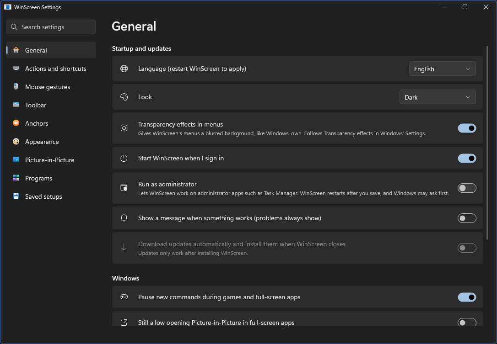
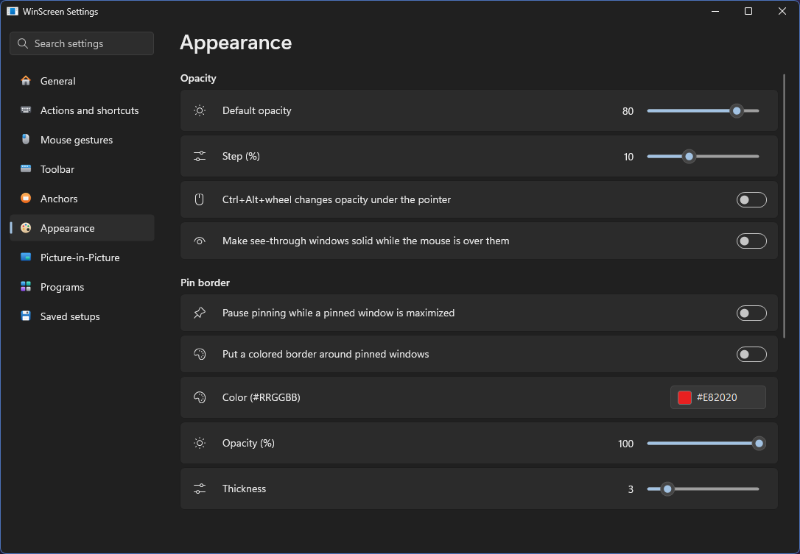

  

<h1 align="center">WinScreen</h1>

  <strong>🧪 Beta testing.</strong> Things may still change and some features are still experimental. Your feedback helps most right now.

  
  
  
  
  
  

  <a href="README.md">English</a> · <a href="README.zh-CN.md">简体中文</a> · <a href="README.zh-TW.md">繁體中文</a>

## Menus

  

  
  

## Use apps through a small view

Press **Ctrl+Alt+P** on a window for a small live view of it that stays on top. Turn on **Interactive** in the view's
menu *(experimental)* and you can use the app right inside the view: click, type, scroll, select text and open menus.
The real window stays hidden out of the way, so a video, chat or document stays at hand in a corner while you work.

**Enhanced hover** keeps hover effects working in browsers and apps like VS Code and Discord. For an app that doesn't
work well through a view, such as a game, a click on its view can bring the real window back instead, and it hides
again when you switch away. [What works where](docs/FEATURE_COMPATIBILITY.md) lists the details.

## Features

**Windows**
- Pin on top, with an optional colored border
- See-through, with a default level, Ctrl+Alt+wheel under the pointer, and solid again while the mouse is over it
- Click-through
- Borderless, fill the display, dark title bar
- Remember a program's setup for its windows from then on

**Picture-in-Picture**
- Live views of a window, a whole display or part of the screen
- Crop, zoom, resize, presets and saved sources
- Keep the original hidden and the view updating
- Use apps through a view, with Enhanced hover and middle-click scrolling *(experimental)*
- Per-view frame limit, opacity, position lock and click-through
- Minimize views to the taskbar, hover preview and reading lens
- Views that move away from text and pictures *(experimental)*

**Anchors**
- Floating buttons that bring a window back with a click
- Drop files on them, rest the pointer for a live preview
- Added and removed for you as windows get covered
- Take their windows off the taskbar, or hide them all for now

**Arrange**
- Nine places on the screen, the next display, an exact position and size, the previous position
- Move and resize by holding Alt or Win and dragging, with edge snapping
- Roll up to the title bar *(experimental)*, send to the back

**Effects** *(experimental)*
- Dark mode, and one that keeps pictures and video as they are
- Glass that fades only the background
- Crop a window, or shrink it to a live tile

**Everyday use**
- A toolbar on title bars, a window menu on Ctrl+right-click, and a full tray menu
- Shortcuts you can change, and a searchable list of every action
- Settings that look like Windows 11's, in light or dark
- Programs to leave alone, or the only ones to work on
- Pauses during games and full-screen apps
- Runs as administrator when you want it to, for apps such as Task Manager
- Put everything back with Ctrl+Alt+R; windows come back even if WinScreen stops unexpectedly
- Automatic updates, and settings you can move to another PC
- English, 简体中文 and 繁體中文

## Install

Download **WinScreen-…-x64-Setup.exe** from [Releases](https://github.com/DarkLian/WinScreen/releases) and run it. It works on
Windows 10 (version 2004 or later) and Windows 11, on 64-bit Intel or AMD PCs (x64). See
[what works where](docs/FEATURE_COMPATIBILITY.md) for other systems and for what each feature can and can't do.

You don't need anything else installed, and it runs without administrator rights. WinScreen lives in the system tray.

The installer isn't signed, so Windows may say it doesn't recognize it. Choose **More info**, then **Run anyway**.
To remove it, go to **Settings → Apps → Installed apps** in Windows.

## Quick start

1. Click the window you want to change.
2. Press **Ctrl+Alt+T** to pin it on top, **Ctrl+Alt+P** for a live view, or **Ctrl+Alt+A** for an Anchor.
3. Click the tray icon for Settings, or right-click it for every command.
4. Press **Ctrl+Alt+R** to put every window back the way it was.

| Do this | Shortcut |
| --- | --- |
| Pin or unpin on top | Ctrl+Alt+T |
| Open or close a live view | Ctrl+Alt+P |
| Add or remove an Anchor | Ctrl+Alt+A |
| More or less see-through | Ctrl+Alt+Down / Up |
| Switch default see-through on or off | Ctrl+Alt+O |
| Click-through on or off | Ctrl+Alt+C |
| Put this window back | Ctrl+Alt+U |
| Put every window back | Ctrl+Alt+R |

The **[User Guide](docs/USER_GUIDE.md)** explains every feature.

## Q&A

### AI Slop!?

The project exists purely out of passion, and to actually solve problems: it offers free, specialized alternatives to
closed source, paid apps, built with the help of AI agents. Compatibility and reliability might be questionable, but
that is where community help is needed most. I can't discover every issue with just my own use and my agents, even
though AI is powerful and fast at patching issues. Yet if you still think it is AI slop, then it is. I can't and won't
bother changing what you think. Simply find another reliable alternative (if any exists, without the use of AI).

### Why not just use existing mature tools?

[PowerToys](https://github.com/microsoft/powertoys) is actively maintained, yet it emphasizes the breadth of features
and lacks targeted enhancements. WinScreen exists as a complement that specializes in certain Windows utilities. It is
not here to replicate PowerToys, which would be pointless.

[WindowTop](https://windowtop.info/) is what inspired this project. However, it is closed source and paid. WinScreen
aims to offer a free, open source option for people (and myself) who want features that are locked behind paywalls.
On top of that, without the constraints of a business, WinScreen gets to update rapidly and without burden, so I aim to
respond and iterate quickly, fixing bugs and adding features people actually need (with thorough tests, I hope).

Many other projects I have found are either discontinued, paid, or real AI slop that doesn't get updated and leaves
issues I found on Day 1 open, and their GitHub is a mess.
**There simply doesn't exist an option that offers free, open source, targeted enhancements with continuous support at
this time.**

### Will the project be continuously maintained?

I will try my best to. Yet as a passion-driven, non-profit project, community support is a huge boost for me. I can't
guarantee it will be maintained constantly, but even then it is MIT licensed, so anyone can fork it and keep it alive.
That's the spirit of open source!

### Is it safe?

The project is fully open source. Anyone can inspect the code (or tell AI to analyze it) and build it themselves.
Turn automatic updates off and analyze the code with AI if you want extra security.

Open source doesn't mean absolutely safe, but everything is out in the open for anyone to check, question or point out
problems. I welcome any security concerns you report.

## Updates

Turn on automatic updates in Settings and WinScreen installs new versions when you close it. To update by hand, close
WinScreen and run the newer installer. Your settings stay as they are.

## Tell us what you think

WinScreen is made by DarkLian with the help of AI agents. The best way to help is to tell us how it works for you.
[Open an issue](https://github.com/DarkLian/WinScreen/issues) to share an idea, report a problem, or mention something
small that bugs you. See **[Contributing](CONTRIBUTING.md)** for what helps most.

If WinScreen is useful to you, you can [support it on Ko-fi](https://ko-fi.com/darklian).

## Build it yourself

You need the .NET 10 SDK named in `global.json`. Run `.\build.ps1 -SkipInteractive`, and the installer appears in `dist\release`.

## Code signing policy

**WinScreen isn't signed.** Free code signing from [SignPath Foundation](https://signpath.org/) needs a project to be
more widely used first, so we'll apply again later.

- **Who's involved:** [DarkLian](https://github.com/DarkLian) writes and reviews WinScreen's code, with help from AI
  agents, and approves every release. Nobody else can change the code or publish a release.
- **Privacy:** WinScreen doesn't send anything about you or your PC anywhere. It only goes online when you turn on
  automatic updates or choose **Check for updates**, and then it just asks GitHub for a newer version.

## License

[MIT](LICENSE)
