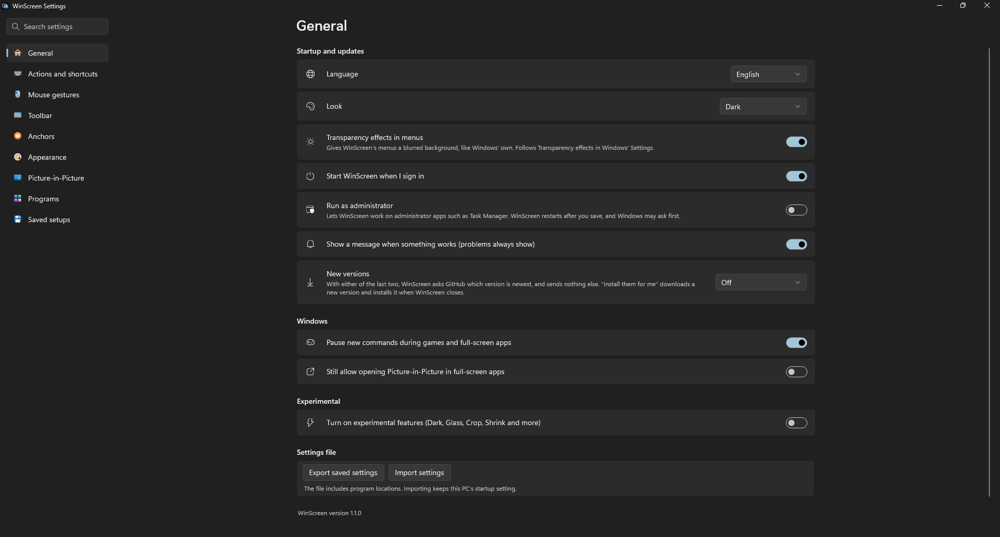
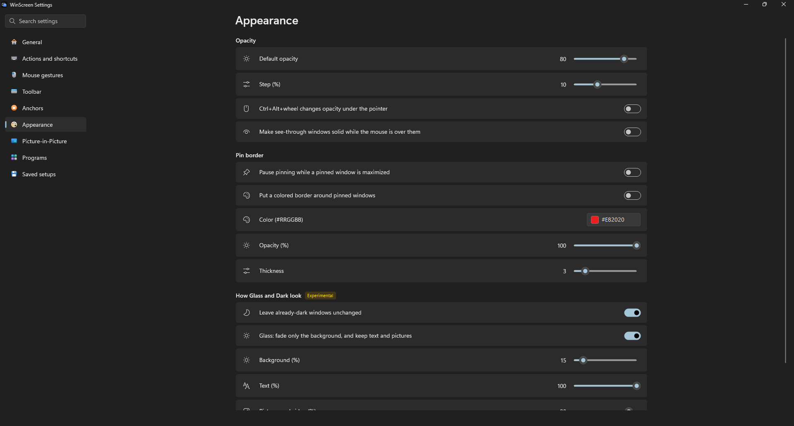
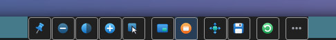
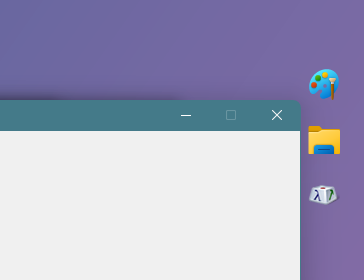

<p align="center">
  
</p>

<h1 align="center">WinScreen</h1>

<p align="center">
  <strong>Estável.</strong> Os recursos marcados como <em>experimentais</em> ainda podem mudar. Agora, o que mais ajuda é a sua opinião.
</p>

<p align="center">
  
  <a href="https://github.com/DarkLian/WinScreen/actions/workflows/build.yml"></a>
  <a href="https://github.com/DarkLian/WinScreen/releases"></a>
  
  
  <a href="LICENSE"></a>
</p>

<p align="center">
  <a href="README.md">English</a> · <a href="README.zh-CN.md">简体中文</a> · <a href="README.zh-TW.md">繁體中文</a> · <a href="README.ja.md">日本語</a> · <a href="README.ko.md">한국어</a> · <a href="README.de.md">Deutsch</a> · <a href="README.fr.md">Français</a> · <a href="README.es.md">Español</a> · <a href="README.pt-BR.md">Português (Brasil)</a>
</p>

Por enquanto, o aplicativo e o guia estão só em inglês e chinês.

## Menus

<p align="center">
  
</p>
<p align="center">
  
</p>
<p align="center">
  
</p>

## Barra de ferramentas e âncoras

<p align="center">
  
  
</p>

## Use aplicativos por uma pequena visualização

Pressione **Ctrl+Alt+P** em uma janela para ter uma pequena visualização ao vivo dela, que fica sempre visível. Ative
**Interactive** no menu da visualização e você pode usar o aplicativo direto nela: clicar, digitar, rolar, selecionar
texto e abrir menus. Está pronto para Chrome, Edge, Brave, Vivaldi, Firefox, aplicativos Electron e o Explorador de
Arquivos; para outros aplicativos, é *(experimental)*. A janela real fica escondida e fora do caminho, então um vídeo,
um chat ou um documento continua à mão em um canto enquanto você trabalha.

O **Enhanced hover** mantém os efeitos de passar o mouse funcionando em navegadores e em aplicativos como VS Code e
Discord. Para um aplicativo que não funciona bem por uma visualização, como um jogo, um clique na visualização pode
trazer a janela real de volta, e ela se esconde de novo quando você muda para outra.
[O que funciona onde](docs/FEATURE_COMPATIBILITY.md) (em inglês) traz os detalhes.

## Recursos

**Janelas**
- Sempre visível, com uma borda colorida opcional
- Transparência, com um nível padrão, Ctrl+Alt+roda do mouse sob o ponteiro, e opaca de novo enquanto o mouse está em cima
- Deixar os cliques passarem
- Sem bordas, preencher a tela, barra de título escura
- Lembrar a configuração de um programa para as janelas dele, reconhecidas pelo título ou pela classe, uma vez ou sempre

**Picture-in-picture**
- Visualizações ao vivo de uma janela, de uma tela inteira ou de parte da tela
- Cortar, ampliar, redimensionar, tamanhos fixos, predefinições e fontes salvas
- Cortar na parte de uma janela em que você clica, e manter o corte quando a janela é redimensionada
- Manter o original escondido e a visualização atualizada
- Silenciar o som do original pela visualização
- Usar aplicativos por uma visualização: Chrome, Edge, Brave, Vivaldi, Firefox, aplicativos Electron e Explorador de Arquivos, além de outros aplicativos, Enhanced hover e rolagem com o botão do meio *(experimental)*
- Limite de quadros, opacidade, trava de posição e cliques passantes para cada visualização
- Minimizar visualizações para a barra de tarefas, prévia ao passar o mouse e lupa de leitura
- Visualizações que saem de cima de textos e imagens *(experimental)*

**Âncoras**
- Botões flutuantes que trazem uma janela de volta com um clique
- Solte arquivos nelas, ou deixe o ponteiro em cima para ver uma prévia ao vivo
- Adicionadas e removidas para você conforme as janelas ficam cobertas
- Minimizar uma janela para a âncora dela
- Tirar as janelas delas da barra de tarefas, ou esconder todas por enquanto
- Mostrar em todas as áreas de trabalho virtuais, ou só na da janela

**Organizar**
- Nove posições na tela, a próxima tela, uma posição e um tamanho exatos, a posição anterior
- Mover e redimensionar segurando Alt ou Win e arrastando, com encaixe nas bordas
- Enrolar até a barra de título *(experimental)*, mandar para trás

**Efeitos** *(experimental)*
- Modo escuro que mantém imagens e vídeos como estão, ou um filtro simples
- Vidro que esmaece só o fundo
- Cortar uma janela, ou encolhê-la para um bloco ao vivo

**No dia a dia**
- Uma barra de ferramentas nas barras de título, um menu da janela com Ctrl+clique direito e um menu completo na bandeja do sistema
- Atalhos que você pode mudar, e uma lista de todas as ações com busca
- Uma linha de comando para scripts
- Configurações e menus que funcionam só com o teclado
- Configurações com a cara das do Windows 11, no tema claro ou escuro
- Programas para deixar de lado, ou os únicos com que trabalhar
- Pausa durante jogos e aplicativos em tela cheia
- Roda como administrador quando você quiser, para aplicativos como o Gerenciador de Tarefas
- Volte tudo ao normal com Ctrl+Alt+R; as janelas voltam mesmo se o WinScreen parar inesperadamente
- Atualizações automáticas, e configurações que você pode levar para outro PC
- English, 简体中文 e 繁體中文

## Instalação

Baixe o **WinScreen-…-x64-Setup.exe** em [Releases](https://github.com/DarkLian/WinScreen/releases) e execute-o.
Funciona no Windows 10 (versão 2004 ou posterior) e no Windows 11, em PCs de 64 bits com Intel ou AMD (x64). Veja
[o que funciona onde](docs/FEATURE_COMPATIBILITY.md) (em inglês) para outros sistemas e para o que cada recurso pode e
não pode fazer.

Você não precisa instalar mais nada, e ele roda sem direitos de administrador. O WinScreen fica na bandeja do sistema.

O instalador não é assinado, então o Windows pode dizer que não o reconhece. Escolha **Mais informações** e depois
**Executar assim mesmo**. Para removê-lo, vá em **Configurações → Aplicativos → Aplicativos instalados** no Windows.

Com o [Scoop](https://scoop.sh), ele é instalado em duas linhas (a versão portátil, atualizada pelo Scoop):

```
scoop bucket add winscreen https://github.com/DarkLian/WinScreen
scoop install winscreen
```

## Primeiros passos

1. Clique na janela que você quer mudar.
2. Pressione **Ctrl+Alt+T** para deixá-la sempre visível, **Ctrl+Alt+P** para uma visualização ao vivo ou **Ctrl+Alt+A** para uma âncora.
3. Clique no ícone da bandeja para abrir as configurações, ou clique com o botão direito para ver todos os comandos.
4. Pressione **Ctrl+Alt+R** para deixar todas as janelas como estavam.

| Para fazer isto | Atalho |
| --- | --- |
| Deixar ou não sempre visível | Ctrl+Alt+T |
| Abrir ou fechar uma visualização ao vivo | Ctrl+Alt+P |
| Adicionar ou remover uma âncora | Ctrl+Alt+A |
| Mais ou menos transparente | Ctrl+Alt+Baixo / Cima |
| Ligar ou desligar a transparência padrão | Ctrl+Alt+O |
| Ligar ou desligar os cliques passantes | Ctrl+Alt+C |
| Voltar esta janela ao normal | Ctrl+Alt+U |
| Voltar todas as janelas ao normal | Ctrl+Alt+R |

O **[guia do usuário](docs/USER_GUIDE.md)** (em inglês) explica todos os recursos.

## Perguntas e respostas

### "AI slop"!?

O projeto existe por pura paixão, e para resolver problemas de verdade: oferece alternativas gratuitas e especializadas
a aplicativos fechados e pagos, feitas com a ajuda de agentes de IA. A compatibilidade e a confiabilidade podem ser
questionáveis, mas é justamente aí que a ajuda da comunidade mais faz falta. Não consigo descobrir todos os problemas só
com o meu próprio uso e os meus agentes, mesmo que a IA seja poderosa e rápida para corrigir. Se ainda assim você acha
que é "AI slop", então é. Não posso e não vou me dar ao trabalho de mudar o que você pensa. Simplesmente procure outra
alternativa confiável (se existir alguma feita sem IA).

### Por que não usar ferramentas maduras que já existem?

O [PowerToys](https://github.com/microsoft/powertoys) é mantido ativamente, mas prioriza a variedade de recursos e não
tem melhorias focadas. O WinScreen existe como um complemento, especializado em certos utilitários do Windows. Ele não
está aqui para copiar o PowerToys, o que não faria sentido.

O [WindowTop](https://windowtop.info/) foi o que inspirou este projeto. Só que ele é fechado e pago. O WinScreen quer
oferecer uma opção gratuita e de código aberto para quem (eu incluído) quer recursos que ficam atrás de um paywall.
Além disso, sem as amarras de um negócio, o WinScreen pode ser atualizado rápido e sem burocracia, então meu objetivo é
responder e melhorar depressa, corrigindo bugs e adicionando os recursos de que as pessoas realmente precisam (com
testes completos, espero).

Muitos outros projetos que encontrei foram abandonados, são pagos ou são "AI slop" de verdade, que não é atualizado,
deixa abertos problemas que encontrei no primeiro dia e tem um GitHub bagunçado.
**Hoje simplesmente não existe uma opção gratuita e de código aberto, com melhorias focadas e suporte contínuo.**

### O projeto vai ser mantido continuamente?

Vou fazer o meu melhor. Mas, como um projeto sem fins lucrativos movido por paixão, o apoio da comunidade me dá um
grande impulso. Não posso garantir que ele vai ser mantido sempre, mas mesmo assim ele tem licença MIT, então qualquer
pessoa pode fazer um fork e mantê-lo vivo. Esse é o espírito do código aberto!

### É seguro?

O projeto é totalmente de código aberto. Qualquer pessoa pode examinar o código (ou pedir para uma IA analisá-lo) e
compilá-lo por conta própria. Desligue as atualizações automáticas e analise o código com IA se quiser mais segurança.

Código aberto não significa absolutamente seguro, mas tudo está à vista para qualquer pessoa conferir, questionar ou
apontar problemas. Toda preocupação de segurança que você relatar é bem-vinda.

## Atualizações

Nas configurações (Settings), escolha o que o WinScreen faz com novas versões: nada (o padrão), avisar você ou
instalá-las para você quando fechá-lo. Uma cópia portátil não consegue se atualizar sozinha, então ela avisa você e abre
a página da nova versão. Para atualizar manualmente, feche o WinScreen e execute o instalador mais novo. Suas
configurações continuam como estão.

## Diga o que você acha

O WinScreen é feito por DarkLian com a ajuda de agentes de IA. A melhor forma de ajudar é contar como ele funciona para
você. [Abra uma issue](https://github.com/DarkLian/WinScreen/issues) para compartilhar uma ideia, relatar um problema
ou mencionar alguma coisinha que incomoda você. Veja **[Contributing](CONTRIBUTING.md)** (em inglês) para saber o que
mais ajuda.

Se o WinScreen for útil para você, você pode [apoiá-lo no Ko-fi](https://ko-fi.com/darklian).

## Compile você mesmo

Você precisa do SDK do .NET 10 indicado em `global.json`. Execute `.\build.ps1 -SkipInteractive` e o instalador
aparece em `dist\release`.

## Política de assinatura de código

**O WinScreen não é assinado.** A assinatura de código gratuita da [SignPath Foundation](https://signpath.org/) exige
que um projeto seja mais usado primeiro, então vamos pedir de novo mais tarde.

- **Quem participa:** [DarkLian](https://github.com/DarkLian) escreve e revisa o código do WinScreen, com a ajuda de
  agentes de IA, e aprova cada versão. Mais ninguém pode alterar o código ou publicar uma versão.
- **Privacidade:** o WinScreen não envia nada sobre você ou o seu PC para lugar nenhum. Ele só se conecta quando você
  pede para ser avisado sobre novas versões ou para instalá-las, ou quando escolhe **Check for updates**, e aí apenas
  pergunta ao GitHub qual é a versão mais recente. Ele mantém um registro curto no seu PC para ajudar a resolver
  problemas, que nunca sai do seu PC a menos que você mesmo o envie.

## Licença

[MIT](LICENSE)
