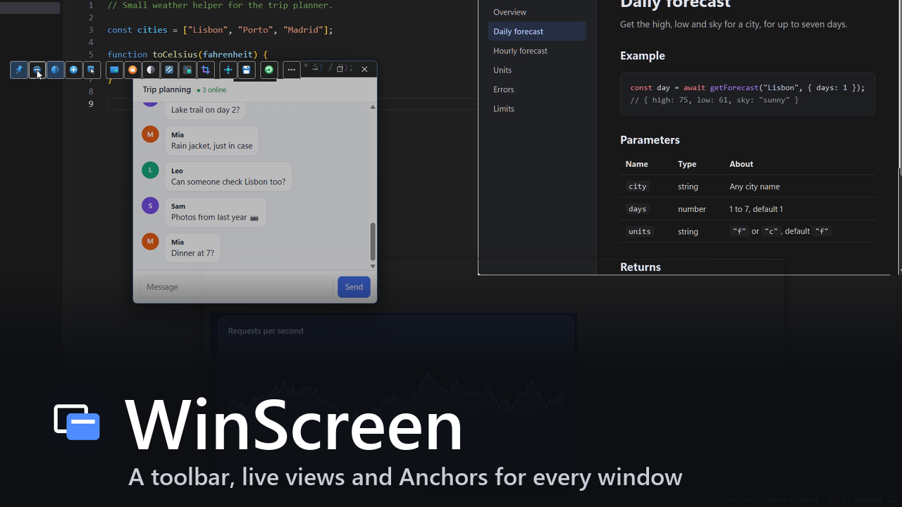
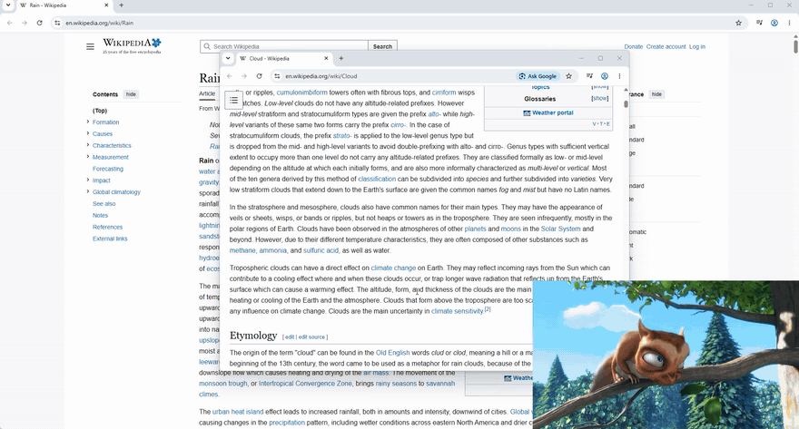
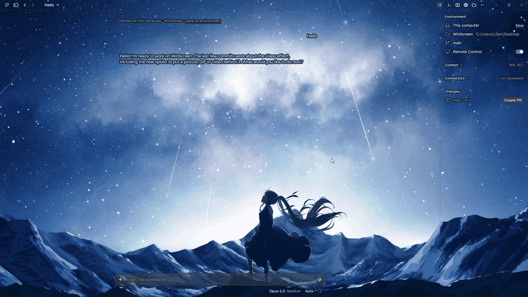
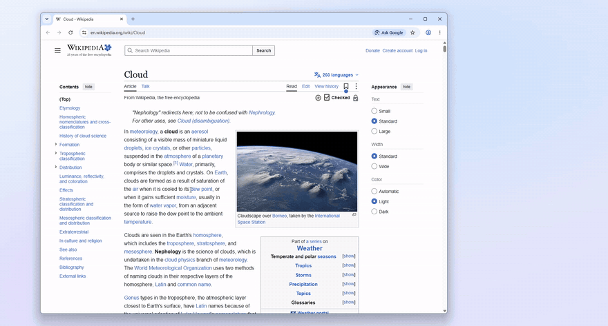
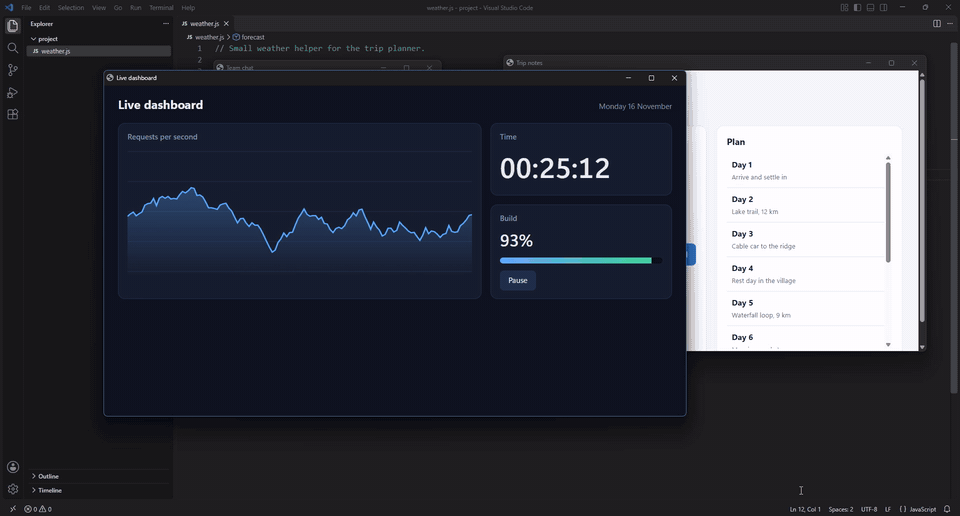

<p align="center">
  
</p>

<h1 align="center">WinScreen</h1>

<p align="center">
  <strong>Стабильная версия.</strong> Функции с пометкой <em>экспериментальная</em> ещё могут измениться. Сейчас больше всего помогают ваши отзывы.
</p>

<p align="center">
  
  <a href="https://github.com/DarkLian/WinScreen/actions/workflows/build.yml"></a>
  <a href="https://github.com/DarkLian/WinScreen/releases"></a>
  
  
  <a href="LICENSE"></a>
</p>

<p align="center">
  <a href="README.md">English</a> · <a href="README.zh-CN.md">简体中文</a> · <a href="README.zh-TW.md">繁體中文</a> · <a href="README.ja.md">日本語</a> · <a href="README.ko.md">한국어</a> · <a href="README.de.md">Deutsch</a> · <a href="README.fr.md">Français</a> · <a href="README.es.md">Español</a> · <a href="README.pt-BR.md">Português (Brasil)</a> · <a href="README.ru.md">Русский</a> · <a href="README.uk.md">Українська</a>
</p>

Пока что приложение и руководство есть только на английском и китайском.

## Как это выглядит

<p align="center">
  <a href="https://www.youtube.com/watch?v=FncLMB3cYDQ"></a>
</p>

<p align="center"><a href="https://www.youtube.com/watch?v=FncLMB3cYDQ"><strong>Смотреть 5-минутное демо на YouTube</strong></a></p>

Две копии сразу: одна обрезана до видео, во второй можно прокручивать страницу прямо в копии. На другой виртуальный рабочий стол они идут за вами.

<p align="center">
  
</p>

Заморозьте копию, оставьте рядом замороженный снимок, запишите фрагмент или закройте личное.

<p align="center">
  
</p>

Картинка или видео за любым приложением, по очереди. Видео играет свой звук, и у каждого своя скорость и яркость.

<p align="center">
  
</p>

Стекло делает прозрачной только страницу. Меняйте степень, текст и его тень — результат виден сразу.

<p align="center">
  
</p>

Фото или видео остаётся как есть в тёмном режиме и под Стеклом.

<p align="center">
  
</p>

Якоря возвращают окно одним щелчком с любого рабочего стола. Наведите указатель, чтобы увидеть окно, или перетащите на якорь файл, чтобы бросить его в окно.

<p align="center">
  
</p>

Панель инструментов на заголовке окна: закрепить поверх всех окон, поставить в угол, сделать полупрозрачным или пропускающим щелчки и двигать с Alt+перетаскиванием.

<p align="center">
  
</p>

Обрежьте копию до нужной части и увеличьте её или уменьшите окно до маленькой живой плитки.

<p align="center">
  
</p>

## Пользуйтесь приложениями через маленькое окно

Нажмите **Ctrl+Alt+P** в любом окне, и появится его маленькая живая копия поверх всех окон. Включите **Interactive** в
меню этой копии, и приложением можно пользоваться прямо в ней: щёлкать, печатать, прокручивать, выделять текст и
открывать меню. Это готово для Chrome, Edge, Brave, Vivaldi, Firefox, приложений Electron и Проводника; для других
приложений это *(экспериментальная)* функция. Настоящее окно остаётся скрытым и не мешает, так что видео, чат или
документ всегда под рукой в углу экрана, пока вы работаете.

**Enhanced hover** сохраняет эффекты при наведении в браузерах и в приложениях вроде VS Code и Discord. Для приложения,
которое плохо работает через копию, например игры, щелчок по копии может вместо этого вернуть настоящее окно, а когда вы
переключитесь на другое, оно снова скроется. Подробности в разделе
[что где работает](docs/FEATURE_COMPATIBILITY.md) (на английском).

## Картинка или видео за любым приложением

Включите для окна Стекло (**Ctrl+Alt+G**), и за его текстом появится картинка, анимированный GIF или видео. В
**Settings → Effects** выберите фон для всех приложений или задайте приложению свой. Видео может играть со звуком
и ставится на паузу, пока окно свёрнуто или на другом рабочем столе.
Несколько фонов могут сменять друг друга, и взять их можно также по ссылке из интернета.

## Возможности

**Окна**
- Закрепить поверх всех окон, по желанию с цветной рамкой
- Прозрачность: уровень по умолчанию, Ctrl+Alt+колесо мыши под указателем, и снова непрозрачно, пока над окном мышь
- Пропускать щелчки сквозь окно
- Без рамки, на весь экран, тёмный заголовок
- Запоминать настройки программы для её окон по заголовку или классу, один раз или каждый раз

**Картинка в картинке**
- Живые копии окна, целого экрана или части экрана
- Обрезка, масштаб, изменение размера, готовые размеры, предустановки и сохранённые источники
- Поворот копии на 90° или зеркальное отражение, и приложениями в ней можно пользоваться дальше
- Обрезка до части окна, по которой вы щёлкнули, которая сохраняется при изменении размера окна
- Держать оригинал скрытым, а копию — обновляемой
- Выключать звук оригинала из копии
- Заморозить копию, скопировать её картинку или текст, оставить застывший снимок, записать видео или закрыть личное
- Перетащить файлы, картинки или текст на копию, чтобы бросить их в её приложение, и вытащить из неё файлы или ссылки
- Пользоваться приложениями через копию: Chrome, Edge, Brave, Vivaldi, Firefox, приложения Electron и Проводник, а также другие приложения, Enhanced hover и прокрутка средней кнопкой *(экспериментально)*
- Для каждой копии: ограничение частоты кадров, прозрачность, закрепление позиции и пропуск щелчков
- Сворачивание копий на панель задач, предпросмотр при наведении и лупа для чтения
- Копии, которые уходят с текста и картинок

**Якоря**
- Плавающие кнопки, которые возвращают окно одним щелчком
- Перетаскивайте на них файлы, задержите указатель для живого предпросмотра
- Добавляются и убираются сами, когда окна перекрываются
- Сворачивать окно в его якорь
- Убирать их окна с панели задач или временно скрыть все
- Показывать на всех виртуальных рабочих столах или только на столе своего окна

**Расположение**
- Девять мест на экране, следующий монитор, точная позиция и размер, прежняя позиция
- Перемещение и изменение размера перетаскиванием с зажатым Alt или Win, с прилипанием к краям
- Свернуть до заголовка, отправить на задний план

**Эффекты**
- Тёмный режим для любого приложения, сохраняющий оттенок каждого цвета
- Насколько светлыми тёмный режим делает страницы и текст и сколько цвета сохраняет, для всех приложений или для каждого
- Стекло, которое делает прозрачным только фон
- Насколько Стекло делает фон прозрачным, для каждого приложения или для одного окна
- Светлый или тёмный текст поверх Стекла, с мягкой тенью или без неё
- Области окон приложения, например видео, которые Стекло и тёмный режим оставляют как есть
- Обрезать окно или уменьшить его до живой плитки

**Фоны**
- Картинка, анимированный GIF или видео за текстом окна — через Стекло
- Один фон для всех приложений, а у отдельных приложений — свой или никакого
- Несколько картинок и видео по очереди, у каждого свои размещение, звук, скорость и яркость
- Картинки и видео по ссылке из интернета
- Заполнение, по размеру, растянуть, замостить или по центру
- Большой предпросмотр: щёлкните, чтобы выбрать файл, или перетащите файл на него
- Звук видео с отдельной громкостью — из окна, которым вы пользовались последним, пока его приложение впереди
- Видео ставится на паузу, пока его окно свёрнуто или на другом рабочем столе, за игрой или полноэкранным приложением и пока Windows экономит заряд

**Каждый день**
- Панель инструментов в заголовках, меню окна по Ctrl+правый щелчок и полное меню в области уведомлений
- Сочетания клавиш, которые можно менять, и список всех действий с поиском
- Командная строка для скриптов
- Параметры и меню, с которыми можно работать только с клавиатуры
- Параметры в стиле Windows 11, в светлой или тёмной теме
- Программы, которые не трогать, или только те, с которыми работать
- Пауза во время игр и полноэкранных приложений
- Запуск от имени администратора, когда нужно, для таких приложений, как Диспетчер задач
- Вернуть всё как было по Ctrl+Alt+R; окна возвращаются, даже если WinScreen неожиданно закроется
- Автоматические обновления и параметры, которые можно перенести на другой ПК
- English, 简体中文 и 繁體中文

## Установка

Скачайте **WinScreen-…-x64-Setup.exe** со страницы [Releases](https://github.com/DarkLian/WinScreen/releases) и
запустите его. Он работает в Windows 10 (версия 2004 или новее) и Windows 11 на 64-битных ПК с Intel или AMD (x64).
О других системах и о том, что умеет и чего не умеет каждая функция, читайте в разделе
[что где работает](docs/FEATURE_COMPATIBILITY.md) (на английском).

Больше ничего устанавливать не нужно, и права администратора не требуются. WinScreen живёт в области уведомлений.

Установщик не подписан, поэтому Windows может сказать, что не распознаёт его. Нажмите **Подробнее**, затем
**Выполнить в любом случае**. Чтобы удалить программу, откройте в Windows
**Параметры → Приложения → Установленные приложения**.

С [Scoop](https://scoop.sh) он ставится в две строки (портативная версия, обновляется через Scoop):

```
scoop bucket add winscreen https://github.com/DarkLian/WinScreen
scoop install winscreen
```

## Быстрый старт

1. Щёлкните окно, которое хотите изменить.
2. Нажмите **Ctrl+Alt+T**, чтобы закрепить его поверх всех окон, **Ctrl+Alt+P** для живой копии или **Ctrl+Alt+A** для якоря.
3. Щёлкните значок в области уведомлений, чтобы открыть параметры, или правой кнопкой — для всех команд.
4. Нажмите **Ctrl+Alt+R**, чтобы вернуть все окна как было.

| Что сделать | Сочетание |
| --- | --- |
| Закрепить поверх всех окон или открепить | Ctrl+Alt+T |
| Открыть или закрыть живую копию | Ctrl+Alt+P |
| Добавить или убрать якорь | Ctrl+Alt+A |
| Больше или меньше прозрачности | Ctrl+Alt+Down / Up |
| Включить или выключить прозрачность по умолчанию | Ctrl+Alt+O |
| Включить или выключить пропуск щелчков | Ctrl+Alt+C |
| Включить или выключить тёмный режим | Ctrl+Alt+D |
| Включить или выключить Стекло | Ctrl+Alt+G |
| Уменьшить до живой плитки | Ctrl+Alt+W |
| Обрезать или убрать обрезку | Ctrl+Alt+X |
| Запомнить или забыть настройку этой программы | Ctrl+Alt+Shift+S |
| Вернуть это окно как было | Ctrl+Alt+U |
| Вернуть все окна как было | Ctrl+Alt+R |
| Посмотреть свои сочетания | Удерживать Ctrl+Alt |

Все возможности описаны в **[руководстве](docs/USER_GUIDE.md)** (на английском).

## Вопросы и ответы

### Это ИИ-халтура?

WinScreen появился из увлечения, чтобы решить проблемы, которые были у меня самого, и создаётся с большой помощью
ИИ-агентов. Я предпочитаю сказать об этом сразу.

Что я могу — это проверять результат: изменения тестируются в Windows 10 и Windows 11, ещё ненадёжные функции
помечены как *экспериментальные*, а найденные ошибки исправляются, а не лежат открытыми. Чего я не могу один — это
охватить все версии Windows, все ПК и все приложения. Здесь ваши сообщения помогают больше всего: если что-то у вас не
работает, [создайте issue](https://github.com/DarkLian/WinScreen/issues).

### Почему бы просто не пользоваться зрелыми готовыми инструментами?

[PowerToys](https://github.com/microsoft/powertoys) активно развивается, но делает упор на широту возможностей, и ему не
хватает точечных улучшений. WinScreen существует как дополнение, специализируясь на некоторых утилитах Windows. Он не
задуман как копия PowerToys, в этом не было бы смысла.

Этот проект вдохновлён [WindowTop](https://windowtop.info/). Но он закрытый и платный. WinScreen стремится дать
бесплатный вариант с открытым кодом людям (и мне самому), которым нужны функции, спрятанные за платным доступом. Кроме
того, без ограничений бизнеса WinScreen может обновляться быстро и без лишней нагрузки, поэтому я стараюсь быстро
реагировать и улучшать его, исправляя ошибки и добавляя то, что людям действительно нужно (с тщательными тестами,
надеюсь).

Многие другие проекты, что я нашёл, заброшены, платные или самая настоящая ИИ-халтура: не обновляются, оставляют
открытыми проблемы, найденные мной в первый же день, а их GitHub — сплошной беспорядок.
**Сейчас просто нет варианта, который был бы бесплатным, с открытым кодом, с точечными улучшениями и постоянной
поддержкой.**

### Будет ли проект поддерживаться дальше?

Я буду стараться изо всех сил. Но для некоммерческого проекта, который держится на увлечении, поддержка сообщества —
огромный стимул. Я не могу гарантировать, что он будет поддерживаться всегда, но даже тогда у него лицензия MIT, так что
любой может сделать форк и сохранить его. В этом и есть дух открытого кода!

### Это безопасно?

Код проекта полностью открыт. Любой может его изучить (или попросить ИИ проанализировать) и собрать сам. Если хотите
дополнительной безопасности, выключите автоматические обновления и проанализируйте код с помощью ИИ.

Открытый код не значит абсолютно безопасный, но всё на виду: любой может проверить, задать вопрос или указать на
проблему. Буду рад любым сообщениям о проблемах безопасности.

## Обновления

В параметрах (Settings) выберите, что WinScreen делает с новыми версиями: ничего (по умолчанию), сообщает вам о них или
устанавливает их при закрытии. Портативная копия не может обновиться сама, поэтому она сообщит вам и откроет страницу
новой версии. Чтобы обновить вручную, закройте WinScreen и запустите более новый установщик. Ваши параметры
сохранятся.

## Расскажите, что вы думаете

WinScreen делает DarkLian с помощью ИИ-агентов. Лучшая помощь — рассказать, как он у вас работает.
[Создайте issue](https://github.com/DarkLian/WinScreen/issues), чтобы поделиться идеей, сообщить о проблеме или
упомянуть мелочь, которая мешает. Что помогает больше всего, написано в **[Contributing](CONTRIBUTING.md)** (на
английском).

Если WinScreen вам полезен, вы можете [поддержать его на Ko-fi](https://ko-fi.com/darklian).

## Сборка своими руками

Нужен .NET 10 SDK, указанный в `global.json`. Запустите `.\build.ps1 -SkipInteractive`, и установщик появится в
`dist\local`.

Как каждая функция ведёт себя с любым типом окон и где это решается в коде, описано в разделе
[Совместимость функций](docs/FEATURE_COMPATIBILITY.md) (на английском).

## Политика подписи кода

**WinScreen не подписан.** Бесплатная подпись кода от [SignPath Foundation](https://signpath.org/) требует, чтобы проект
сначала стал популярнее, поэтому мы подадим заявку позже.

- **Кто участвует:** [DarkLian](https://github.com/DarkLian) пишет и проверяет код WinScreen с помощью ИИ-агентов и
  утверждает каждый выпуск. Никто другой не может менять код или публиковать выпуски.
- **Конфиденциальность:** WinScreen никуда не отправляет ничего о вас или вашем ПК. Он выходит в интернет, только когда
  вы попросили сообщать о новых версиях или устанавливать их либо выбрали **Check for updates**, и тогда лишь спрашивает
  у GitHub, какая версия новейшая. Картинку или видео, заданные для Glass веб-ссылкой, он загружает с этого адреса. Он ведёт на вашем ПК короткий журнал, чтобы помочь в решении проблем, и этот журнал
  никогда не покидает ваш ПК, если вы не отправите его сами.

## Лицензия

[MIT](LICENSE)
