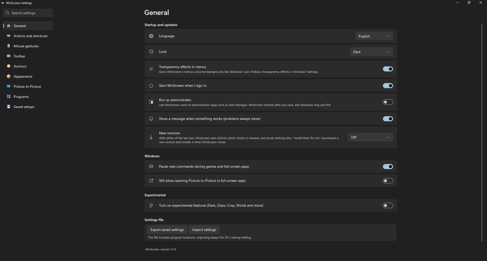
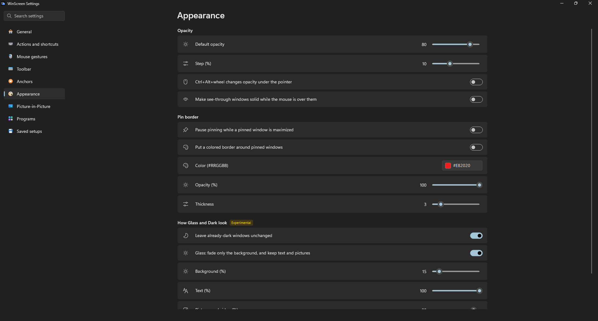
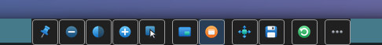
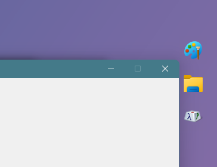

<p align="center">
  
</p>

<h1 align="center">WinScreen</h1>

<p align="center">
  <strong>Стабільна версія.</strong> Функції з позначкою <em>експериментальна</em> ще можуть змінитися. Зараз найбільше допомагають ваші відгуки.
</p>

<p align="center">
  
  <a href="https://github.com/DarkLian/WinScreen/actions/workflows/build.yml"></a>
  <a href="https://github.com/DarkLian/WinScreen/releases"></a>
  
  
  <a href="LICENSE"></a>
</p>

<p align="center">
  <a href="README.md">English</a> · <a href="README.zh-CN.md">简体中文</a> · <a href="README.zh-TW.md">繁體中文</a> · <a href="README.ja.md">日本語</a> · <a href="README.ko.md">한국어</a> · <a href="README.de.md">Deutsch</a> · <a href="README.fr.md">Français</a> · <a href="README.es.md">Español</a> · <a href="README.pt-BR.md">Português (Brasil)</a> · <a href="README.ru.md">Русский</a> · <a href="README.uk.md">Українська</a>
</p>

Поки що застосунок і посібник є лише англійською та китайською.

## Меню

<p align="center">
  
</p>
<p align="center">
  
</p>
<p align="center">
  
</p>

## Панель інструментів і якорі

<p align="center">
  
  
</p>

## Користуйтеся застосунками через маленьке вікно

Натисніть **Ctrl+Alt+P** у будь-якому вікні, і з'явиться його маленька жива копія поверх усіх вікон. Увімкніть
**Interactive** у меню цієї копії, і застосунком можна користуватися просто в ній: клацати, друкувати, прокручувати,
виділяти текст і відкривати меню. Це готово для Chrome, Edge, Brave, Vivaldi, Firefox, застосунків Electron і
Провідника файлів; для інших застосунків це *(експериментальна)* функція. Справжнє вікно лишається прихованим і не
заважає, тож відео, чат чи документ завжди під рукою в кутку екрана, поки ви працюєте.

**Enhanced hover** зберігає ефекти наведення в браузерах і в застосунках на кшталт VS Code та Discord. Для застосунку,
який погано працює через копію, наприклад гри, клацання по копії може натомість повернути справжнє вікно, а коли ви
перемкнетеся на інше, воно знову сховається. Подробиці в розділі
[що де працює](docs/FEATURE_COMPATIBILITY.md) (англійською).

## Можливості

**Вікна**
- Закріпити поверх усіх вікон, за бажанням із кольоровою рамкою
- Прозорість: рівень за замовчуванням, Ctrl+Alt+коліщатко під вказівником, і знову непрозоре, поки над вікном миша
- Пропускати клацання крізь вікно
- Без рамки, на весь екран, темний заголовок
- Запам'ятовувати налаштування програми для її вікон за заголовком або класом, один раз або щоразу

**Картинка в картинці**
- Живі копії вікна, цілого екрана або частини екрана
- Обрізання, масштаб, зміна розміру, готові розміри, шаблони та збережені джерела
- Обрізання до частини вікна, на яку ви клацнули, що зберігається, коли вікно змінює розмір
- Тримати оригінал прихованим, а копію — оновлюваною
- Вимикати звук оригіналу з копії
- Користуватися застосунками через копію: Chrome, Edge, Brave, Vivaldi, Firefox, застосунки Electron і Провідник файлів, а також інші застосунки, Enhanced hover і прокручування середньою кнопкою *(експериментально)*
- Для кожної копії: обмеження частоти кадрів, прозорість, фіксація позиції та пропуск клацань
- Згортання копій на панель завдань, попередній перегляд під час наведення та лупа для читання
- Копії, що відходять із тексту й зображень *(експериментально)*

**Якорі**
- Плаваючі кнопки, що повертають вікно одним клацанням
- Перетягуйте на них файли, затримайте вказівник для живого попереднього перегляду
- Додаються й прибираються самі, коли вікна перекриваються
- Згортати вікно в його якір
- Прибирати їхні вікна з панелі завдань або тимчасово сховати всі
- Показувати на всіх віртуальних робочих столах або лише на столі свого вікна

**Розташування**
- Дев'ять місць на екрані, наступний монітор, точна позиція й розмір, попередня позиція
- Переміщення та зміна розміру перетягуванням із затиснутою клавішею Alt або Win, із прилипанням до країв
- Згорнути до заголовка *(експериментально)*, відправити на задній план

**Ефекти** *(експериментально)*
- Темний режим, що не чіпає зображення й відео, або простий фільтр
- Скло, що робить прозорим лише тло
- Обрізати вікно або зменшити його до живої плитки

**Щодня**
- Панель інструментів у заголовках, меню вікна за Ctrl+правим клацанням і повне меню в області сповіщень
- Сполучення клавіш, які можна змінювати, і список усіх дій із пошуком
- Командний рядок для скриптів
- Параметри й меню, з якими можна працювати лише з клавіатури
- Параметри в стилі Windows 11, у світлій або темній темі
- Програми, яких не чіпати, або лише ті, з якими працювати
- Пауза під час ігор і повноекранних застосунків
- Запуск від імені адміністратора, коли потрібно, для таких застосунків, як Диспетчер завдань
- Повернути все як було за Ctrl+Alt+R; вікна повертаються, навіть якщо WinScreen несподівано закриється
- Автоматичні оновлення та параметри, які можна перенести на інший ПК
- English, 简体中文 і 繁體中文

## Встановлення

Завантажте **WinScreen-…-x64-Setup.exe** зі сторінки [Releases](https://github.com/DarkLian/WinScreen/releases) і
запустіть його. Він працює у Windows 10 (версія 2004 або новіша) та Windows 11 на 64-бітних ПК з Intel або AMD (x64).
Про інші системи та про те, що вміє і чого не вміє кожна функція, читайте в розділі
[що де працює](docs/FEATURE_COMPATIBILITY.md) (англійською).

Більше нічого встановлювати не потрібно, і права адміністратора не потрібні. WinScreen живе в області сповіщень.

Інсталятор не підписаний, тому Windows може сказати, що не розпізнає його. Натисніть **Докладніше**, а потім кнопку,
яка все одно запускає програму. Щоб видалити програму, відкрийте у Windows
**Параметри → Програми → Встановлені програми**.

Зі [Scoop](https://scoop.sh) він встановлюється у два рядки (портативна версія, оновлюється через Scoop):

```
scoop bucket add winscreen https://github.com/DarkLian/WinScreen
scoop install winscreen
```

## Швидкий старт

1. Клацніть вікно, яке хочете змінити.
2. Натисніть **Ctrl+Alt+T**, щоб закріпити його поверх усіх вікон, **Ctrl+Alt+P** для живої копії або **Ctrl+Alt+A** для якоря.
3. Клацніть значок в області сповіщень, щоб відкрити параметри, або правою кнопкою — для всіх команд.
4. Натисніть **Ctrl+Alt+R**, щоб повернути всі вікна як було.

| Що зробити | Сполучення |
| --- | --- |
| Закріпити поверх усіх вікон або відкріпити | Ctrl+Alt+T |
| Відкрити або закрити живу копію | Ctrl+Alt+P |
| Додати або прибрати якір | Ctrl+Alt+A |
| Більше або менше прозорості | Ctrl+Alt+Down / Up |
| Увімкнути або вимкнути прозорість за замовчуванням | Ctrl+Alt+O |
| Увімкнути або вимкнути пропуск клацань | Ctrl+Alt+C |
| Повернути це вікно як було | Ctrl+Alt+U |
| Повернути всі вікна як було | Ctrl+Alt+R |

Усі можливості описано в **[посібнику](docs/USER_GUIDE.md)** (англійською).

## Запитання та відповіді

### Це ШІ-халтура?

WinScreen з'явився із захоплення, щоб розв'язати проблеми, які були в мене самого, і створюється з великою допомогою
ШІ-агентів. Я волію сказати про це одразу.

Що я можу — це перевіряти результат: кожну версію тестують у Windows 10 і Windows 11, ще ненадійні функції позначені
як *експериментальні*, а повідомлені помилки виправляються, а не лежать відкритими. Чого я не можу сам — це охопити всі
версії Windows, усі ПК і всі застосунки. Саме тут ваші повідомлення допомагають найбільше: якщо щось у вас не працює,
[створіть issue](https://github.com/DarkLian/WinScreen/issues).

### Чому б просто не користуватися зрілими готовими інструментами?

[PowerToys](https://github.com/microsoft/powertoys) активно розвивається, але робить ставку на широту можливостей, і йому
бракує точкових покращень. WinScreen існує як доповнення, що спеціалізується на деяких утилітах Windows. Він не задуманий
як копія PowerToys, у цьому не було б сенсу.

Цей проєкт натхненний [WindowTop](https://windowtop.info/). Але він закритий і платний. WinScreen прагне дати
безкоштовний варіант із відкритим кодом людям (і мені самому), яким потрібні функції, сховані за платним доступом.
Крім того, без обмежень бізнесу WinScreen може оновлюватися швидко й без зайвого тягаря, тож я намагаюся швидко
реагувати й покращувати його, виправляючи помилки та додаючи те, що людям справді потрібно (з ретельними тестами,
сподіваюся).

Багато інших проєктів, які я знайшов, покинуті, платні або справжня ШІ-халтура: не оновлюються, залишають відкритими
проблеми, які я знайшов у перший же день, а їхній GitHub — суцільний безлад.
**Зараз просто немає варіанту, який був би безкоштовним, із відкритим кодом, із точковими покращеннями та постійною
підтримкою.**

### Чи підтримуватиметься проєкт і далі?

Я старатимуся з усіх сил. Але для некомерційного проєкту, що тримається на захопленні, підтримка спільноти — величезний
стимул. Я не можу гарантувати, що його підтримуватимуть завжди, але навіть тоді в нього ліцензія MIT, тож будь-хто може
зробити форк і зберегти його. У цьому й полягає дух відкритого коду!

### Чи це безпечно?

Код проєкту повністю відкритий. Будь-хто може його вивчити (або попросити ШІ проаналізувати) і зібрати сам. Якщо хочете
додаткової безпеки, вимкніть автоматичні оновлення та проаналізуйте код за допомогою ШІ.

Відкритий код не означає абсолютно безпечний, але все на виду: будь-хто може перевірити, поставити запитання чи вказати
на проблему. Буду радий будь-яким повідомленням про проблеми безпеки.

## Оновлення

У параметрах (Settings) виберіть, що WinScreen робить із новими версіями: нічого (за замовчуванням), повідомляє вас про
них або встановлює їх, коли ви його закриваєте. Портативна копія не може оновитися сама, тож вона повідомить вас і
відкриє сторінку нової версії. Щоб оновити вручну, закрийте WinScreen і запустіть новіший інсталятор. Ваші параметри
збережуться.

## Розкажіть, що ви думаєте

WinScreen робить DarkLian за допомогою ШІ-агентів. Найкраща допомога — розповісти, як він у вас працює.
[Створіть issue](https://github.com/DarkLian/WinScreen/issues), щоб поділитися ідеєю, повідомити про проблему чи
згадати дрібницю, яка заважає. Що допомагає найбільше, написано в **[Contributing](CONTRIBUTING.md)** (англійською).

Якщо WinScreen вам корисний, ви можете [підтримати його на Ko-fi](https://ko-fi.com/darklian).

## Зібрати самостійно

Потрібен .NET 10 SDK, указаний у `global.json`. Запустіть `.\build.ps1 -SkipInteractive`, і інсталятор з'явиться в
`dist\release`.

## Політика підписування коду

**WinScreen не підписаний.** Безкоштовне підписування коду від [SignPath Foundation](https://signpath.org/) вимагає,
щоб проєкт спершу став популярнішим, тож ми подамо заявку пізніше.

- **Хто бере участь:** [DarkLian](https://github.com/DarkLian) пише й перевіряє код WinScreen за допомогою ШІ-агентів і
  затверджує кожен випуск. Ніхто інший не може змінювати код чи публікувати випуски.
- **Конфіденційність:** WinScreen нікуди не надсилає нічого про вас чи ваш ПК. Він виходить в інтернет лише тоді, коли
  ви попросили повідомляти про нові версії чи встановлювати їх або вибрали **Check for updates**, і тоді лише запитує
  в GitHub, яка версія найновіша. Він веде на вашому ПК короткий журнал, щоб допомогти в розв'язанні проблем, і цей
  журнал ніколи не залишає ваш ПК, якщо ви не надішлете його самі.

## Ліцензія

[MIT](LICENSE)
