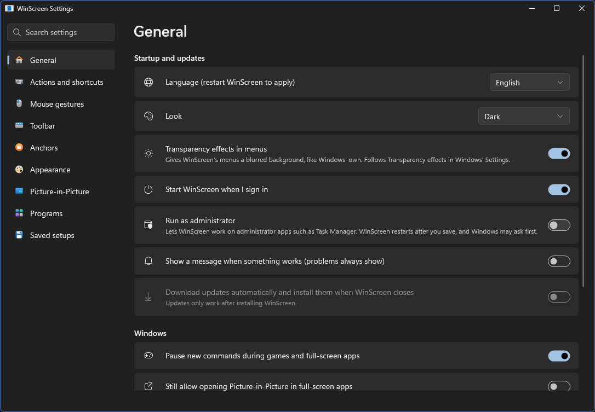
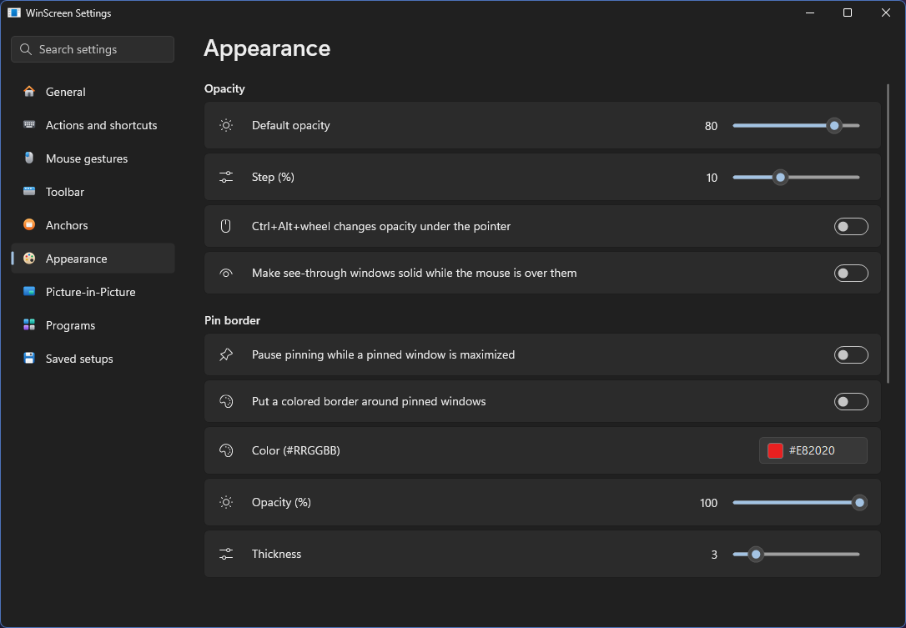
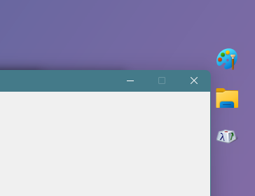

  

<h1 align="center">WinScreen</h1>

  <strong>正式版。</strong>標為<em>實驗性</em>的功能仍可能變化。現在最需要你的回饋。

  
  
  
  
  
  

  <a href="README.md">English</a> · <a href="README.zh-CN.md">简体中文</a> · <a href="README.zh-TW.md">繁體中文</a>

## 選單

  

  
  

## 工具列和錨點

  
  

## 透過小檢視使用應用程式

在視窗上按 **Ctrl+Alt+P**，即可開啟一個置頂的小即時檢視。在檢視選單中開啟**互動**，就能直接在檢視裡使用應用程式：
點選、輸入、捲動、選取文字和開啟選單。Chrome 和 Edge 可直接使用，其他應用程式為*（實驗性）*。真正的視窗會隱藏起來，讓影片、聊天或文件一直待在角落，方便你邊看邊做別的事。

**增強懸停**讓瀏覽器以及 VS Code、Discord 等應用程式的懸停效果正常顯示。對於不適合透過檢視使用的應用程式（例如遊戲），
點選檢視可改為顯示原視窗，切換到別的視窗後它會再次隱藏。詳情請見[功能相容性](docs/FEATURE_COMPATIBILITY.md)。

## 功能

**視窗**
- 置頂，可加彩色邊框
- 半透明：預設透明度、Ctrl+Alt+滾輪調整指標下的視窗、滑鼠停留時恢復不透明
- 滑鼠穿透
- 無邊框、填滿顯示器、深色標題列
- 記住程式的設定，之後它的視窗都照此開啟

**子母畫面**
- 為視窗、整個顯示器或螢幕的一部分開啟即時檢視
- 裁切、縮放、調整大小、預設和已儲存的來源
- 隱藏原視窗並保持檢視更新
- 透過檢視使用應用程式：Chrome 和 Edge；其他應用程式、增強懸停與中鍵捲動 *（實驗性）*
- 每個檢視單獨設定畫面更新上限、不透明度、鎖定位置與滑鼠穿透
- 把檢視最小化到工作列、停留預覽與閱讀放大鏡
- 自動避開文字與圖片的檢視 *（實驗性）*

**錨點**
- 浮動按鈕，點一下就把視窗帶回來
- 可把檔案拖到上面，指標停留時顯示即時預覽
- 視窗被擋住時自動新增和移除
- 可把對應視窗從工作列移除，或暫時隱藏所有錨點

**排列**
- 螢幕上的九個位置、下一台顯示器、精確的位置與大小、上一個位置
- 按住 Alt 或 Win 拖曳即可移動和調整大小，並可貼齊螢幕邊緣
- 收起到標題列 *（實驗性）*、移到最底層

**效果** *（實驗性）*
- 深色模式，以及保持圖片與影片原樣的版本
- 只淡化背景的玻璃效果
- 裁切視窗，或縮小成即時小圖塊

**日常使用**
- 標題列工具列、Ctrl+右鍵視窗選單和完整的系統匣選單
- 可修改的快捷鍵，以及可搜尋的全部動作清單
- 與 Windows 11 一致的設定介面，支援淺色與深色
- 指定不處理的程式，或只處理哪些程式
- 遊戲與全螢幕應用程式執行時自動暫停
- 需要時以系統管理員身分執行，用於工作管理員等應用程式
- 按 Ctrl+Alt+R 恢復一切；即使 WinScreen 意外停止，視窗也會恢復
- 自動更新，設定可移轉到另一台電腦
- English、简体中文與繁體中文

## 安裝

從 [Releases](https://github.com/DarkLian/WinScreen/releases) 下載 **WinScreen-…-x64-Setup.exe** 並執行。
適用於 64 位元 Intel 或 AMD 電腦（x64）上的 Windows 10（2004 版或更新版本）與 Windows 11。
其他系統的情況以及各功能能做什麼、不能做什麼，請見[功能相容性](docs/FEATURE_COMPATIBILITY.md)。

不用另外安裝任何東西，也無須系統管理員權限即可執行。WinScreen 會顯示在系統匣中。

安裝程式未經簽署，Windows 可能提示無法辨識。請點選 **其他資訊**，然後點選 **仍要執行**。
如需解除安裝，請開啟 Windows 的 **設定 → 應用程式 → 已安裝的應用程式**。

## 快速上手

1. 點選要變更的視窗。
2. 按 **Ctrl+Alt+T** 置頂，按 **Ctrl+Alt+P** 開啟即時檢視，或按 **Ctrl+Alt+A** 新增錨點。
3. 點選系統匣圖示開啟設定，以滑鼠右鍵點選可使用所有命令。
4. 按 **Ctrl+Alt+R** 把所有視窗恢復原樣。

| 操作 | 快捷鍵 |
| --- | --- |
| 置頂或取消置頂 | Ctrl+Alt+T |
| 開啟或關閉即時檢視 | Ctrl+Alt+P |
| 新增或移除錨點 | Ctrl+Alt+A |
| 更透明或更不透明 | Ctrl+Alt+Down / Up |
| 開關預設透明度 | Ctrl+Alt+O |
| 開關滑鼠穿透 | Ctrl+Alt+C |
| 還原此視窗 | Ctrl+Alt+U |
| 還原所有視窗 | Ctrl+Alt+R |

**[使用指南](docs/USER_GUIDE.zh-TW.md)** 介紹了所有功能。

## 常見問題

### AI Slop！？

這個專案的誕生純粹是出於熱情，以及想解決自己遇到的問題，只不過我選擇借助 AI 的力量來實現而已。

相容性和可靠性或許還有待檢驗，但這也正是我最需要社群幫忙的地方。光靠我自己使用，加上 AI 產生的測試，肯定還是會漏掉很多問題。畢竟我不可能測試所有的 Windows 版本、硬體配置和應用程式。如果沒有人回報問題，就算 AI 再擅長修 Bug，也根本不知道哪裡需要修。

如果這樣你還是覺得它是 AI Slop，那就隨你吧，我也懶得管你怎麼看。去找另一個更可靠的替代品就好（前提是你找得到，而且它真的完全沒用 AI）。

### 為什麼不直接用現有的成熟工具？

[PowerToys](https://github.com/microsoft/powertoys) 一直都有在積極維護，但它更著重於功能的廣度，對某些特定功能的深入增強相對有限。WinScreen 希望在這些方面提供補充，而不是重新做一套 PowerToys。

[WindowTop](https://windowtop.info/) 則是這個專案最主要的靈感來源。不過它是閉源軟體，而且部分功能需要付費。WinScreen 希望為想使用這些功能的人（包括我自己）提供一個免費、開源的選擇。

此外，由於沒有商業上的束縛，WinScreen 可以更自由地嘗試新想法，也能快速推出更新。我會盡量快速回應、快速迭代，修復問題，並加入大家真正需要的新功能——當然，希望每次更新都有充分的測試。

在尋找替代品的過程中，我也看過不少其他專案。有些早就停止維護，有些需要付費，還有些才是真正讓我覺得是 AI Slop 的東西：幾乎不更新、第一天就能發現的 Bug 過了很久還是沒修，連 GitHub 頁面都整理得亂七八糟。

至少在我目前找到的專案中，還沒有一個能同時滿足免費、開源、針對特定功能深入增強，以及持續維護這幾個條件的選擇。這也是我決定繼續開發 WinScreen 的原因。

### 這個專案會持續維護嗎？

我會盡力！

不過，WinScreen 終究是一個出於熱情、不以營利為目的的個人專案。社群的支持、回饋，甚至只是有人願意使用，對我來說都是很大的鼓勵。

我沒辦法承諾自己會永遠維護下去。但就算有一天我真的停下來了，WinScreen 仍然採用 MIT 授權，任何人都可以自由地 fork、修改，甚至接手繼續開發。

這不就是開源的精神嗎！

### 安全嗎？

WinScreen 完全開源，任何人都可以檢查程式碼，也可以請 AI 協助分析，或是直接從原始碼自行建置。

如果你對安全性有更高的要求，可以關閉自動更新，自行檢查每個版本的變更，甚至使用 AI 輔助審查程式碼後再自行編譯。

當然，開源本身不代表絕對安全，但至少所有程式碼都攤在陽光下，任何人都能檢查、質疑，或指出問題。我也歡迎大家回報任何安全疑慮。

## 更新

在設定中開啟自動更新後，WinScreen 會在關閉時安裝新版本。手動更新時，先關閉 WinScreen，再執行新版安裝程式。
你的設定會保留。

## 告訴我們你的想法

WinScreen 由 DarkLian 在 AI 助手的協助下開發。最好的幫助就是告訴我們它用起來怎麼樣。
歡迎 [提交 issue](https://github.com/DarkLian/WinScreen/issues) 分享想法、回報問題，或說說讓你不順手的小地方。
**[參與貢獻](CONTRIBUTING.md)** 說明了哪些回饋最有幫助。

如果 WinScreen 對你有用，也可以在 [Ko-fi](https://ko-fi.com/darklian) 上支持它。

## 自行建置

需要 `global.json` 中指定的 .NET 10 SDK。執行 `.\build.ps1 -SkipInteractive`，安裝程式會出現在 `dist\release`。

## 程式碼簽署政策

**WinScreen 未經簽署。**[SignPath Foundation](https://signpath.org/) 的免費程式碼簽署要求專案先有更多使用者，我們之後會再次申請。

- **參與者：**[DarkLian](https://github.com/DarkLian) 在 AI 助手的協助下撰寫和審查 WinScreen 的程式碼，並核准每個發布。
  其他人無法修改程式碼或發布新版本。
- **隱私：**WinScreen 不會把你或你電腦的任何資訊傳送到任何地方。只有在你開啟自動更新或選擇 **檢查更新** 時才會連網，
  而且只是向 GitHub 查詢是否有新版本。它會在你的電腦上保留一份簡短的記錄，用來協助解決問題；除非你自己傳送，
  這份記錄不會離開你的電腦。

## 授權

[MIT](LICENSE)
