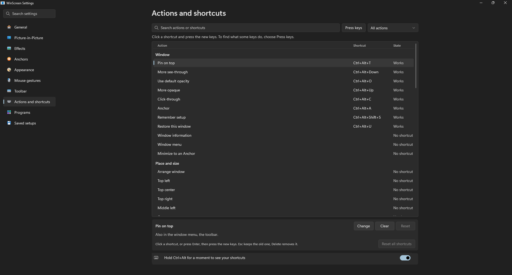

# WinScreen User Guide

[English](USER_GUIDE.md) · [简体中文](USER_GUIDE.zh-CN.md) · [繁體中文](USER_GUIDE.zh-TW.md) · [Back to README](../README.md)

## Getting started

After you install WinScreen, its icon sits in the system tray (look under the small arrow if you don't see it).

- **Click** the icon to open Settings.
- **Right-click** it for every command, including putting windows back and exiting. Menus stay open while you turn
  things on and off, so you can change several at once.
- **Hotkeys** work on the window you're using. The tray menu works on the window named under **Last window**.
- **Rest the pointer** on the middle of a window's title bar to show the toolbar. In **Settings → Toolbar** you can
  have it open from the minimize button instead, or from either.

Some features are marked *experimental*. Turn them on in **Settings → General → Experimental**.

## Shortcuts

You can change or clear any of these in **Settings → Actions and shortcuts**. Select an action, click its box and press the keys, or press Delete to clear it.

| Do this | Shortcut |
| --- | --- |
| Pin or unpin on top | Ctrl+Alt+T |
| More opaque / more see-through | Ctrl+Alt+Up / Down |
| Switch default see-through on or off | Ctrl+Alt+O |
| Click-through on or off | Ctrl+Alt+C |
| Open or close a live view | Ctrl+Alt+P |
| Add or remove an Anchor | Ctrl+Alt+A |
| Dark mode | Ctrl+Alt+D |
| Glass | Ctrl+Alt+G |
| Shrink to a live tile | Ctrl+Alt+W |
| Crop or uncrop | Ctrl+Alt+X |
| Remember or forget this program's setup | Ctrl+Alt+Shift+S |
| Put this window back | Ctrl+Alt+U |
| Put every window back | Ctrl+Alt+R |

Other commands, like moving a window to a corner, have no shortcut until you give them one. So do the view's own: Keep hidden, Interactive or Watch only, Use or go to the original, Mute, Freeze, Rotate or mirror, Reset crop and zoom, Minimize or restore, Copy picture, Freeze a copy, Copy text, Record and Cover parts. They work on the view of the window in front, or else on the view under the pointer, or the one it was last on; a minimized view comes back with its key.

## Pin and see-through

- **Ctrl+Alt+T** keeps a window above the others.
- **Ctrl+Alt+Up/Down** changes how solid it is. It never goes below 20%.
- **Ctrl+Alt+O** switches between solid and your default see-through level, set in Settings → Appearance.
- **Ctrl+Alt+C** lets clicks pass through the window to whatever is behind it. Press it again to turn it off.

If you can't reach a click-through window, press **Ctrl+Alt+R** to put every window back.

If another program takes "always on top" away from a pinned window, WinScreen pins it again. If an app changes its
own transparency, WinScreen lets go of the opacity and click-through it set, and tells you.

In **Settings → Appearance** you can change the opacity step, give pinned windows a colored border, and turn on
**Ctrl+Alt+wheel**, which changes the opacity of the window under the pointer.

## Picture-in-Picture views

Press **Ctrl+Alt+P** to open a small live view of the window you're using. Press it again to close it.
The window itself is hidden while its view is open, so the view keeps going even when other windows cover it.
To see the window again, turn off **Keep hidden** in the view's menu.
To show a whole display or part of the screen, right-click the tray icon and choose **New view**. For part of the
screen, choose **Region** and drag over the area.
To keep one, choose **Presets → Save this source** in its view's menu. It keeps the area and the view exactly as it is:
its size and place on the screen, crop and options. Open it again from **Saved sources** in the tray menu or in
**New view**.

| On a view | What happens |
| --- | --- |
| Drag | Move the view |
| Wheel | Resize the view |
| Ctrl+wheel | Zoom in; Ctrl+double-click to zoom out |
| Ctrl+drag | Crop to the part you want; Ctrl+double-click to remove the crop |
| Right-click | Open the view's menu, with **Go to it** under **Original window** |

Every view has a title bar above the picture, or below it near the top of the screen. Hover to show it; drag it to move the view. Its buttons minimize and close the view. Drag an edge or corner to resize; close to the window's own size it stops there, and the view shows the window exactly as it is. **Keep aspect ratio** in **Size and options** is on by default. The bar fades away after you leave. To keep it showing,
turn on **Always show title bar** in **Size and options**, or for every new view in **Settings → Picture-in-Picture**.

**Useful options in the view's menu**

- **Keep hidden:** on for every new view, unless you turn off **Hide the original window for new views** in Settings →
  Picture-in-Picture. It hides the original and removes it from the taskbar and Alt+Tab where supported. Turn it off to
  show the original; closing the view brings it back too.
  Some apps, such as browsers, stop drawing when they're fully covered. With Keep hidden off, WinScreen keeps them
  drawing: while nothing of the window shows, it's made invisible where it is, and it's back to normal as soon as
  part of it would show or you switch to it.
- **Mute the original:** silences the app's sound, and nothing else. For a browser it mutes the whole browser,
  so the item says **Mute the browser**. The sound comes back when you turn it off, restore the window, close the
  view or exit WinScreen. An app you had muted yourself stays muted.
- **Size and options:** frame limit, scaling, opacity, size, position lock and click-through, just for this view.
  For scaling, **Best** suits almost everything; **Pixelated** is for pixel art and **Soft** for video.
- **Presets:** save how a view looks (crop, size, place and options) under a name, and use it on any view later.
- **Freeze**, under **Picture:** the view keeps showing what it shows now while the window goes on changing. You can
  still move, resize, crop and zoom it, but not use the app through it. Choose it again to go back to live.
- **Rotate or mirror**, under **Picture:** turn the view a quarter at a time, or mirror it. You can still use the app
  through it: clicks, drags and typing land where you see them. The app's own menus stay upright, and **Upright**
  puts the view back. Saved with a preset.
- **Copy picture**, under **Picture:** copies what the view shows, cropped, zoomed and turned as it is, at the
  window's own sharpness. Like Windows' Snipping Tool, it also saves a file to your Screenshots folder; in
  **Settings → Picture-in-Picture** you can choose another folder, **Save only** or **Copy only**. It works the same whatever covers the
  view, at any opacity, and on views of a display or part of the screen, which screenshots can't take.
- **Freeze a copy:** keeps the picture in a small window of its own beside the view, while the view goes on. Move it,
  resize it with the wheel, Ctrl+drag to crop and Ctrl+wheel to zoom. Right-click it to copy or save the picture, copy
  its text, or close it (Esc).
- **Copy text:** drag over the text you want, or click to take all of it, and the words are copied. It reads the text in
  the picture, so it also works on video, games, remote desktops and pages that won't let you select. It uses Windows'
  own text recognition for your languages.
- **Record:** makes a video of what the view shows, at the view's frame rate unless Settings names another, cropped,
  zoomed and turned as it is, with covered parts black in every frame. A red dot on the view shows it's recording.
  Choose **Stop recording**, then click the note on the view to see the file. Minimizing or closing the view stops it
  and saves the video too. Like the Snipping Tool, it saves to Screen Recordings in your Videos folder; in **Settings
  → Picture-in-Picture** you can choose another folder and record the app's sound; while the view is muted, the
  recording is silent too. It works whatever covers the view, and on views of a display or part of the screen (without
  sound). On Windows 10, a view can't record while its original is hidden.
- **Cover parts:** drag over anything private, such as an email address or a chat, and it's blacked out in the view.
  Copies, frozen copies, the text reader and sharing the view in a call never show it. Covers stay through zoom, crop,
  turning, Freeze, Keep hidden, minimizing and everything else, and are saved with a preset. Click a cover in the
  same editor to remove it, or choose **Remove covers**.
- **Interactive** lets you point, click, select text, drag and scroll in the picture. Ready for Chrome, Edge, Brave,
  Vivaldi, Firefox, Electron apps and File Explorer; *experimental* for other apps.
  **Keep hidden** stays checked and locked while this is on. Turning it off restores your previous hiding choice.
  Drag the view's title bar to move it, or hold Alt and drag the picture.
  Menus open near the pointer. If the app asks you something, the original comes back so you can answer.
  Keys return to your previous window when you leave.
  When an app running as administrator is in front, the view can't follow the pointer until you click in it once.
  On Windows 11, the input method's list of choices and the emoji panel open next to where you type in the view.
  Store apps, such as Calculator, work too. They keep their taskbar button, and choosing it shows the app.
  On some newer controls, in Store apps and parts of File Explorer, you can click, right-click and scroll,
  but not hover, drag or select.
  By default, browser pointer shapes work, but hover effects and tooltips may not stay active.
  **Enhanced hover (experimental)** keeps hover effects showing while you use an app through a view. WinScreen turns it on for the apps it works well with: Chrome, Edge, Brave and Vivaldi; Firefox; and apps like VS Code and Discord. In **Settings → Picture-in-Picture → Using apps through a view**, turn off **Choose for me** to pick the apps yourself, including File Explorer and any program you add, and each view's menu can change it for that view. It needs a 64-bit Intel or AMD PC. See the [compatibility table](FEATURE_COMPATIBILITY.md) for what has been tested. Native tooltips may still be unavailable.
  With Enhanced hover on, a browser's own middle-click scrolling works in the view, and so does VS Code's or Discord's.
  Where it doesn't, enable **Middle-click scrolling** in this view (or for new views in **Settings → Picture-in-Picture**), middle-click, then move away from that point. Middle-click again, left-click or press Escape to stop. Leave it off to keep the app's normal middle-click actions.
  A few apps can't be hidden, such as PowerShell ISE, and WinScreen tells you.
- **Use it, then hide again** is for an app that doesn't work well through a view, such as a game.
  The original window comes back where it was, and hides again when you switch to another window.
  To have a click on the view do this every time, add the program under
  **Settings → Picture-in-Picture → Using apps through a view** and turn on **Show original** for it. Apps built with Java always work this way.
  If a click on a view doesn't get through, the view says so. Click that note to use the original instead.
  If it keeps happening with an app, the note offers to turn on **Show original** for it.
- **Drag something onto a view**, such as a file, a picture or some text, and the original window comes up under the
  pointer so you can drop it there. It hides again when you let go.
- **Drag a file out of a File Explorer view** onto another window, the desktop or another view. The view steps
  aside while you drag and comes back when you let go. A file can't be dropped back into the same view.
- **Drag a link out of a browser view** (Chrome, Edge, Brave, Vivaldi) onto another window, the desktop or another
  view, in the same way.

Views pause direct use while a WinScreen menu or the tray overflow panel is open.

When Windows can't hide the capture border, a hidden original uses standard mode. Showing it brings back your choice.

**In Settings → Picture-in-Picture** you can choose a hover preview (for small views only) or reading lens. Minimized views, and minimized windows that have a view, stay on the taskbar unless you turn that off there.

## Anchors

An Anchor is a small floating button for a window. Press **Ctrl+Alt+A** to add or remove one.

- **Click** brings the window back.
- **Right-click** opens a menu to show, minimize or close it.
- **Middle-click** asks the window to close.
- **Drag a file over it** to bring the window forward and drop the file there.
- **Rest the pointer** on it to see the window. Anchors of the same program show their window titles.

**Minimize to an Anchor** in the window menu gives a window an Anchor and minimizes it in one step.

In **Settings → Anchors**, WinScreen can add Anchors by itself for windows that are completely covered, and take them away
again when you can see the window. You can also choose where Anchors appear, how many, their size and style (dark, light, or just the icon), and whether
they move off text and pictures, and take windows with an Anchor you added off the taskbar. A small notch on an Anchor
means its window has a view. **Hide all Anchors** in the tray menu puts them away until you show them again.

Anchors show on every virtual desktop, and clicking one takes you to its window's desktop. To show each Anchor only on
its window's desktop, turn off **Show Anchors on every desktop** in **Settings → Anchors**.

## Arrange windows

The toolbar's **Arrange window** button has everything that moves a window:

- Nine places on the screen: corners, edges and center.
- Move to the next display.
- A common size, such as 1280 × 720.
- Type an exact position and size.
- Go back to the previous position.
- Send to the back, behind every other window.
- Roll up to the title bar *(experimental)*.

On a maximized window, a place or an exact position brings it back to its usual size there.

The toolbar's **Window menu** button has the rest of the window menu: the **Opacity** slider and whatever isn't already a
button on your toolbar, such as **Borderless**, **Fill display**, **Dark title bar**, **Copy** and **Open file location**.
Most of these can be buttons too: tick them in **Settings → Toolbar**.

Turn on **Settings → Mouse gestures → Move and resize** to hold Alt (or Win) and drag anywhere in a window: the left button
moves it, the right button resizes it. It works on maximized windows too, and Esc puts the window back. Drag a window to the
left or right edge of the screen to fill that half, to a corner for a quarter, or to the top to maximize it. Turn on **Window menu** there for a menu of commands on **Ctrl+right-click**.

The tray and window menus also have an **Opacity** slider, a grid of nine places to put the window (so their **Arrange window** lists only the other commands), **Borderless**, **Fill display** and **Dark title bar**. **Copy** and **Open file location** are under **More**.
Borderless and Fill display also work on apps that draw their own title bar, such as browsers. Dark title bar only
changes a title bar that Windows draws.

## Effects *(experimental)*

- **Dark mode** swaps light and dark. Windows that are already dark are left alone.
- **Glass** makes a window's background see-through.

A window has Dark mode or Glass, not both: turning one on turns the other off.
- **Crop** keeps just the part of a window you drag over. Clicks on the rest reach what's behind. Click a highlighted
  part instead of dragging, and the crop follows that part when the window is resized.
- **Shrink** turns a window into a small live tile. Click the tile to bring the window back. Dark mode or Glass is
  off while it's a tile and comes back with the window.

Dark mode swaps light and dark and keeps each color's hue, so pictures and video turn too. To keep one as it is, see
**Keep pictures and video solid** below. Glass fades the colors close to the page's own and keeps text readable. On a
PC without a graphics card, neither can keep areas as they are, and Glass makes one color see-through, where clicks go
through to what's behind. Dark mode's setting is in **Settings → Appearance**. Glass's settings are in **Settings →
Backgrounds**. On Windows 10, a yellow border shows around a window while these two are working. If a window under
Dark mode or Glass ever stops taking clicks, WinScreen turns the effect off and tells you.

### A picture or video behind Glass

In **Settings → Backgrounds**, choose pictures, GIFs or videos to show behind the text of windows with Glass, or
**Add a link** to one on the web. **Every app** sets the background and the Glass levels for all of them. Add an app to
give it its own, or to show none in it. The preview shows how it will fit, and you can drop a file onto it. To see
more of the picture, lower **Background** in Every app's card.

Add more than one and they take turns, **In order** or **Shuffle**. With **Switch** on **When a video ends**, each video
plays once and each picture stays for the minutes you choose; on **On a timer**, each stays for those minutes. Each has its own **Fit**, **Sound**, **Speed** and **Brightness**. If a file was moved or
deleted, Settings marks it **(not found)** and Glass shows the next one. It shows again by itself once it's back.

Videos play without sound until you turn **Sound** up, also with **Background sound** under **Effects** in the window's
menu; **Next background** there goes on to the next of several, and **Change background** opens these settings for its app. Only the window you used last plays sound, and only
while its app is in front. Videos pause while their window is minimized or on another desktop, behind a game or
full-screen app, and while Windows saves battery. Each of these can be turned off under **App backgrounds**.

### Keep pictures and video solid

Glass fades every color close to the page's own, so dark scenes on a dark page, or bright skies on a light one, fade
a little too. Two settings help:

- **Fade range** in Every app's card in **Settings → Backgrounds**: lower it and only colors very near the page's fade,
  so pictures and videos stay solid. Text edges look a little sharper. Raise it past 100% and colors further from the
  page fade too; at the top, all of them.
- **Keep areas as they are**, under **Effects** in a window's menu: drag over a video or picture, or click a
  highlighted part, and Glass and Dark mode leave it as it is. Click a marked area to remove it, and press Enter when
  you're done. An app can have up to eight, and they're kept for all its windows and follow them when you resize
  them. The list is at the bottom of **Settings → Backgrounds**, where you can remove an app's areas. Plain Glass
  keeps them too, on a PC with a graphics card.

### Text over a busy background

Glass keeps a soft shadow of the page's color around text, so it stays readable over what's behind. Two settings in
Every app's card in **Settings → Backgrounds** change that:

- **Text color**: **Light** or **Dark** turns the page the other way round when it needs to, as Dark mode does. You
  get light text with a dark shadow, or dark text with a light one. Pictures turn too, as in Dark mode, unless you
  keep their areas as they are.
- **Shadow behind text**: turn it off for text with no shadow.

### Glass for each app or window

Under **App backgrounds** in **Settings → Backgrounds**, add an app to give it its own background and its own Background, Text,
Fade range, text color and shadow. Both start as every app has them, and either can be turned off for that app.

To try things out on a window itself, choose **Glass and background** under **Effects** in its menu. Its levels are on the left
and its picture or video on the right: add or remove them, and set the fit, sound, speed, brightness, order and timing.
The changes show on that window at once and last until it closes; **Save for this app** keeps them for all its windows.

**Background** is how much of the page's own color covers the picture, and **Brightness** is how bright the picture itself
is. On a dark page both make the picture dimmer. On a light page, a higher Background makes it paler instead.

## Remember a program's setup

Set a window up the way you like it: pinned, see-through, dark, with a view open if you want one. Then press
**Ctrl+Alt+Shift+S**. From then on, that program's windows start the same way, even after a restart.
Press it again on a plain window to forget the setup, or remove it in **Settings → Saved setups**. Glass isn't part of a setup.

Choose **Change** there to keep a setup to windows whose title contains some text, to put the window in a place or on
a display, to make it borderless, give it an Anchor or keep the toolbar off it. For an app that draws its own title
bar, where the toolbar never shows, choose **Toolbar where the title bar usually is**. A setup can also apply every time the
window comes forward, or be turned off for now.

## Commands from scripts

`WinScreen.exe --run TogglePin --window title:Chat` asks WinScreen to do a command, as its hotkey would, on the window
you name: `active` (the default), `pointer`, or the first window whose title contains some text. WinScreen must be
running. `WinScreen.exe --list-commands` lists the commands. The exit code is 0 when it worked.

## Settings at a glance

Changes take effect as soon as you make them. The mouse wheel only scrolls; click or drag to change a setting.

| Page | What you'll find |
| --- | --- |
| General | Language, light or dark look, notifications, starting with Windows, running as administrator, updates, experimental features, and moving your settings to another PC |
| Picture-in-Picture | How views look and behave, and where pictures and recordings are saved |
| Backgrounds | How Glass looks, and a picture or video behind it, for every app or for each app |
| Anchors | Automatic Anchors and how Anchors look |
| Appearance | Opacity, pinned windows and Dark mode |
| Mouse gestures | Move and resize with a key, and the mouse menu |
| Toolbar | Where the toolbar appears, how quickly, and which buttons it shows |
| Actions and shortcuts | Everything WinScreen can do, with its shortcut. Select an action to change its shortcut |
| Programs | Programs WinScreen should leave alone, or the only ones it should work on |
| Saved setups | Program setups you've remembered |

## Putting things back

- **Ctrl+Alt+U**, or **Restore this window** in its menu, puts the window you're using back to normal.
- **Ctrl+Alt+R**, or **Restore all windows** in the tray menu, puts every window back.
- **Turn off click-through everywhere** and **Unpin all windows** in the tray menu undo just that, for every window. Turn off click-through everywhere also makes click-through views take clicks again.
- Closing WinScreen puts every window back too.
- If WinScreen stops unexpectedly, hidden windows come back within a couple of seconds, and the rest when it starts again.

If something didn't work, the tray menu's **Last result** shows what happened.

## Updates

In **Settings → General → New versions**, choose **Off** (the default: WinScreen never goes online for this), **Tell me
about them**, or **Install them for me**, which downloads a new version in the background and installs it when you
close WinScreen. Either of the last two only asks GitHub which version is newest, and sends nothing else. A portable
copy can't update itself: it tells you, and a click opens the new version's page. You can also choose **Check for
updates** from the tray menu, or **Check now** in **Settings → General**, at any time: a small window shows each step,
and when the new version is ready, **Restart now** installs it. To update by hand, close WinScreen and run the newer installer. Your
settings stay as they are.

After an update, WinScreen offers once to show what's new. **What's new** is also in the tray menu and at the end of
**Settings → General**.

## Reporting a problem

Choose **Save diagnostics** from the tray menu. WinScreen saves a small file and shows it in File Explorer; attach it to
a [new issue](https://github.com/DarkLian/WinScreen/issues). It holds WinScreen's own short log and your settings.
Programs appear only by file name, such as chrome.exe; window titles, file paths and anything you type are never in it.
Nothing leaves your PC unless you send it yourself.

## Good to know

- WinScreen runs on Windows 10 (version 2004 or later) and Windows 11, on 64-bit Intel or AMD PCs (x64). ARM PCs and
  32-bit Windows aren't supported.
- To change apps running as administrator, such as Task Manager, turn on **Run as administrator** in
  **Settings → General**. WinScreen keeps running as you and starts a small helper with those rights just for those apps
  (Windows may ask first). The helper starts again whenever WinScreen does, and closes with it.
- Commands pause while a game or full-screen app is in front.
- Minimizing a window that has a view hides it behind the view instead, so the view keeps updating. It stays on the
  taskbar and in Alt+Tab, so you bring it back as usual. A window that can't be hidden stops drawing when minimized, and its view shows the last picture.
- Views show on every virtual desktop and keep updating while you're on another one. To keep it updating, the view
  hides its window while you're away, and its menu says **Hidden while you're on another desktop**. On Windows 10
  and on Windows 11 24H2 and later, a window kept hidden by a view goes back to its own desktop when it's shown again.
- When **Transparency effects** is on in Windows' own Settings, WinScreen's menus get the same blurred background as Windows' own.
  To keep them plain, turn off **Transparency effects in menus** in **Settings → General**.
- In smooth mode Windows draws a yellow border around the window being shown. On Windows 11 WinScreen asks to leave it
  off; you can change that in **Settings → Picture-in-Picture**. Windows 10 always shows it, so choose standard mode there if
  it bothers you.

See [Limitations at a glance](FEATURE_COMPATIBILITY.md#limitations-at-a-glance) for what each feature can't do.
