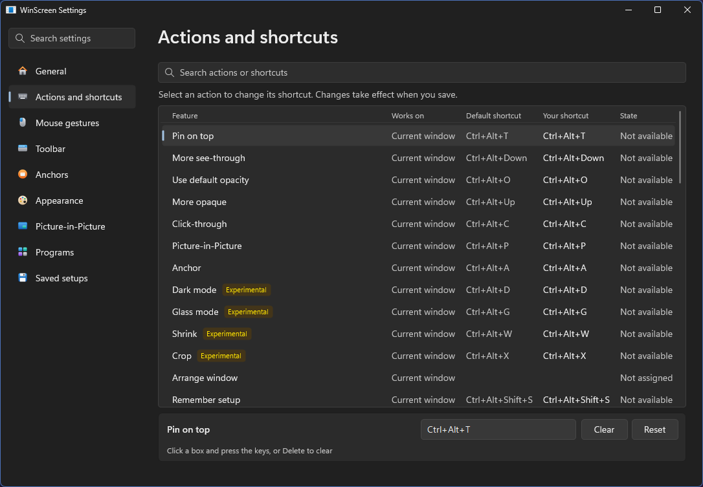

# WinScreen User Guide

[English](USER_GUIDE.md) · [简体中文](USER_GUIDE.zh-CN.md) · [繁體中文](USER_GUIDE.zh-TW.md) · [Back to README](../README.md)

## Getting started

After you install WinScreen, its icon sits in the system tray (look under the small arrow if you don't see it).

- **Click** the icon to open Settings.
- **Right-click** it for every command, including putting windows back and exiting. Menus stay open while you turn
  things on and off, so you can change several at once.
- **Hotkeys** work on the window you're using. The tray menu works on the window named under **Last window**.
- **Rest the pointer** on the middle of a window's title bar to show the toolbar.

Some features are marked *experimental*. Turn them on in **Settings → General → Experimental**.

## Shortcuts

You can change or clear any of these in **Settings → Actions and shortcuts**. Select an action, click its box and press the keys, or press Delete to clear it.

| Do this | Shortcut |
| --- | --- |
| Pin or unpin on top | Ctrl+Alt+T |
| More opaque / more see-through | Ctrl+Alt+Up / Down |
| Switch default see-through on or off | Ctrl+Alt+O |
| Click-through on or off | Ctrl+Alt+C |
| Open or close a live view | Ctrl+Alt+P |
| Add or remove an Anchor | Ctrl+Alt+A |
| Dark mode | Ctrl+Alt+D |
| Glass | Ctrl+Alt+G |
| Shrink to a live tile | Ctrl+Alt+W |
| Crop or uncrop | Ctrl+Alt+X |
| Remember or forget this program's setup | Ctrl+Alt+Shift+S |
| Put this window back | Ctrl+Alt+U |
| Put every window back | Ctrl+Alt+R |

Other commands, like moving a window to a corner, have no shortcut until you give them one.

## Pin and see-through

- **Ctrl+Alt+T** keeps a window above the others.
- **Ctrl+Alt+Up/Down** changes how solid it is. It never goes below 20%.
- **Ctrl+Alt+O** switches between solid and your default see-through level, set in Settings → Appearance.
- **Ctrl+Alt+C** lets clicks pass through the window to whatever is behind it. Press it again to turn it off.

If you can't reach a click-through window, press **Ctrl+Alt+R** to put every window back.

In **Settings → Appearance** you can change the opacity step, give pinned windows a colored border, and turn on
**Ctrl+Alt+wheel**, which changes the opacity of the window under the pointer.

## Picture-in-Picture views

Press **Ctrl+Alt+P** to open a small live view of the window you're using. Press it again to close it.
To show a whole display or part of the screen, right-click the tray icon and choose **New view**. For part of the
screen, choose **Region** and drag over the area.
You can save a display or area there and open it again later from **Picture-in-Picture views → Saved sources**.

| On a view | What happens |
| --- | --- |
| Drag | Move the view |
| Wheel | Resize the view |
| Ctrl+wheel | Zoom in; Ctrl+double-click to zoom out |
| Ctrl+drag | Crop to the part you want; Ctrl+double-click to remove the crop |
| Right-click | Open the view's menu, with **Go to it** under **Original window** |

Every view has a title bar above the picture, or below it near the top of the screen. Hover to show it; drag it to move the view. Its buttons minimize and close the view. Drag an edge or corner to resize. **Keep aspect ratio** in **Size and options** is on by default. The bar fades away after you leave. To keep it showing,
turn on **Always show title bar** in **Size and options**, or for every new view in **Settings → Picture-in-Picture**.

**Useful options in the view's menu**

- **Keep hidden:** some apps, such as browsers, stop drawing when they're covered. This hides the original
  so the view stays live. It also removes the original from the taskbar and Alt+Tab where supported. Showing the original or closing the view restores its entry.
- **Size and options:** frame limit, opacity, size, position lock and click-through, just for this view.
- **Presets:** save the crop, size and place under a name and use it again later.
- **Interactive (experimental)** lets you point, click, select text, drag and scroll in the picture.
  **Keep hidden** stays checked and locked while this is on. Turning it off restores your previous hiding choice.
  Drag the view's title bar to move it, or hold Alt and drag the picture.
  Menus open near the pointer. If the app asks you something, the original comes back so you can answer.
  Keys return to your previous window when you leave.
  Store apps, such as Calculator, work too. They keep their taskbar button, and choosing it shows the app.
  On some newer controls, in Store apps and parts of File Explorer, you can click, right-click and scroll,
  but not hover, drag or select.
  By default, browser pointer shapes work, but hover effects and tooltips may not stay active.
  **Enhanced hover (experimental)** keeps hover effects showing while you use an app through a view. WinScreen turns it on for the apps it works well with: Chrome, Edge, Brave and Vivaldi; Firefox; and apps like VS Code and Discord. In **Settings → Picture-in-Picture → Using apps through a view**, turn off **Choose for me** to pick the apps yourself, including File Explorer and any program you add, and each view's menu can change it for that view. It needs a 64-bit Intel or AMD PC. See the [compatibility table](FEATURE_COMPATIBILITY.md) for what has been tested. Native tooltips may still be unavailable.
  With Enhanced hover on, a browser's own middle-click scrolling works in the view, and so does VS Code's or Discord's.
  Where it doesn't, enable **Middle-click scrolling** in this view (or for new views in **Settings → Picture-in-Picture**), middle-click, then move away from that point. Middle-click again, left-click or press Escape to stop. Leave it off to keep the app's normal middle-click actions.
  A few apps can't be hidden, such as PowerShell ISE, and WinScreen tells you.
- **Use it, then hide again** is for an app that doesn't work well through a view, such as a game.
  The original window comes back where it was, and hides again when you switch to another window.
  To have a click on the view do this every time, add the program under
  **Settings → Picture-in-Picture → Using apps through a view** and turn on **Show original** for it. Apps built with Java always work this way.

Views pause direct use while a WinScreen menu or the tray overflow panel is open.

When Windows can't hide the capture border, a hidden original uses standard mode. Showing it brings back your choice.

**In Settings → Picture-in-Picture** you can choose a hover preview (for small views only) or reading lens, and keep minimized views on the taskbar.

## Anchors

An Anchor is a small floating button for a window. Press **Ctrl+Alt+A** to add or remove one.

- **Click** brings the window back.
- **Right-click** opens a menu to show, minimize or close it.
- **Middle-click** asks the window to close.
- **Drag a file over it** to bring the window forward and drop the file there.
- **Rest the pointer** on it to see the window. Anchors of the same program show their window titles.

In **Settings → Anchors**, WinScreen can add Anchors by itself for windows that are completely covered, and take them away
again when you can see the window. You can also choose where Anchors appear, how many, their size and style (dark, light, or just the icon), and whether
they move off text and pictures, and take windows with an Anchor you added off the taskbar. A small notch on an Anchor
means its window has a view. **Hide all Anchors** in the tray menu puts them away until you show them again.

## Arrange windows

The toolbar's **Arrange window** button has everything that moves a window:

- Nine places on the screen: corners, edges and center.
- Move to the next display.
- Type an exact position and size.
- Go back to the previous position.
- Send to the back, behind every other window.
- Roll up to the title bar *(experimental)*.

On a maximized window, a place or an exact position brings it back to its usual size there.

The toolbar's **Window menu** button has the rest of the window menu: whatever isn't already a button on your toolbar,
such as **Borderless**, **Fill display**, **Dark title bar**, **Copy** and **Open file location**.

Turn on **Settings → Mouse gestures → Move and resize** to hold Alt (or Win) and drag anywhere in a window: the left button
moves it, the right button resizes it. It works on maximized windows too, and Esc puts the window back. Drag a window to the
left or right edge of the screen to fill that half, to a corner for a quarter, or to the top to maximize it. Turn on **Window menu** there for a menu of commands on **Ctrl+right-click**.

The tray and window menus also have an **Opacity** slider, a grid of nine places to put the window (so their **Arrange window** lists only the other commands), **Borderless**, **Fill display** and **Dark title bar**. **Copy** and **Open file location** are under **More**.
Borderless and Fill display also work on apps that draw their own title bar, such as browsers. Dark title bar only
changes a title bar that Windows draws.

## Effects *(experimental)*

- **Dark mode** swaps light and dark. Windows that are already dark are left alone.
- **Glass** makes a window's background see-through.

A window has Dark mode or Glass, not both: turning one on turns the other off.
- **Crop** keeps just the part of a window you drag over. Clicks on the rest reach what's behind.
- **Shrink** turns a window into a small live tile. Click the tile to bring the window back.

In **Settings → Appearance** you can make Glass fade only the background while keeping text and pictures, and
make Dark mode leave pictures and video as they are. You can also choose how solid the background, text and pictures stay.
Windows shows a colored border around a window while these two options are working.

## Remember a program's setup

Set a window up the way you like it: pinned, see-through, dark, with a view open if you want one. Then press
**Ctrl+Alt+Shift+S**. From then on, that program's windows start the same way, even after a restart.
Press it again on a plain window to forget the setup, or remove it in **Settings → Saved setups**.

## Settings at a glance

Changes take effect as soon as you make them. The mouse wheel only scrolls; click or drag to change a setting.

| Page | What you'll find |
| --- | --- |
| General | Language, light or dark look, notifications, starting with Windows, running as administrator, updates, experimental features, and moving your settings to another PC |
| Actions and shortcuts | Everything WinScreen can do, with its shortcut. Select an action to change its shortcut |
| Mouse gestures | Move and resize with a key, and the mouse menu |
| Toolbar | Where the toolbar appears, how quickly, and which buttons it shows |
| Anchors | Automatic Anchors and how Anchors look |
| Appearance | Opacity, pin border and effects |
| Picture-in-Picture | How views look and behave |
| Programs | Programs WinScreen should leave alone, or the only ones it should work on |
| Saved setups | Program setups you've remembered |

## Putting things back

- **Ctrl+Alt+U** puts the window you're using back to normal.
- **Ctrl+Alt+R**, or **Restore all windows** in the tray menu, puts every window back.
- **Turn off click-through everywhere** and **Unpin all windows** in the tray menu undo just that, for every window.
- Closing WinScreen puts every window back too.
- If WinScreen stops unexpectedly, hidden windows come back within a couple of seconds, and the rest when it starts again.

If something didn't work, the tray menu's **Last result** shows what happened.

## Updates

Turn on automatic updates in **Settings → General**. WinScreen downloads new versions in the background and installs them
when you close it. You can also choose **Check for updates** from the tray menu at any time. To update by hand, close WinScreen and run
the newer installer. Your settings stay as they are.

## Reporting a problem

Choose **Save diagnostics** from the tray menu. WinScreen saves a small file and shows it in File Explorer; attach it to
a [new issue](https://github.com/DarkLian/WinScreen/issues). It holds WinScreen's own short log and your settings.
Programs appear only by file name, such as chrome.exe; window titles, file paths and anything you type are never in it.
Nothing leaves your PC unless you send it yourself.

## Good to know

- WinScreen runs on Windows 10 (version 2004 or later) and Windows 11, on 64-bit Intel or AMD PCs (x64). ARM PCs and
  32-bit Windows aren't supported.
- To change apps running as administrator, such as Task Manager, turn on **Run as administrator** in
  **Settings → General**. WinScreen restarts with those rights (Windows may ask first) and keeps them when it starts with
  Windows.
- Commands pause while a game or full-screen app is in front. Views can't appear over games in exclusive full screen.
- A minimized app stops drawing, so its view shows the last picture.
- Protected video may show as black in a view.
- When **Transparency effects** is on in Windows' own Settings, WinScreen's menus get the same blurred background as Windows' own.
  To keep them plain, turn off **Transparency effects in menus** in **Settings → General**.
- In smooth mode Windows draws a yellow border around the window being shown. On Windows 11 WinScreen asks to leave it
  off; you can change that in **Settings → Picture-in-Picture**. Windows 10 always shows it, so choose standard mode there if
  it bothers you.
- Views of a display or region, and Anchors that move off content, don't show up in your own screenshots or screen sharing.
- Results of Dark, Glass and Crop depend on how each app draws itself.

See [Limitations at a glance](FEATURE_COMPATIBILITY.md#limitations-at-a-glance) for the full list.
