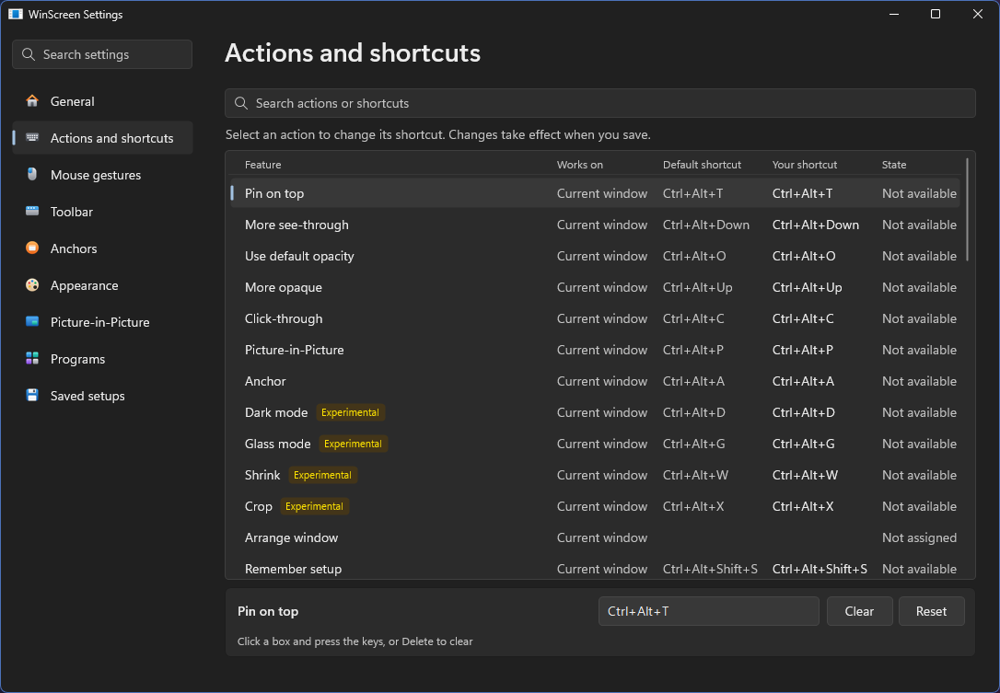

# WinScreen 用户指南

[English](USER_GUIDE.md) · [简体中文](USER_GUIDE.zh-CN.md) · [繁體中文](USER_GUIDE.zh-TW.md) · [返回 README](../README.zh-CN.md)

## 开始使用

安装 WinScreen 后，它的图标会出现在系统托盘中（如果看不到，请点一下小箭头）。

- **点击**图标打开设置。
- **右键点击**图标可使用所有命令，包括还原窗口和退出。开启或关闭选项时菜单会保持打开，方便一次更改多项。
- **快捷键**作用于你正在使用的窗口。托盘菜单作用于**上一个窗口**下显示的窗口。
- 把**指针停在**窗口标题栏中间即可显示工具栏。

部分功能标为*实验性*，可在 **设置 → 常规 → 实验性功能** 中开启。

## 快捷键

可在 **设置 → 操作与快捷键** 中修改或清除。选择一个操作，点击输入框后按下按键，按 Delete 可清除。

| 操作 | 快捷键 |
| --- | --- |
| 置顶或取消置顶 | Ctrl+Alt+T |
| 更不透明 / 更透明 | Ctrl+Alt+Up / Down |
| 开关默认透明度 | Ctrl+Alt+O |
| 开关鼠标穿透 | Ctrl+Alt+C |
| 打开或关闭实时视图 | Ctrl+Alt+P |
| 添加或移除锚点 | Ctrl+Alt+A |
| 深色模式 | Ctrl+Alt+D |
| 玻璃 | Ctrl+Alt+G |
| 缩小为实时小图块 | Ctrl+Alt+W |
| 裁剪或取消裁剪 | Ctrl+Alt+X |
| 记住或忘记此程序的配置 | Ctrl+Alt+Shift+S |
| 还原此窗口 | Ctrl+Alt+U |
| 还原所有窗口 | Ctrl+Alt+R |

其他命令（例如把窗口移到角落）默认没有快捷键，需要时可以自己设置。

## 置顶和透明

- **Ctrl+Alt+T** 让窗口保持在其他窗口之上。
- **Ctrl+Alt+Up/Down** 调整不透明度，最低 20%。
- **Ctrl+Alt+O** 在不透明和默认透明度之间切换，默认值在 设置 → 外观 中设置。
- **Ctrl+Alt+C** 让点击穿过窗口，到达后面的内容。再按一次即可关闭。

如果无法点到鼠标穿透的窗口，按 **Ctrl+Alt+R** 还原所有窗口即可。

在 **设置 → 外观** 中，可以修改透明度步长、为置顶窗口加上彩色边框，并开启 **Ctrl+Alt+滚轮**
来调整指针下窗口的不透明度。

## 画中画视图

按 **Ctrl+Alt+P** 为正在使用的窗口打开一个小的实时视图，再按一次即可关闭。
如需显示整个显示器或屏幕的一部分，请右键点击托盘图标，选择 **新建视图**。如需屏幕的一部分，请选择 **区域**，然后拖动选出该区域。
你可以在那里保存显示器或区域，以后从 **画中画视图 → 已保存的来源** 再次打开。

| 在视图上 | 效果 |
| --- | --- |
| 拖动 | 移动视图 |
| 滚轮 | 调整视图大小 |
| Ctrl+滚轮 | 放大；Ctrl+双击还原 |
| Ctrl+拖动 | 裁剪到需要的部分；Ctrl+双击取消裁剪 |
| 右键点击 | 打开视图菜单，其中有 **转到原窗口** |

每个视图都有标题栏，位于画面上方；靠近屏幕顶端时则位于下方。移入指针可显示，拖动可移动视图，也可最小化或关闭视图。指针离开后会淡出。 拖动边缘或角落可调整大小。**大小和选项** 中的 **保持宽高比** 默认开启。要让标题栏一直显示，请在 **大小和选项** 中开启 **始终显示标题栏**，或在 **设置 → 画中画** 中为所有新视图开启。

**视图菜单中的常用选项**

- **保持隐藏：** 浏览器等应用被挡住时会停止绘制。开启后会隐藏原窗口，让视图保持实时。 支持时也会从任务栏与 Alt+Tab 隐藏原窗口，显示原窗口或关闭视图后即恢复。
- **大小和选项：** 仅针对此视图设置帧率上限、不透明度、大小、锁定位置和鼠标穿透。
- **预设：** 把裁剪、大小和位置保存起来，以后再用。
- **交互（实验性）** 可直接指向、点击、选取文字、拖动和滚动，原窗口保持隐藏。
  开启时会勾选并锁定 **保持隐藏**；关闭后会恢复之前的隐藏选择。
  拖动视图标题栏可移动视图，也可按住 Alt 拖动画面。菜单会在指针附近打开。
  应用提问时会显示原窗口。指针离开后，按键会回到之前使用的窗口。
  计算器等商店应用也可以直接使用。它们会保留任务栏按钮，点击按钮会显示应用。
  在部分新式控件上（商店应用和文件资源管理器的部分区域），可以点击、右键单击和滚动，但不能悬停、拖动或选取。
  默认情况下，浏览器的指针形状可正常显示，但悬停效果和工具提示可能无法持续。
  **增强悬停（实验性）** 可在通过视图使用应用时保持悬停效果，WinScreen 会为效果好的应用开启：Chrome、Edge、Brave 和 Vivaldi，Firefox，以及 VS Code、Discord 等类似应用。也可在**设置 → 画中画 → 通过视图使用应用**中关闭**由 WinScreen 选择**，自己选择应用，包括文件资源管理器和你添加的其他程序；每个视图的菜单仍可单独更改。需要 64 位 Intel 或 AMD 电脑。已测试的应用见[兼容性表](FEATURE_COMPATIBILITY.md)。原生工具提示仍可能无法使用。
  开启增强悬停后，浏览器以及 VS Code、Discord 等应用自带的中键滚动可在视图中使用。
  其他情况下，可在此视图开启 **中键滚动**（也可在 **设置 → 画中画** 中为新视图开启），按下中键后将指针移离该点。再按中键、左键或 Escape 即可停止。关闭此选项可保留应用原本的中键动作。
  少数应用无法隐藏（例如 PowerShell ISE），WinScreen 会告诉你。
- **使用后再隐藏** 适用于无法通过视图正常操作的应用，例如游戏。
  原窗口会回到原来的位置，切换到别的窗口后再次隐藏。
  如果想每次点击视图都这样做，请在**设置 → 画中画 → 通过视图使用应用**中添加该程序，并为它开启**显示原窗口**。使用 Java 开发的应用总是这样。

WinScreen 菜单或托盘溢出面板打开时，视图会暂停直接操作。

Windows 无法隐藏捕获边框时，隐藏的原窗口会改用标准模式。显示原窗口后会恢复你的选择。

在 **设置 → 画中画** 中可以选择悬停预览或阅读放大镜，也可以把最小化的视图保留在任务栏上。

完整预览仅在视图小于所显示原画面的一半大小时出现；放大镜不受此限制。

## 锚点

锚点是窗口的小悬浮按钮。按 **Ctrl+Alt+A** 添加或移除。

- **点击**：把窗口带回前台。
- **右键点击**：打开菜单，可显示、最小化或关闭窗口。
- **中键点击**：请求关闭窗口。
- **把文件拖到锚点上**：把窗口带到前台，方便放下文件。
- **把指针停在锚点上**：查看该窗口。同一程序的锚点会显示窗口标题。

在 **设置 → 锚点** 中，WinScreen 可以为被完全挡住的窗口自动添加锚点，能看到窗口时再自动移除。
你还可以选择锚点出现的位置、数量、大小和样式（深色、浅色或只显示图标）、是否避开文字和图片，以及是否将你添加了锚点的窗口从任务栏移除。锚点上的小缺口表示该窗口有视图。
托盘菜单中的 **隐藏所有浮动锚点** 会把锚点收起，直到你再次显示它们。

## 排列窗口

工具栏的 **排列窗口** 按钮包含所有移动窗口的命令：

- 屏幕上的九个位置：角落、边缘和中央。
- 移到下一个显示器。
- 输入精确的位置和大小。
- 回到之前的位置。
- 移到最底层，放在所有窗口后面。
- 收起到标题栏 *（实验性）*。

对最大化的窗口选择位置或输入精确位置时，窗口会以原来的大小放到那里。

工具栏的 **窗口菜单** 按钮包含窗口菜单的其余部分：工具栏上还没有按钮的命令，例如 **无边框**、**填满显示器**、
**深色标题栏**、**复制** 和 **打开文件位置**。

开启 **设置 → 鼠标手势 → 移动和调整大小** 后，按住 Alt（或 Win）拖动窗口任意处：左键移动，右键调整大小。最大化的窗口也可以，按 Esc 可还原。拖到屏幕左右边缘会占满那一半，拖到角落占四分之一，拖到顶部则最大化。
在同一页开启 **窗口菜单**，即可用 **Ctrl+右键点击** 打开命令菜单。

托盘和窗口菜单中还有 **不透明度** 滑块、九个摆放位置的网格（因此其中的 **排列窗口** 只列出其他命令）、**无边框**、**填满显示器** 和 **深色标题栏**。**复制** 和 **打开文件位置** 在 **更多** 中。
无边框和填满显示器也适用于自己绘制标题栏的应用，例如浏览器。深色标题栏只会更改由 Windows 绘制的标题栏。

## 效果 *（实验性）*

- **深色模式**：交换明暗。已经是深色的窗口会保持原样。
- **玻璃**：让窗口背景变透明。

一个窗口只能使用深色模式或玻璃其中之一：开启一个会关闭另一个。
- **裁剪**：只保留你拖动选中的部分，点击其余部分会到达后面的内容。
- **缩小**：把窗口变成实时小图块，点击小图块即可还原。

在 **设置 → 外观** 中，可以让玻璃只淡化背景并保留文字和图片，也可以让深色模式不改变图片和视频，
还能设置背景、文字和图片各自保留多少不透明度。这两个选项工作时，Windows 会在窗口周围显示彩色边框。

## 记住程序的配置

按喜欢的方式设置窗口：置顶、透明、深色，需要的话再打开视图，然后按 **Ctrl+Alt+Shift+S**。
此后该程序的窗口都会这样启动，重启后也一样。在没有更改的窗口上再按一次可忘记配置，
也可以在 **设置 → 已保存的配置** 中移除。

## 设置一览

更改会立即生效。鼠标滚轮只用于滚动；点击或拖动才会更改设置。

| 页面 | 内容 |
| --- | --- |
| 常规 | 语言、浅色或深色外观、通知、开机启动、以管理员身份运行、更新、实验性功能，以及把设置带到另一台电脑 |
| 操作与快捷键 | WinScreen 的所有功能及其快捷键。选择一个操作即可更改快捷键 |
| 鼠标手势 | 按键移动和调整大小，以及鼠标菜单 |
| 工具栏 | 工具栏出现的位置、速度和按钮 |
| 锚点 | 自动锚点和锚点外观 |
| 外观 | 透明度、置顶边框和效果 |
| 画中画 | 视图的外观和行为 |
| 程序 | WinScreen 应忽略的程序，或只操作的程序 |
| 已保存的配置 | 已记住的程序配置 |

## 还原窗口

- **Ctrl+Alt+U** 把正在使用的窗口恢复正常。
- **Ctrl+Alt+R**，或托盘菜单中的 **还原所有窗口**，把所有窗口恢复原样。
- 托盘菜单中的 **在所有窗口关闭鼠标穿透** 和 **取消所有窗口置顶** 只撤销这一项，对所有窗口生效。
- 关闭 WinScreen 也会还原所有窗口。
- 如果 WinScreen 意外停止，隐藏的窗口会在几秒内恢复，其余窗口会在下次启动时恢复。

如果操作没有成功，托盘菜单中的 **最近结果** 会说明原因。

## 更新

在 **设置 → 常规** 中开启自动更新后，WinScreen 会在后台下载新版本，并在关闭时安装。
也可以在托盘菜单中选择 **检查更新**。手动更新时，先关闭 WinScreen，再运行新版安装程序。你的设置会保留。

## 小提示

- WinScreen 支持 64 位 Intel 或 AMD 电脑（x64）上的 Windows 10（2004 版或更高版本）和 Windows 11。不支持 ARM 电脑和 32 位 Windows。
- 要更改以管理员身份运行的应用（例如任务管理器），请在 **设置 → 常规** 中开启 **以管理员身份运行**。
  WinScreen 会以这些权限重新启动（Windows 可能会先询问你），随 Windows 启动时也会保留这些权限。
- 游戏或全屏应用在前台时，命令会暂停。视图无法显示在独占全屏的游戏上方。
- 最小化的应用会停止绘制，因此视图会显示最后的画面。
- 受保护的视频在视图中可能显示为黑色。
- 在 Windows 自己的设置中开启 **透明效果** 后，WinScreen 的菜单也会像 Windows 自己的菜单一样带有模糊背景。如不需要，请在**设置 → 常规**中关闭**菜单透明效果**。
- 在“流畅”模式下，Windows 会在被显示的窗口周围画一圈黄色边框。在 Windows 11 上 WinScreen 会请求隐藏它，可在
  **设置 → 画中画** 中更改。Windows 10 总会显示这圈边框，介意的话可在那里改用“标准”模式。
- 显示器或区域视图，以及会避开内容的锚点，不会出现在你自己的截图或屏幕共享中。
- 深色、玻璃和裁剪的效果取决于每个应用的绘制方式。

完整列表见[功能兼容性中的限制一览](FEATURE_COMPATIBILITY.md#limitations-at-a-glance)。
