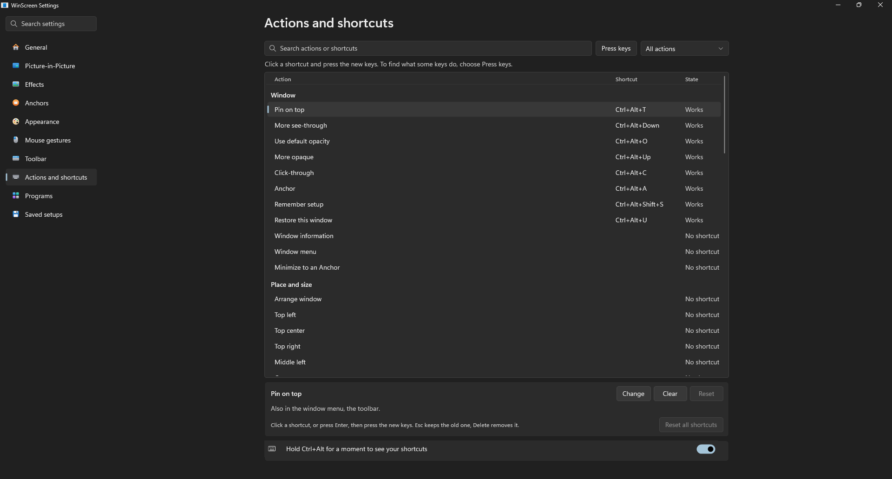
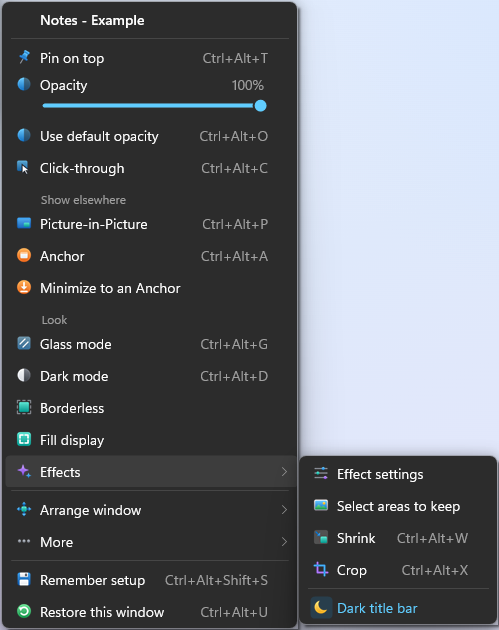

# WinScreen 用户指南

[English](USER_GUIDE.md) · [简体中文](USER_GUIDE.zh-CN.md) · [繁體中文](USER_GUIDE.zh-TW.md) · [返回 README](../README.zh-CN.md)

## 开始使用

安装 WinScreen 后，它的图标会出现在系统托盘中（如果看不到，请点一下小箭头）。

- **点击**图标打开设置。
- **右键点击**图标可使用所有命令，包括还原窗口和退出。开启或关闭选项时菜单会保持打开，方便一次更改多项。
- **快捷键**作用于你正在使用的窗口。托盘菜单作用于**上一个窗口**下显示的窗口。
- 把**指针停在**窗口标题栏中间即可显示工具栏。也可以在 **设置 → 工具栏** 中改为停在最小化按钮上，或两者都可以。

部分功能标为*实验性*，可在 **设置 → 常规 → 实验性功能** 中开启。

## 快捷键

可在 **设置 → 操作与快捷键** 中修改或清除。选择一个操作，点击输入框后按下按键，按 Delete 可清除。

| 操作 | 快捷键 |
| --- | --- |
| 置顶或取消置顶 | Ctrl+Alt+T |
| 更不透明 / 更透明 | Ctrl+Alt+Up / Down |
| 开关默认透明度 | Ctrl+Alt+O |
| 开关鼠标穿透 | Ctrl+Alt+C |
| 打开或关闭实时视图 | Ctrl+Alt+P |
| 添加或移除锚点 | Ctrl+Alt+A |
| 深色模式 | Ctrl+Alt+D |
| 玻璃 | Ctrl+Alt+G |
| 缩小为实时小图块 | Ctrl+Alt+W |
| 裁剪或取消裁剪 | Ctrl+Alt+X |
| 记住或忘记此程序的配置 | Ctrl+Alt+Shift+S |
| 还原此窗口 | Ctrl+Alt+U |
| 还原所有窗口 | Ctrl+Alt+R |

其他命令（例如把窗口移到角落）默认没有快捷键，需要时可以自己设置。视图自己的命令也一样：保持隐藏、交互或仅观看、使用或转到原窗口、静音、冻结、旋转或翻转、重置裁剪和缩放、最小化或还原、复制画面、冻结一份副本、复制文字、录制和遮盖部分。它们作用于前台窗口的视图，否则作用于指针下方的视图，或指针最后停留过的视图；最小化的视图按它的快捷键即可还原。

## 置顶和透明

- **Ctrl+Alt+T** 让窗口保持在其他窗口之上。
- **Ctrl+Alt+Up/Down** 调整不透明度，最低 20%。
- **Ctrl+Alt+O** 在不透明和默认透明度之间切换，默认值在 设置 → 外观 中设置。
- **Ctrl+Alt+C** 让点击穿过窗口，到达后面的内容。再按一次即可关闭。

如果无法点到鼠标穿透的窗口，按 **Ctrl+Alt+R** 还原所有窗口即可。

如果另一个程序取消了置顶窗口的“总在最前”，WinScreen 会重新置顶。如果应用自行更改了透明效果，WinScreen 会放弃它设置的透明度和鼠标穿透，并告诉你。

在 **设置 → 外观** 中，可以修改透明度步长、为置顶窗口加上彩色边框，并开启 **Ctrl+Alt+滚轮**
来调整指针下窗口的不透明度。

## 画中画视图

按 **Ctrl+Alt+P** 为正在使用的窗口打开一个小的实时视图，再按一次即可关闭。
视图打开期间原窗口会隐藏，这样即使被其他窗口挡住，视图也会继续更新。在视图菜单中关闭 **保持隐藏** 即可再次显示原窗口。
如需显示整个显示器或屏幕的一部分，请右键点击托盘图标，选择 **新建视图**。如需屏幕的一部分，请选择 **区域**，然后拖动选出该区域。
要保留它，请在视图菜单中选择 **预设 → 保存此来源**。它会记住该区域，以及视图的当前状态：屏幕上的大小和位置、裁剪和选项。以后可从托盘菜单或 **新建视图** 中的 **已保存的来源** 再次打开。

| 在视图上 | 效果 |
| --- | --- |
| 拖动 | 移动视图 |
| 滚轮 | 调整视图大小 |
| Ctrl+滚轮 | 放大；Ctrl+双击还原 |
| Ctrl+拖动 | 裁剪到需要的部分；Ctrl+双击取消裁剪 |
| 右键点击 | 打开视图菜单，其中有 **转到原窗口** |

每个视图都有标题栏，位于画面上方；靠近屏幕顶端时则位于下方。移入指针可显示，拖动可移动视图，也可最小化或关闭视图。拖动边缘或角落可调整大小；接近窗口本身的大小时会停在那里，视图与窗口完全一样。**大小和选项** 中的 **保持宽高比** 默认开启。指针离开后标题栏会淡出。要让标题栏一直显示，请在 **大小和选项** 中开启 **始终显示标题栏**，或在 **设置 → 画中画** 中为所有新视图开启。

**视图菜单中的常用选项**

- **保持隐藏：** 新视图默认开启，除非在 **设置 → 画中画** 中关闭 **为新视图隐藏原窗口**。它会隐藏原窗口，支持时也会从任务栏与 Alt+Tab 隐藏原窗口。关闭此项即可显示原窗口，关闭视图后也会恢复。
  浏览器等应用被完全挡住时会停止绘制。关闭保持隐藏时，WinScreen 仍会让它们继续绘制：窗口完全看不到时，它会在原处变为不可见；一旦有部分会露出来或你切换到它，它就会恢复正常。
- **将原程序静音：** 只让该应用不出声，其他不变。浏览器会整个静音，所以菜单项写作 **将整个浏览器静音**。关闭此项、还原窗口、关闭视图或退出 WinScreen 后，声音都会恢复。你自己先静音的应用会保持静音。
- **大小和选项：** 仅针对此视图设置帧率上限、缩放、不透明度、大小、锁定位置和鼠标穿透。
  缩放选 **最佳** 适合几乎所有情况；**像素化** 适合像素画，**柔和** 适合视频。
- **预设：** 把视图的外观（裁剪、大小、位置和选项）以名称保存起来，以后可用于任何视图。
- **画面** 下的 **冻结：** 视图会一直显示现在的画面，窗口本身照常变化。仍然可以移动、调整大小、裁剪和缩放，但不能通过它使用应用。
  再选一次即可恢复实时画面。
- **画面** 下的 **旋转或翻转：** 每次把视图旋转 90 度，或水平、垂直翻转。仍然可以通过它使用应用：点击、拖动和输入都会落在你看到的位置。
  应用自己的菜单保持正向，**恢复原方向** 可让视图回到原样。会随预设一起保存。
- **画面** 下的 **复制画面：** 复制视图显示的内容，保留当前的裁剪、缩放和旋转，清晰度与原窗口相同。和 Windows 截图工具一样，它还会把文件保存到“屏幕截图”文件夹；可在 **设置 → 画中画** 中选择其他文件夹，或只复制。无论视图上盖着什么、不透明度是多少都一样有效，显示器或屏幕区域的视图也可以（普通截图拍不到这些视图）。
- **冻结一份副本：** 把画面保存在视图旁边的小窗口中，视图本身继续更新。可以移动它，用滚轮调整大小，按住 Ctrl 拖动裁剪，按住 Ctrl 滚动滚轮缩放。右键点击它可复制或保存画面、复制其中的文字或关闭它（Esc）。
- **复制文字：** 拖动选择需要的文字，或点击以获取全部文字，文字就会被复制。它识别的是画面中的文字，所以视频、游戏、远程桌面和不能选取文字的网页也可以。它使用 Windows 自带的、适用于你的语言的文字识别。
- **录制：** 把视图显示的内容按视图的帧率录成视频，保留当前的裁剪、缩放和旋转，遮盖的部分在每一帧里都是黑的。视图上的红点表示正在录制。选择 **停止录制**，再点击视图上的提示即可查看文件。最小化或关闭视图也会停止录制并保存视频。和截图工具一样，它保存到“视频”文件夹中的“屏幕录制”；可在 **设置 → 画中画** 中选择其他文件夹，并选择录制应用的声音；视图静音时，录制也没有声音。无论视图上盖着什么都一样有效，显示器或屏幕区域的视图也可以录制（没有声音）。在 Windows 10 上，原窗口隐藏时视图无法录制。
- **遮盖部分：** 拖动选择任何隐私内容（例如电子邮件地址或聊天），它在视图中就会被涂黑。复制、冻结的副本、文字识别以及在通话中共享此视图都不会显示它。缩放、裁剪、旋转、冻结、保持隐藏、最小化等任何操作后遮盖都会保留，并会随预设一起保存。在同一编辑器中点击遮盖可将其移除，或选择 **移除遮盖**。
- **交互** 可直接指向、点击、选取文字、拖动和滚动。Chrome、Edge、Brave、Vivaldi、Firefox、Electron 应用和文件资源管理器 可直接使用，其他应用为*实验性*。
  开启时会勾选并锁定 **保持隐藏**；关闭后会恢复之前的隐藏选择。
  拖动视图标题栏可移动视图，也可按住 Alt 拖动画面。菜单会在指针附近打开。
  应用提问时会显示原窗口。指针离开后，按键会回到之前使用的窗口。
  以管理员身份运行的应用在前台时，视图要等你在其中点击一次后才能跟随指针。
  在 Windows 11 上，输入法的候选字列表和表情符号面板会在视图中你输入的位置旁打开。
  计算器等商店应用也可以直接使用。它们会保留任务栏按钮，点击按钮会显示应用。
  在部分新式控件上（商店应用和文件资源管理器的部分区域），可以点击、右键单击和滚动，但不能悬停、拖动或选取。
  默认情况下，浏览器的指针形状可正常显示，但悬停效果和工具提示可能无法持续。
  **增强悬停（实验性）** 可在通过视图使用应用时保持悬停效果，WinScreen 会为效果好的应用开启：Chrome、Edge、Brave 和 Vivaldi，Firefox，以及 VS Code、Discord 等类似应用。也可在**设置 → 画中画 → 通过视图使用应用**中关闭**由 WinScreen 选择**，自己选择应用，包括文件资源管理器和你添加的其他程序；每个视图的菜单仍可单独更改。需要 64 位 Intel 或 AMD 电脑。已测试的应用见[兼容性表](FEATURE_COMPATIBILITY.md)。原生工具提示仍可能无法使用。
  开启增强悬停后，浏览器以及 VS Code、Discord 等应用自带的中键滚动可在视图中使用。
  其他情况下，可在此视图开启 **中键滚动**（也可在 **设置 → 画中画** 中为新视图开启），按下中键后将指针移离该点。再按中键、左键或 Escape 即可停止。关闭此选项可保留应用原本的中键动作。
  少数应用无法隐藏（例如 PowerShell ISE），WinScreen 会告诉你。
- **使用后再隐藏** 适用于无法通过视图正常操作的应用，例如游戏。
  原窗口会回到原来的位置，切换到别的窗口后再次隐藏。
  如果想每次点击视图都这样做，请在**设置 → 画中画 → 通过视图使用应用**中添加该程序，并为它开启**显示原窗口**。使用 Java 开发的应用总是这样。
  如果在视图上的点击没有传到应用，视图会显示提示。点击提示即可改用原窗口。
  如果某个应用经常这样，提示会让你为它开启**显示原窗口**。
- **把东西拖到视图上**（文件、图片或文字），原窗口会出现在指针下，方便你放下。松开后它会再次隐藏。
- **从文件资源管理器的视图里拖出文件**，拖到另一个窗口、桌面或另一个视图上。拖动时视图会让到一旁，松开后再回来。文件不能拖回同一个视图里。
- **从浏览器的视图里拖出链接**（Chrome、Edge、Brave、Vivaldi），拖到另一个窗口、桌面或另一个视图上，方式相同。

WinScreen 菜单或托盘溢出面板打开时，视图会暂停直接操作。

Windows 无法隐藏捕获边框时，隐藏的原窗口会改用标准模式。显示原窗口后会恢复你的选择。

在 **设置 → 画中画** 中可以选择悬停预览（仅适用于较小的视图）或阅读放大镜，最小化的视图和有视图的最小化窗口默认保留在任务栏上，也可在此关闭。

## 锚点

锚点是窗口的小悬浮按钮。按 **Ctrl+Alt+A** 添加或移除。

- **点击**：把窗口带回前台。
- **右键点击**：打开菜单，可显示、最小化或关闭窗口。
- **中键点击**：请求关闭窗口。
- **把文件拖到锚点上**：把窗口带到前台，方便放下文件。
- **把指针停在锚点上**：查看该窗口。同一程序的锚点会显示窗口标题。

窗口菜单中的 **最小化为浮动锚点** 会为窗口添加锚点并将其最小化，一步完成。

在 **设置 → 锚点** 中，WinScreen 可以为被完全挡住的窗口自动添加锚点，能看到窗口时再自动移除。
你还可以选择锚点出现的位置、数量、大小和样式（深色、浅色或只显示图标）、是否避开文字和图片，以及是否将你添加了锚点的窗口从任务栏移除。锚点上的小缺口表示该窗口有视图。
托盘菜单中的 **隐藏所有浮动锚点** 会把锚点收起，直到你再次显示它们。

锚点会显示在所有虚拟桌面上，点击锚点会切换到其窗口所在的桌面。若要每个锚点只在其窗口所在的桌面上显示，请在 **设置 → 锚点** 中关闭 **在所有桌面上显示锚点**。

## 排列窗口

工具栏的 **排列窗口** 按钮包含所有移动窗口的命令：

- 屏幕上的九个位置：角落、边缘和中央。
- 移到下一个显示器。
- 常用大小，例如 1280 × 720。
- 输入精确的位置和大小。
- 回到之前的位置。
- 移到最底层，放在所有窗口后面。
- 收起到标题栏 *（实验性）*。

对最大化的窗口选择位置或输入精确位置时，窗口会以原来的大小放到那里。

工具栏的 **窗口菜单** 按钮包含窗口菜单的其余部分：工具栏上还没有按钮的命令，例如 **无边框**、**填满显示器**、
**深色标题栏**、**复制** 和 **打开文件位置**。

开启 **设置 → 鼠标手势 → 移动和调整大小** 后，按住 Alt（或 Win）拖动窗口任意处：左键移动，右键调整大小。最大化的窗口也可以，按 Esc 可还原。拖到屏幕左右边缘会占满那一半，拖到角落占四分之一，拖到顶部则最大化。
在同一页开启 **窗口菜单**，即可用 **Ctrl+右键点击** 打开命令菜单。

托盘和窗口菜单中还有 **不透明度** 滑块、九个摆放位置的网格（因此其中的 **排列窗口** 只列出其他命令）、**无边框**、**填满显示器** 和 **深色标题栏**。**复制** 和 **打开文件位置** 在 **更多** 中。
无边框和填满显示器也适用于自己绘制标题栏的应用，例如浏览器。深色标题栏只会更改由 Windows 绘制的标题栏。

## 效果 *（实验性）*

- **深色模式**：交换明暗。已经是深色的窗口会保持原样。
- **玻璃**：让窗口背景变透明。

一个窗口只能使用深色模式或玻璃其中之一：开启一个会关闭另一个。
- **裁剪**：只保留你拖动选中的部分，点击其余部分会到达后面的内容。不拖动而是点击高亮的部分时，调整窗口大小后裁剪会跟着这个部分。
- **缩小**：把窗口变成实时小图块，点击小图块即可还原。变成小图块时会暂时关闭深色模式或玻璃，窗口还原后会一并恢复。

深色模式会对调深浅，并保留每种颜色的色调，所以图片和视频也会跟着变。想让某处保持原样，请看下面的 **让图片和视频保持不透明**。玻璃会淡化接近页面颜色的颜色，并让文字保持清晰。没有显卡的电脑上，两者都无法让区域保持原样，玻璃则让一种颜色变透明，点击该处会到达后面的内容。
深色模式的选项在 **设置 → 外观** 中；玻璃的选项在 **设置 → 背景** 中。在 Windows 10 上，这两项工作时窗口周围会显示黄色边框。如果深色模式或玻璃下的窗口不再响应点击，WinScreen 会关闭该效果并告诉你。

### 玻璃后面的图片或视频

在 **设置 → 背景** 中，可以选择一张图片、GIF 或视频，显示在开启玻璃的窗口的文字后面。
**所有应用** 为全部应用设置一个背景。添加某个应用，可以给它单独的背景，或让它不显示背景。预览会显示背景的摆放效果，
也可以把文件拖到预览上。想看到更多图片，可调低同一页面顶部的 **背景**。

视频默认静音，调高 **声音** 后才会播放声音。只有你最后使用的窗口会播放声音；窗口最小化或位于其他桌面时，视频会暂停。

### 让图片和视频保持不透明

玻璃会淡化所有接近页面颜色的颜色，所以深色页面上的暗场景、浅色页面上的明亮天空也会被淡化一些。有两个设置可以帮忙：

- **设置 → 背景** 顶部的 **淡化范围**：调低后，只有非常接近页面颜色的颜色才会淡化，图片和视频会保持不透明，文字边缘也会稍显锐利。
- 窗口菜单 **效果** 中的 **让区域保持原样**：拖动选择视频或图片，或点击高亮的部分，玻璃和深色模式就不会改变它。点击已标记的区域可将其移除，
  完成后按 Enter。每个应用最多可以有八个区域，会用于它的所有窗口，调整窗口大小时也会跟着移动。列表在 **设置 → 背景** 的底部，
  可以在那里移除某个应用的区域。在有显卡的电脑上，普通玻璃也会保留这些区域。

### 动态背景上的文字

玻璃会在文字周围保留一层页面颜色的柔和阴影，让文字在后面的内容上也能看清。**设置 → 背景** 的 **玻璃** 卡片中有两个设置可以改变它：

- **文字颜色**：选 **浅色** 或 **深色** 时，页面会在需要时像深色模式一样反转，得到带深色阴影的浅色文字，或带浅色阴影的深色文字。
  图片也会像深色模式一样反转，除非用 **让区域保持原样** 标记它们。
- **文字阴影**：关闭后文字不再有阴影。

### 每个应用或窗口的玻璃

在 **设置 → 背景** 的 **应用** 中添加应用，即可为它设置自己的背景图片或视频，以及自己的背景、文字、淡化范围、文字颜色和阴影。两者一开始都与所有应用
相同，也可以为此应用分别关闭。只想改一个窗口时，在它的菜单
**效果** 中选择 **玻璃程度**：更改会立即显示，直到窗口关闭；选择 **为此应用保存** 可用于它的所有窗口。

## 记住程序的配置

按喜欢的方式设置窗口：置顶、透明、深色，需要的话再打开视图，然后按 **Ctrl+Alt+Shift+S**。
此后该程序的窗口都会这样启动，重启后也一样。在没有更改的窗口上再按一次可忘记配置，
也可以在 **设置 → 已保存的配置** 中移除。

在那里选择 **更改**，可让配置只用于标题包含某些文字的窗口，也可以把窗口放到某个位置或某台显示器、
设为无边框、添加锚点，或不在其上显示工具栏。对于自己绘制标题栏、从不显示工具栏的应用，请选择 **在通常是标题栏的位置显示工具栏**。配置还可以在窗口每次回到前台时都应用，或暂时关闭。

## 用脚本执行命令

`WinScreen.exe --run TogglePin --window title:Chat` 会让 WinScreen 像按下快捷键一样，对你指定的窗口执行命令：
`active`（默认）、`pointer`，或标题包含某些文字的第一个窗口。WinScreen 需要正在运行。
`WinScreen.exe --list-commands` 会列出所有命令。成功时退出代码为 0。

## 设置一览

更改会立即生效。鼠标滚轮只用于滚动；点击或拖动才会更改设置。

| 页面 | 内容 |
| --- | --- |
| 常规 | 语言、浅色或深色外观、通知、开机启动、以管理员身份运行、更新、实验性功能，以及把设置带到另一台电脑 |
| 操作与快捷键 | WinScreen 的所有功能及其快捷键。选择一个操作即可更改快捷键 |
| 鼠标手势 | 按键移动和调整大小，以及鼠标菜单 |
| 工具栏 | 工具栏出现的位置、速度和按钮 |
| 锚点 | 自动锚点和锚点外观 |
| 外观 | 透明度、置顶边框和深色模式 |
| 背景 | 玻璃的效果，以及它后面的图片或视频，可以所有应用共用，也可以每个应用单独设置 |
| 画中画 | 视图的外观和行为，以及复制的画面保存到哪里 |
| 程序 | WinScreen 应忽略的程序，或只操作的程序 |
| 已保存的配置 | 已记住的程序配置 |

## 还原窗口

- **Ctrl+Alt+U** 把正在使用的窗口恢复正常。
- **Ctrl+Alt+R**，或托盘菜单中的 **还原所有窗口**，把所有窗口恢复原样。
- 托盘菜单中的 **在所有窗口关闭鼠标穿透** 和 **取消所有窗口置顶** 只撤销这一项，对所有窗口生效。在所有窗口关闭鼠标穿透也会让鼠标穿透的视图重新接收点击。
- 关闭 WinScreen 也会还原所有窗口。
- 如果 WinScreen 意外停止，隐藏的窗口会在几秒内恢复，其余窗口会在下次启动时恢复。

如果操作没有成功，托盘菜单中的 **最近结果** 会说明原因。

## 更新

在 **设置 → 常规 → 新版本** 中选择 **关闭**（默认：WinScreen 不会为此联网）、**告诉我**，或 **为我安装**：后者会在后台下载
新版本，并在你关闭 WinScreen 时安装。后两项都只是向 GitHub 查询最新版本，不会发送任何其他内容。便携版无法自行更新：
它会告诉你，点击即可打开新版本的页面。也可以随时在托盘菜单中选择 **检查更新**。手动更新时，先关闭 WinScreen，再运行新版安装程序。你的设置会保留。

更新后，WinScreen 会提示一次，可查看新功能。托盘菜单和 **设置 → 常规** 末尾也有 **新功能**。

## 报告问题

在托盘菜单中选择 **保存诊断信息**。WinScreen 会保存一个小文件并在文件资源管理器中显示它，把它附加到
[新的 Issue](https://github.com/DarkLian/WinScreen/issues) 中即可。文件里有 WinScreen 自己的简短日志和你的设置。
程序只以文件名出现（例如 chrome.exe），窗口标题、文件路径和你输入的内容都不会在里面。除非你自己发送，否则什么都不会离开你的电脑。

## 小提示

- WinScreen 支持 64 位 Intel 或 AMD 电脑（x64）上的 Windows 10（2004 版或更高版本）和 Windows 11。不支持 ARM 电脑和 32 位 Windows。
- 要更改以管理员身份运行的应用（例如任务管理器），请在 **设置 → 常规** 中开启 **以管理员身份运行**。
  WinScreen 本身照常运行，并启动一个带这些权限的小助手，专门处理这类应用（Windows 可能会先询问你）。WinScreen 每次启动时助手也会启动，并随它一起关闭。
- 游戏或全屏应用在前台时，命令会暂停。
- 最小化一个有视图的窗口时，它会改为隐藏在视图后面，因此视图会继续更新。它仍保留在任务栏和 Alt+Tab 中，可像平常一样找回。无法隐藏的窗口最小化后会停止绘制，视图会显示最后的画面。
- 视图会显示在所有虚拟桌面上，你在另一个桌面时也会继续更新。为此，你不在时视图会暂时隐藏它的窗口，视图菜单中会显示**你在另一个桌面时暂时隐藏**。在 Windows 10 和 Windows 11 24H2 及更高版本上，被视图保持隐藏的窗口再次显示时，会回到它自己的桌面。
- 在 Windows 自己的设置中开启 **透明效果** 后，WinScreen 的菜单也会像 Windows 自己的菜单一样带有模糊背景。如不需要，请在**设置 → 常规**中关闭**菜单透明效果**。
- 在“流畅”模式下，Windows 会在被显示的窗口周围画一圈黄色边框。在 Windows 11 上 WinScreen 会请求隐藏它，可在
  **设置 → 画中画** 中更改。Windows 10 总会显示这圈边框，介意的话可在那里改用“标准”模式。

各项功能做不到的事，见[功能兼容性中的限制一览](FEATURE_COMPATIBILITY.md#limitations-at-a-glance)。
