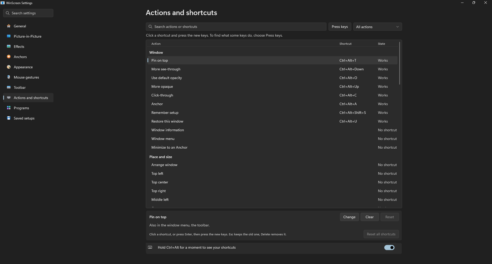

# WinScreen 使用指南

[English](USER_GUIDE.md) · [简体中文](USER_GUIDE.zh-CN.md) · [繁體中文](USER_GUIDE.zh-TW.md) · [返回 README](../README.zh-TW.md)

## 開始使用

安裝 WinScreen 後，它的圖示會出現在系統匣中（如果看不到，請點一下小箭頭）。

- **點選**圖示開啟設定。
- 以滑鼠**右鍵點選**圖示可使用所有命令，包括還原視窗與結束。開啟或關閉選項時選單會保持開啟，方便一次變更多項。
- **快捷鍵**作用於你正在使用的視窗。系統匣選單作用於**上一個視窗**下顯示的視窗。
- 把**指標停在**視窗標題列中間即可顯示工具列。也可以在 **設定 → 工具列** 中改為停在最小化按鈕上，或兩者皆可。

部分功能標為*實驗性*，可在 **設定 → 一般 → 實驗性功能** 中開啟。

## 快捷鍵

可在 **設定 → 操作與快捷鍵** 中修改或清除。選取一個操作，點選輸入框後按下按鍵，按 Delete 可清除。

| 操作 | 快捷鍵 |
| --- | --- |
| 置頂或取消置頂 | Ctrl+Alt+T |
| 更不透明 / 更透明 | Ctrl+Alt+Up / Down |
| 開關預設透明度 | Ctrl+Alt+O |
| 開關滑鼠穿透 | Ctrl+Alt+C |
| 開啟或關閉即時檢視 | Ctrl+Alt+P |
| 新增或移除錨點 | Ctrl+Alt+A |
| 深色模式 | Ctrl+Alt+D |
| 玻璃 | Ctrl+Alt+G |
| 縮小為即時小圖塊 | Ctrl+Alt+W |
| 裁切或取消裁切 | Ctrl+Alt+X |
| 記住或忘記此程式的設定 | Ctrl+Alt+Shift+S |
| 還原此視窗 | Ctrl+Alt+U |
| 還原所有視窗 | Ctrl+Alt+R |

其他命令（例如把視窗移到角落）預設沒有快捷鍵，需要時可以自己設定。檢視自己的命令也一樣：保持隱藏、互動或僅觀看、使用或前往原視窗、靜音、凍結、旋轉或翻轉、重設裁切和縮放、最小化或還原、複製畫面、凍結一份副本、複製文字、錄製和遮蓋部分。它們作用於前景視窗的檢視，否則作用於指標下方的檢視，或指標最後停留過的檢視；最小化的檢視按它的快捷鍵即可還原。

## 置頂與透明

- **Ctrl+Alt+T** 讓視窗保持在其他視窗之上。
- **Ctrl+Alt+Up/Down** 調整不透明度，最低 20%。
- **Ctrl+Alt+O** 在不透明與預設透明度之間切換，預設值在 設定 → 外觀 中設定。
- **Ctrl+Alt+C** 讓點選穿過視窗，到達後面的內容。再按一次即可關閉。

如果無法點到滑鼠穿透的視窗，按 **Ctrl+Alt+R** 還原所有視窗即可。

如果另一個程式取消了置頂視窗的「永遠在最上層」，WinScreen 會重新置頂。如果應用程式自行變更了透明效果，WinScreen 會放棄它設定的透明度與滑鼠穿透，並告訴你。

在 **設定 → 外觀** 中，可以修改透明度間距、為置頂視窗加上彩色外框，並開啟 **Ctrl+Alt+滾輪**
來調整指標下視窗的不透明度。

## 子母畫面檢視

按 **Ctrl+Alt+P** 為正在使用的視窗開啟一個小的即時檢視，再按一次即可關閉。
檢視開啟期間原視窗會隱藏，這樣即使被其他視窗擋住，檢視也會繼續更新。在檢視選單中關閉 **保持隱藏** 即可再次顯示原視窗。
如需顯示整個顯示器或螢幕的一部分，請以滑鼠右鍵點選系統匣圖示，選擇 **新增檢視**。如需螢幕的一部分，請選擇 **區域**，然後拖曳選取該區域。
要保留它，請在檢視選單中選擇 **預設組合 → 儲存此來源**。它會記住該區域，以及檢視的目前狀態：螢幕上的大小與位置、裁切與選項。之後可從系統匣選單或 **新增檢視** 中的 **已儲存的來源** 再次開啟。

| 在檢視上 | 效果 |
| --- | --- |
| 拖曳 | 移動檢視 |
| 滾輪 | 調整檢視大小 |
| Ctrl+滾輪 | 放大；Ctrl+連按兩下還原 |
| Ctrl+拖曳 | 裁切到需要的部分；Ctrl+連按兩下取消裁切 |
| 右鍵點選 | 開啟檢視選單，其中有 **前往原視窗** |

每個檢視都有標題列，位於畫面上方；靠近螢幕頂端時則位於下方。移入指標可顯示，拖曳可移動檢視，也可最小化或關閉檢視。拖曳邊緣或角落可調整大小；接近視窗本身的大小時會停在那裡，檢視與視窗完全一樣。**大小與選項** 中的 **保持長寬比** 預設為開啟。指標離開後標題列會淡出。要讓標題列一直顯示，請在 **大小與選項** 中開啟 **一律顯示標題列**，或在 **設定 → 子母畫面** 中為所有新檢視開啟。

**檢視選單中的常用選項**

- **保持隱藏：** 新檢視預設開啟，除非在 **設定 → 子母畫面** 中關閉 **為新檢視隱藏原視窗**。它會隱藏原視窗，支援時也會從工作列與 Alt+Tab 隱藏原視窗。關閉此項即可顯示原視窗，關閉檢視後也會恢復。
  瀏覽器等應用程式被完全擋住時會停止繪製。關閉保持隱藏時，WinScreen 仍會讓它們繼續繪製：視窗完全看不到時，它會在原處變為不可見；一旦有部分會露出來或你切換到它，它就會恢復正常。
- **將原程式靜音：** 只讓該應用程式不出聲，其他不變。瀏覽器會整個靜音，所以選單項目寫作 **將整個瀏覽器靜音**。關閉此項、還原視窗、關閉檢視或結束 WinScreen 後，聲音都會恢復。你自己先靜音的應用程式會保持靜音。
- **大小與選項：** 僅針對此檢視設定影格率上限、縮放、不透明度、大小、鎖定位置與滑鼠穿透。
  縮放選 **最佳** 適合幾乎所有情況；**像素化** 適合像素畫，**柔和** 適合影片。
- **預設組合：** 把檢視的外觀（裁切、大小、位置與選項）以名稱儲存起來，以後可用於任何檢視。
- **畫面** 下的 **凍結：** 檢視會一直顯示現在的畫面，視窗本身照常變化。仍然可以移動、調整大小、裁切和縮放，但不能透過它使用應用程式。
  再選一次即可恢復即時畫面。
- **畫面** 下的 **旋轉或翻轉：** 每次把檢視旋轉 90 度，或水平、垂直翻轉。仍然可以透過它使用應用程式：點選、拖曳和輸入都會落在你看到的位置。
  應用程式自己的選單保持正向，**恢復原方向** 可讓檢視回到原樣。會隨預設一起儲存。
- **畫面** 下的 **複製畫面：** 複製檢視顯示的內容，保留目前的裁切、縮放和旋轉，清晰度與原視窗相同。和 Windows 剪取工具一樣，它還會把檔案儲存到「螢幕擷取畫面」資料夾；可在 **設定 → 子母畫面** 中選擇其他資料夾，或只複製。無論檢視上蓋著什麼、不透明度是多少都一樣有效，顯示器或螢幕區域的檢視也可以（一般螢幕擷取拍不到這些檢視）。
- **凍結一份副本：** 把畫面保留在檢視旁邊的小視窗中，檢視本身繼續更新。可以移動它，用滾輪調整大小，按住 Ctrl 拖曳裁切，按住 Ctrl 捲動滾輪縮放。按右鍵可複製或儲存畫面、複製其中的文字或關閉它（Esc）。
- **複製文字：** 拖曳選取需要的文字，或點選以取得全部文字，文字就會被複製。它辨識的是畫面中的文字，所以影片、遊戲、遠端桌面和無法選取文字的網頁也可以。它使用 Windows 內建、適用於你的語言的文字辨識。
- **錄製：** 把檢視顯示的內容按檢視的影格率（或在設定中選擇的影格率）錄成影片，保留目前的裁切、縮放和旋轉，遮蓋的部分在每一格畫面裡都是黑的。檢視上的紅點表示正在錄製。選擇 **停止錄製**，再點選檢視上的提示即可查看檔案。最小化或關閉檢視也會停止錄製並儲存影片。和剪取工具一樣，它儲存到「影片」資料夾中的「螢幕錄製」；可在 **設定 → 子母畫面** 中選擇其他資料夾，並選擇錄製應用程式的聲音；檢視靜音時，錄製也沒有聲音。無論檢視上蓋著什麼都一樣有效，顯示器或螢幕區域的檢視也可以錄製（沒有聲音）。在 Windows 10 上，原視窗隱藏時檢視無法錄製。
- **遮蓋部分：** 拖曳選取任何隱私內容（例如電子郵件地址或聊天），它在檢視中就會被塗黑。複製、凍結的副本、文字辨識以及在通話中分享此檢視都不會顯示它。縮放、裁切、旋轉、凍結、保持隱藏、最小化等任何操作後遮蓋都會保留，並會隨預設一起儲存。在同一編輯器中點選遮蓋可將其移除，或選擇 **移除遮蓋**。
- **互動** 可直接指向、點選、選取文字、拖曳與捲動。Chrome、Edge、Brave、Vivaldi、Firefox、Electron 應用程式和檔案總管 可直接使用，其他應用程式為*實驗性*。
  開啟時會勾選並鎖定 **保持隱藏**；關閉後會恢復先前的隱藏選擇。
  拖曳檢視標題列可移動檢視，也可按住 Alt 拖曳畫面。選單會在指標附近開啟。
  應用程式提問時會顯示原視窗。指標離開後，按鍵會回到之前使用的視窗。
  以系統管理員身分執行的應用程式在前景時，要先在檢視中點一下，檢視才能跟隨指標。
  在 Windows 11 上，輸入法的選字清單和表情符號面板會在檢視中你輸入的位置旁開啟。
  小算盤等市集應用程式也可以直接使用。它們會保留工作列按鈕，點選按鈕會顯示應用程式。
  在部分新式控制項上（市集應用程式與檔案總管的部分區域），可以點選、按右鍵與捲動，但無法停留、拖曳或選取。
  預設情況下，瀏覽器的指標形狀可正常顯示，但懸停效果與工具提示可能無法持續。
  **增強懸停（實驗性）** 可在透過檢視使用應用程式時保持懸停效果，WinScreen 會為效果好的應用程式開啟：Chrome、Edge、Brave 和 Vivaldi，Firefox，以及 VS Code、Discord 等類似應用程式。也可在**設定 → 子母畫面 → 透過檢視使用應用程式**中關閉**由 WinScreen 選擇**，自己選擇應用程式，包括檔案總管和你新增的其他程式；每個檢視的功能表仍可個別變更。需要 64 位元 Intel 或 AMD 電腦。已測試的應用程式請見[相容性表](FEATURE_COMPATIBILITY.md)。原生工具提示仍可能無法使用。
  開啟增強懸停後，瀏覽器以及 VS Code、Discord 等應用程式內建的中鍵捲動可在檢視中使用。
  其他情況下，可在此檢視開啟 **中鍵捲動**（也可在 **設定 → 子母畫面** 中為新檢視開啟），按下中鍵後把指標移離該點。再按中鍵、左鍵或 Escape 即可停止。關閉此選項可保留應用程式原本的中鍵動作。
  少數應用程式無法隱藏（例如 PowerShell ISE），WinScreen 會告訴你。
- **使用後再隱藏** 適用於無法透過檢視正常操作的應用程式，例如遊戲。
  原視窗會回到原來的位置，切換到別的視窗後再次隱藏。
  如果想每次按一下檢視都這樣做，請在**設定 → 子母畫面 → 透過檢視使用應用程式**中新增該程式，並為它開啟**顯示原視窗**。使用 Java 開發的應用程式一律如此。
  如果在檢視上按一下沒有傳到應用程式，檢視會顯示提示。按一下提示即可改用原視窗。
  如果某個應用程式經常這樣，提示會讓你為它開啟**顯示原視窗**。
- **把東西拖到檢視上**（檔案、圖片或文字），原視窗會出現在指標下，方便你放下。放開後它會再次隱藏。
- **從檔案總管的檢視裡拖出檔案**，拖到另一個視窗、桌面或另一個檢視上。拖曳時檢視會讓到一旁，放開後再回來。檔案不能拖回同一個檢視裡。
- **從瀏覽器的檢視裡拖出連結**（Chrome、Edge、Brave、Vivaldi），拖到另一個視窗、桌面或另一個檢視上，方式相同。

WinScreen 選單或系統匣溢位面板開啟時，檢視會暫停直接操作。

Windows 無法隱藏擷取邊框時，隱藏的原視窗會改用標準模式。顯示原視窗後會恢復你的選擇。

在 **設定 → 子母畫面** 中可以選擇停留預覽（僅適用於較小的檢視）或閱讀放大鏡，最小化的檢視和有檢視的最小化視窗預設保留在工作列上，也可在此關閉。

## 錨點

錨點是視窗的小浮動按鈕。按 **Ctrl+Alt+A** 新增或移除。

- **點選**：把視窗帶回前景。
- **右鍵點選**：開啟選單，可顯示、最小化或關閉視窗。
- **中鍵點選**：要求關閉視窗。
- **把檔案拖到錨點上**：把視窗帶到前景，方便放下檔案。
- **把指標停在錨點上**：查看該視窗。同一程式的錨點會顯示視窗標題。

視窗選單中的 **最小化為浮動錨點** 會為視窗新增錨點並將其最小化，一步完成。

在 **設定 → 錨點** 中，WinScreen 可以為被完全擋住的視窗自動新增錨點，能看到視窗時再自動移除。
你還可以選擇錨點出現的位置、數量、大小與樣式（深色、淺色或只顯示圖示）、是否避開文字與圖片，以及是否將你新增了錨點的視窗從工作列移除。錨點上的小缺口表示該視窗有檢視。
系統匣選單中的 **隱藏所有浮動錨點** 會把錨點收起，直到你再次顯示它們。

錨點會顯示在所有虛擬桌面上，點選錨點會切換到其視窗所在的桌面。若要每個錨點只在其視窗所在的桌面上顯示，請在 **設定 → 錨點** 中關閉 **在所有桌面上顯示錨點**。

## 排列視窗

工具列的 **排列視窗** 按鈕包含所有移動視窗的命令：

- 螢幕上的九個位置：角落、邊緣與中央。
- 移到下一台顯示器。
- 常用大小，例如 1280 × 720。
- 輸入精確的位置與大小。
- 回到之前的位置。
- 移到最底層，放在所有視窗後面。
- 收起到標題列 *（實驗性）*。

對最大化的視窗選擇位置或輸入精確位置時，視窗會以原來的大小放到那裡。

工具列的 **視窗選單** 按鈕包含視窗選單的其餘部分：**不透明度** 滑桿，以及工具列上還沒有按鈕的命令，例如 **無邊框**、**填滿顯示器**、
**深色標題列**、**複製** 與 **開啟檔案位置**。其中大多數也可以作為按鈕顯示：在 **設定 → 工具列** 中勾選即可。

開啟 **設定 → 滑鼠手勢 → 移動與調整大小** 後，按住 Alt（或 Win）拖曳視窗任何地方：左鍵移動，右鍵調整大小。最大化的視窗也可以，按 Esc 可還原。拖到螢幕左右邊緣會佔滿那一半，拖到角落佔四分之一，拖到頂端則最大化。
在同一頁開啟 **視窗選單**，即可用 **Ctrl+右鍵點選** 開啟命令選單。

系統匣與視窗選單中還有 **不透明度** 滑桿、九個擺放位置的格線（因此其中的 **排列視窗** 只列出其他命令）、**無邊框**、**填滿顯示器** 與 **深色標題列**。**複製** 與 **開啟檔案位置** 在 **更多** 中。
無邊框與填滿顯示器也適用於自行繪製標題列的應用程式，例如瀏覽器。深色標題列只會變更由 Windows 繪製的標題列。

## 效果 *（實驗性）*

- **深色模式**：交換明暗。已經是深色的視窗會保持原樣。
- **玻璃**：讓視窗背景變透明。

一個視窗只能使用深色模式或玻璃其中之一：開啟一個會關閉另一個。
- **裁切**：只保留你拖曳選取的部分，點選其餘部分會到達後面的內容。不拖曳而是點選醒目提示的部分時，調整視窗大小後裁切會跟著這個部分。
- **縮小**：把視窗變成即時小圖塊，點選小圖塊即可還原。變成小圖塊時會暫時關閉深色模式或玻璃，視窗還原後會一併恢復。

深色模式會對調深淺，並保留每種顏色的色調，所以圖片與影片也會跟著變。想讓某處保持原樣，請看下面的 **讓圖片和影片保持不透明**。玻璃會淡化接近頁面顏色的顏色，並讓文字保持清晰。沒有顯示卡的電腦上，兩者都無法讓區域保持原樣，玻璃則讓一種顏色變透明，點選該處會到達後面的內容。
深色模式的選項在 **設定 → 外觀** 中；玻璃的選項在 **設定 → 背景** 中。在 Windows 10 上，這兩項運作時視窗周圍會顯示黃色外框。如果深色模式或玻璃下的視窗不再回應點選，WinScreen 會關閉該效果並告訴你。

### 玻璃後面的圖片或影片

在 **設定 → 背景** 中，可以選擇圖片、GIF 或影片，顯示在開啟玻璃的視窗的文字後面，也可以用 **新增連結** 使用網路上的圖片或影片。
**所有應用程式** 為全部應用程式設定背景和玻璃程度。新增某個應用程式，可以給它專屬的設定，或讓它不顯示背景。預覽會顯示背景的擺放效果，
也可以把檔案拖曳到預覽上。想看到更多圖片，可調低「所有應用程式」卡片中的 **背景**。

新增多個時，它們會 **依順序** 或 **隨機** 輪流顯示。**切換** 選 **影片結束時**，每部影片播放一次，每張圖片顯示你選擇的分鐘數；選 **定時**，每一個都顯示該分鐘數。每一個都有自己的 **顯示方式**、
**聲音**、**速度** 和 **亮度**。如果檔案被移動或刪除，設定中會標為 **（找不到）**，玻璃會顯示下一個；檔案恢復後會自動重新顯示。

影片預設靜音，調高 **聲音** 後才會播放聲音；也可以在視窗選單 **效果** 中的 **背景聲音** 調整，**下一個背景** 會換到下一個，**變更背景** 會為該應用程式開啟這些設定。
只有你最後使用的視窗會播放聲音，而且只在其應用程式位於最前面時播放。視窗最小化或位於其他桌面、遊戲或全螢幕應用程式位於最前面，
以及 Windows 省電時，影片會暫停。這些都可以在 **應用程式背景** 中關閉。

### 讓圖片和影片保持不透明

玻璃會淡化所有接近頁面顏色的顏色，所以深色頁面上的暗場景、淺色頁面上的明亮天空也會被淡化一些。有兩個設定可以幫忙：

- **設定 → 背景** 中「所有應用程式」卡片的 **淡化範圍**：調低後，只有非常接近頁面顏色的顏色才會淡化，圖片和影片會保持不透明，文字邊緣也會稍顯銳利。
  調到 100% 以上，離頁面顏色更遠的顏色也會淡化；調到最高時，所有顏色都會淡化。
- 視窗選單 **效果** 中的 **讓區域保持原樣**：拖曳選取影片或圖片，或點選醒目提示的部分，玻璃和深色模式就不會改變它。點選已標記的區域可將其移除，
  完成後按 Enter。每個應用程式最多可以有八個區域，會用於它的所有視窗，調整視窗大小時也會跟著移動。清單在 **設定 → 背景** 的底部，
  可以在那裡移除某個應用程式的區域。在有顯示卡的電腦上，一般玻璃也會保留這些區域。

### 動態背景上的文字

玻璃會在文字周圍保留一層頁面顏色的柔和陰影，讓文字在後面的內容上也能看清。**設定 → 背景** 的「所有應用程式」卡片中有兩個設定可以改變它：

- **文字顏色**：選 **淺色** 或 **深色** 時，頁面會在需要時像深色模式一樣反轉，得到帶深色陰影的淺色文字，或帶淺色陰影的深色文字。
  圖片也會像深色模式一樣反轉，除非用 **讓區域保持原樣** 標記它們。
- **文字陰影**：關閉後文字不再有陰影。

### 每個應用程式或視窗的玻璃

在 **設定 → 背景** 的 **應用程式背景** 中新增應用程式，即可為它設定自己的背景圖片或影片，以及自己的背景、文字、淡化範圍、文字顏色和陰影。兩者一開始
都與所有應用程式相同，也可以為此應用程式分別關閉。

想直接在視窗上試試效果時，在它的選單 **效果** 中選擇 **玻璃與背景**。左邊是玻璃的程度，右邊是圖片或影片：可以新增或移除，
並設定顯示方式、聲音、速度、亮度、順序和時間。變更會立即顯示在該視窗上，直到視窗關閉；選擇 **為此應用程式儲存** 可用於它的所有視窗。

**背景** 是頁面顏色蓋住圖片的程度，**亮度** 是圖片本身的明暗。在深色頁面上，兩者都會讓圖片變暗；在淺色頁面上，背景越高，圖片越淡。

## 記住程式的設定

依喜好設定視窗：置頂、透明、深色，需要的話再開啟檢視，然後按 **Ctrl+Alt+Shift+S**。
此後該程式的視窗都會這樣啟動，重新啟動後也一樣。在沒有變更的視窗上再按一次可忘記設定，
也可以在 **設定 → 已儲存的設定** 中移除。玻璃不會記入設定。

在那裡選擇 **變更**，可讓設定只用於標題包含某些文字的視窗，也可以把視窗放到某個位置或某台顯示器、
設為無邊框、新增錨點，或不在其上顯示工具列。對於自行繪製標題列、從不顯示工具列的應用程式，請選擇 **在通常是標題列的位置顯示工具列**。設定還可以在視窗每次回到前景時都套用，或暫時關閉。

## 用指令碼執行命令

`WinScreen.exe --run TogglePin --window title:Chat` 會讓 WinScreen 像按下快速鍵一樣，對你指定的視窗執行命令：
`active`（預設）、`pointer`，或標題包含某些文字的第一個視窗。WinScreen 需要正在執行。
`WinScreen.exe --list-commands` 會列出所有命令。成功時結束代碼為 0。

## 設定一覽

變更會立即生效。滑鼠滾輪只用於捲動；點選或拖曳才會變更設定。

| 頁面 | 內容 |
| --- | --- |
| 一般 | 語言、淺色或深色外觀、通知、開機啟動、以系統管理員身分執行、更新、實驗性功能，以及把設定帶到另一台電腦 |
| 子母畫面 | 檢視的外觀與行為，以及畫面與錄影儲存到哪裡 |
| 背景 | 玻璃的效果，以及它後面的圖片或影片，可以所有應用程式共用，也可以每個應用程式各自設定 |
| 錨點 | 自動錨點與錨點外觀 |
| 外觀 | 透明度、置頂的視窗與深色模式 |
| 滑鼠手勢 | 按鍵移動與調整大小，以及滑鼠選單 |
| 工具列 | 工具列出現的位置、速度與按鈕 |
| 操作與快捷鍵 | WinScreen 的所有功能及其快捷鍵。選取一個操作即可變更快捷鍵 |
| 程式 | WinScreen 應忽略的程式，或只操作的程式 |
| 已儲存的設定 | 已記住的程式設定 |

## 還原視窗

- **Ctrl+Alt+U**，或視窗選單中的 **還原此視窗**，把正在使用的視窗恢復正常。
- **Ctrl+Alt+R**，或系統匣選單中的 **還原所有視窗**，把所有視窗恢復原樣。
- 系統匣選單中的 **在所有視窗關閉滑鼠穿透** 與 **取消所有視窗置頂** 只復原這一項，對所有視窗生效。在所有視窗關閉滑鼠穿透也會讓滑鼠穿透的檢視重新接收點擊。
- 關閉 WinScreen 也會還原所有視窗。
- 如果 WinScreen 意外停止，隱藏的視窗會在幾秒內恢復，其餘視窗會在下次啟動時恢復。

如果操作沒有成功，系統匣選單中的 **最近結果** 會說明原因。

## 更新

在 **設定 → 一般 → 新版本** 中選擇 **關閉**（預設：WinScreen 不會為此連網）、**告訴我**，或 **為我安裝**：後者會在背景下載
新版本，並在你關閉 WinScreen 時安裝。後兩項都只是向 GitHub 查詢最新版本，不會傳送任何其他內容。可攜版無法自行更新：
它會告訴你，按一下即可開啟新版本的頁面。也可以隨時在系統匣選單中選擇 **檢查更新**，或在 **設定 → 一般** 中選擇 **立即檢查**：一個小視窗會顯示每一步，新版本準備好後，選擇 **立即重新啟動** 即可安裝。手動更新時，先關閉 WinScreen，再執行新版安裝程式。你的設定會保留。

更新後，WinScreen 會提示一次，可查看新功能。系統匣選單與 **設定 → 一般** 末尾也有 **新功能**。

## 回報問題

在系統匣選單中選擇 **儲存診斷資訊**。WinScreen 會儲存一個小檔案並在檔案總管中顯示它，把它附加到
[新的 Issue](https://github.com/DarkLian/WinScreen/issues) 中即可。檔案裡有 WinScreen 自己的簡短記錄與你的設定。
程式只以檔名出現（例如 chrome.exe），視窗標題、檔案路徑和你輸入的內容都不會在裡面。除非你自己傳送，否則什麼都不會離開你的電腦。

## 小提示

- WinScreen 支援 64 位元 Intel 或 AMD 電腦（x64）上的 Windows 10（2004 版或更新版本）與 Windows 11。不支援 ARM 電腦與 32 位元 Windows。
- 要變更以系統管理員身分執行的應用程式（例如工作管理員），請在 **設定 → 一般** 中開啟 **以系統管理員身分執行**。
  WinScreen 本身照常執行，並啟動一個帶這些權限的小助手，專門處理這類應用程式（Windows 可能會先詢問你）。WinScreen 每次啟動時助手也會啟動，並隨它一起關閉。
- 遊戲或全螢幕應用程式在前景時，命令會暫停。
- 最小化一個有檢視的視窗時，它會改為隱藏在檢視後面，因此檢視會繼續更新。它仍保留在工作列和 Alt+Tab 中，可像平常一樣找回。無法隱藏的視窗最小化後會停止繪製，檢視會顯示最後的畫面。
- 檢視會顯示在所有虛擬桌面上，你在另一個桌面時也會繼續更新。為此，你不在時檢視會暫時隱藏它的視窗，檢視選單中會顯示**你在另一個桌面時暫時隱藏**。在 Windows 10 和 Windows 11 24H2 及更新版本上，被檢視保持隱藏的視窗再次顯示時，會回到它自己的桌面。
- 在 Windows 本身的設定中開啟 **透明效果** 後，WinScreen 的選單也會像 Windows 本身的選單一樣帶有模糊背景。如不需要，請在**設定 → 一般**中關閉**選單透明效果**。
- 在「流暢」模式下，Windows 會在被顯示的視窗周圍畫一圈黃色邊框。在 Windows 11 上 WinScreen 會要求隱藏它，可在
  **設定 → 子母畫面** 中變更。Windows 10 一律會顯示這圈邊框，介意的話可在那裡改用「標準」模式。

各項功能做不到的事，請見[功能相容性中的限制一覽](FEATURE_COMPATIBILITY.md#limitations-at-a-glance)。
