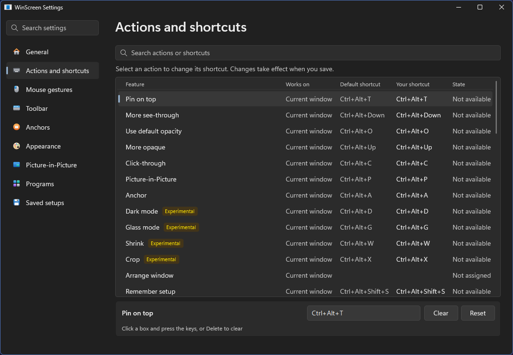
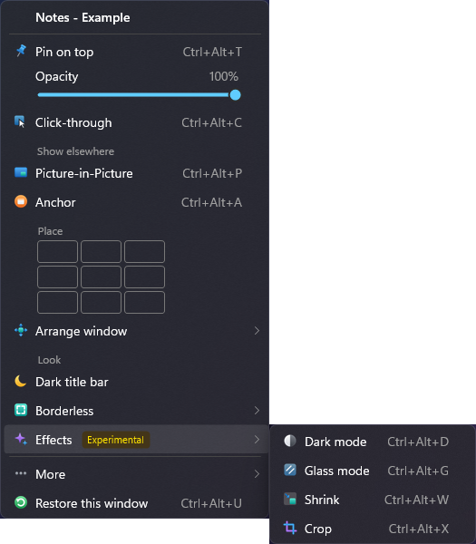

# WinScreen 使用指南

[English](USER_GUIDE.md) · [简体中文](USER_GUIDE.zh-CN.md) · [繁體中文](USER_GUIDE.zh-TW.md) · [返回 README](../README.zh-TW.md)

## 開始使用

安裝 WinScreen 後，它的圖示會出現在系統匣中（如果看不到，請點一下小箭頭）。

- **點選**圖示開啟設定。
- 以滑鼠**右鍵點選**圖示可使用所有命令，包括還原視窗與結束。開啟或關閉選項時選單會保持開啟，方便一次變更多項。
- **快捷鍵**作用於你正在使用的視窗。系統匣選單作用於**上一個視窗**下顯示的視窗。
- 把**指標停在**視窗標題列中間即可顯示工具列。

部分功能標為*實驗性*，可在 **設定 → 一般 → 實驗性功能** 中開啟。

## 快捷鍵

可在 **設定 → 操作與快捷鍵** 中修改或清除。選取一個操作，點選輸入框後按下按鍵，按 Delete 可清除。

| 操作 | 快捷鍵 |
| --- | --- |
| 置頂或取消置頂 | Ctrl+Alt+T |
| 更不透明 / 更透明 | Ctrl+Alt+Up / Down |
| 開關預設透明度 | Ctrl+Alt+O |
| 開關滑鼠穿透 | Ctrl+Alt+C |
| 開啟或關閉即時檢視 | Ctrl+Alt+P |
| 新增或移除錨點 | Ctrl+Alt+A |
| 深色模式 | Ctrl+Alt+D |
| 玻璃 | Ctrl+Alt+G |
| 縮小為即時小圖塊 | Ctrl+Alt+W |
| 裁切或取消裁切 | Ctrl+Alt+X |
| 記住或忘記此程式的設定 | Ctrl+Alt+Shift+S |
| 還原此視窗 | Ctrl+Alt+U |
| 還原所有視窗 | Ctrl+Alt+R |

其他命令（例如把視窗移到角落）預設沒有快捷鍵，需要時可以自己設定。

## 置頂與透明

- **Ctrl+Alt+T** 讓視窗保持在其他視窗之上。
- **Ctrl+Alt+Up/Down** 調整不透明度，最低 20%。
- **Ctrl+Alt+O** 在不透明與預設透明度之間切換，預設值在 設定 → 外觀 中設定。
- **Ctrl+Alt+C** 讓點選穿過視窗，到達後面的內容。再按一次即可關閉。

如果無法點到滑鼠穿透的視窗，按 **Ctrl+Alt+R** 還原所有視窗即可。

在 **設定 → 外觀** 中，可以修改透明度間距、為置頂視窗加上彩色外框，並開啟 **Ctrl+Alt+滾輪**
來調整指標下視窗的不透明度。

## 子母畫面檢視

按 **Ctrl+Alt+P** 為正在使用的視窗開啟一個小的即時檢視，再按一次即可關閉。
如需顯示整個顯示器或螢幕的一部分，請以滑鼠右鍵點選系統匣圖示，選擇 **新增檢視**。如需螢幕的一部分，請選擇 **區域**，然後拖曳選取該區域。
你可以在那裡儲存顯示器或區域，之後從 **子母畫面檢視 → 已儲存的來源** 再次開啟。

| 在檢視上 | 效果 |
| --- | --- |
| 拖曳 | 移動檢視 |
| 滾輪 | 調整檢視大小 |
| Ctrl+滾輪 | 放大；Ctrl+連按兩下還原 |
| Ctrl+拖曳 | 裁切到需要的部分；Ctrl+連按兩下取消裁切 |
| 右鍵點選 | 開啟檢視選單，其中有 **前往原視窗** |

每個檢視都有標題列，位於畫面上方；靠近螢幕頂端時則位於下方。移入指標可顯示，拖曳可移動檢視，也可最小化或關閉檢視。指標離開後會淡出。 拖曳邊緣或角落可調整大小。**大小與選項** 中的 **保持長寬比** 預設為開啟。要讓標題列一直顯示，請在 **大小與選項** 中開啟 **一律顯示標題列**，或在 **設定 → 子母畫面** 中為所有新檢視開啟。

**檢視選單中的常用選項**

- **保持隱藏：** 瀏覽器等應用程式被擋住時會停止繪製。開啟後會隱藏原視窗，讓檢視保持即時。 支援時也會從工作列與 Alt+Tab 隱藏原視窗，顯示原視窗或關閉檢視後即恢復。
- **大小與選項：** 僅針對此檢視設定影格率上限、不透明度、大小、鎖定位置與滑鼠穿透。
- **預設組合：** 把裁切、大小與位置儲存起來，以後再用。
- **互動（實驗性）** 可直接指向、點選、選取文字、拖曳與捲動，原視窗保持隱藏。
  開啟時會勾選並鎖定 **保持隱藏**；關閉後會恢復先前的隱藏選擇。
  拖曳檢視標題列可移動檢視，也可按住 Alt 拖曳畫面。選單會在指標附近開啟。
  應用程式提問時會顯示原視窗。指標離開後，按鍵會回到之前使用的視窗。
  小算盤等市集應用程式也可以直接使用。它們會保留工作列按鈕，點選按鈕會顯示應用程式。
  在部分新式控制項上（市集應用程式與檔案總管的部分區域），可以點選、按右鍵與捲動，但無法停留、拖曳或選取。
  預設情況下，瀏覽器的指標形狀可正常顯示，但懸停效果與工具提示可能無法持續。
  **增強懸停（實驗性）** 可在透過檢視使用應用程式時保持懸停效果，WinScreen 會為效果好的應用程式開啟：Chrome、Edge、Brave 和 Vivaldi，Firefox，以及 VS Code、Discord 等類似應用程式。也可在**設定 → 子母畫面 → 透過檢視使用應用程式**中關閉**由 WinScreen 選擇**，自己選擇應用程式，包括檔案總管和你新增的其他程式；每個檢視的功能表仍可個別變更。需要 64 位元 Intel 或 AMD 電腦。已測試的應用程式請見[相容性表](FEATURE_COMPATIBILITY.md)。原生工具提示仍可能無法使用。
  開啟增強懸停後，瀏覽器以及 VS Code、Discord 等應用程式內建的中鍵捲動可在檢視中使用。
  其他情況下，可在此檢視開啟 **中鍵捲動**（也可在 **設定 → 子母畫面** 中為新檢視開啟），按下中鍵後把指標移離該點。再按中鍵、左鍵或 Escape 即可停止。關閉此選項可保留應用程式原本的中鍵動作。
  少數應用程式無法隱藏（例如 PowerShell ISE），WinScreen 會告訴你。
- **使用後再隱藏** 適用於無法透過檢視正常操作的應用程式，例如遊戲。
  原視窗會回到原來的位置，切換到別的視窗後再次隱藏。
  如果想每次按一下檢視都這樣做，請在**設定 → 子母畫面 → 透過檢視使用應用程式**中新增該程式，並為它開啟**顯示原視窗**。

WinScreen 選單或系統匣溢位面板開啟時，檢視會暫停直接操作。

Windows 無法隱藏擷取邊框時，隱藏的原視窗會改用標準模式。顯示原視窗後會恢復你的選擇。

在 **設定 → 子母畫面** 中可以選擇停留預覽或閱讀放大鏡，也可以把最小化的檢視保留在工作列上。

完整預覽僅在檢視小於所顯示原畫面的一半大小時出現；放大鏡不受此限制。

## 錨點

錨點是視窗的小浮動按鈕。按 **Ctrl+Alt+A** 新增或移除。

- **點選**：把視窗帶回前景。
- **右鍵點選**：開啟選單，可顯示、最小化或關閉視窗。
- **中鍵點選**：要求關閉視窗。
- **把檔案拖到錨點上**：把視窗帶到前景，方便放下檔案。
- **把指標停在錨點上**：查看該視窗。同一程式的錨點會顯示視窗標題。

在 **設定 → 錨點** 中，WinScreen 可以為被完全擋住的視窗自動新增錨點，能看到視窗時再自動移除。
你還可以選擇錨點出現的位置、數量、大小與樣式（深色、淺色或只顯示圖示）、是否避開文字與圖片，以及是否將你新增了錨點的視窗從工作列移除。錨點上的小缺口表示該視窗有檢視。
系統匣選單中的 **隱藏所有浮動錨點** 會把錨點收起，直到你再次顯示它們。

## 排列視窗

工具列的 **排列視窗** 按鈕包含所有移動視窗的命令：

- 螢幕上的九個位置：角落、邊緣與中央。
- 移到下一台顯示器。
- 輸入精確的位置與大小。
- 回到之前的位置。
- 移到最底層，放在所有視窗後面。
- 收起到標題列 *（實驗性）*。

對最大化的視窗選擇位置或輸入精確位置時，視窗會以原來的大小放到那裡。

工具列的 **視窗選單** 按鈕包含視窗選單的其餘部分：工具列上還沒有按鈕的命令，例如 **無邊框**、**填滿顯示器**、
**深色標題列**、**複製** 與 **開啟檔案位置**。

開啟 **設定 → 滑鼠手勢 → 移動與調整大小** 後，按住 Alt（或 Win）拖曳視窗任何地方：左鍵移動，右鍵調整大小。最大化的視窗也可以，按 Esc 可還原。拖到螢幕左右邊緣會佔滿那一半，拖到角落佔四分之一，拖到頂端則最大化。
在同一頁開啟 **視窗選單**，即可用 **Ctrl+右鍵點選** 開啟命令選單。

系統匣與視窗選單中還有 **不透明度** 滑桿、九個擺放位置的格線（因此其中的 **排列視窗** 只列出其他命令）、**無邊框**、**填滿顯示器** 與 **深色標題列**。**複製** 與 **開啟檔案位置** 在 **更多** 中。
無邊框與填滿顯示器也適用於自行繪製標題列的應用程式，例如瀏覽器。深色標題列只會變更由 Windows 繪製的標題列。

## 效果 *（實驗性）*

- **深色模式**：交換明暗。已經是深色的視窗會保持原樣。
- **玻璃**：讓視窗背景變透明。

一個視窗只能使用深色模式或玻璃其中之一：開啟一個會關閉另一個。
- **裁切**：只保留你拖曳選取的部分，點選其餘部分會到達後面的內容。
- **縮小**：把視窗變成即時小圖塊，點選小圖塊即可還原。

在 **設定 → 外觀** 中，可以讓玻璃只淡化背景並保留文字與圖片，也可以讓深色模式不改變圖片與影片，
還能設定背景、文字與圖片各自保留多少不透明度。這兩個選項運作時，Windows 會在視窗周圍顯示彩色外框。

## 記住程式的設定

依喜好設定視窗：置頂、透明、深色，需要的話再開啟檢視，然後按 **Ctrl+Alt+Shift+S**。
此後該程式的視窗都會這樣啟動，重新啟動後也一樣。在沒有變更的視窗上再按一次可忘記設定，
也可以在 **設定 → 已儲存的設定** 中移除。

## 設定一覽

變更會立即生效。滑鼠滾輪只用於捲動；點選或拖曳才會變更設定。

| 頁面 | 內容 |
| --- | --- |
| 一般 | 語言、淺色或深色外觀、通知、開機啟動、以系統管理員身分執行、更新、實驗性功能，以及把設定帶到另一台電腦 |
| 操作與快捷鍵 | WinScreen 的所有功能及其快捷鍵。選取一個操作即可變更快捷鍵 |
| 滑鼠手勢 | 按鍵移動與調整大小，以及滑鼠選單 |
| 工具列 | 工具列出現的位置、速度與按鈕 |
| 錨點 | 自動錨點與錨點外觀 |
| 外觀 | 透明度、置頂外框與效果 |
| 子母畫面 | 檢視的外觀與行為 |
| 程式 | WinScreen 應忽略的程式，或只操作的程式 |
| 已儲存的設定 | 已記住的程式設定 |

## 還原視窗

- **Ctrl+Alt+U** 把正在使用的視窗恢復正常。
- **Ctrl+Alt+R**，或系統匣選單中的 **還原所有視窗**，把所有視窗恢復原樣。
- 系統匣選單中的 **在所有視窗關閉滑鼠穿透** 與 **取消所有視窗置頂** 只復原這一項，對所有視窗生效。
- 關閉 WinScreen 也會還原所有視窗。
- 如果 WinScreen 意外停止，隱藏的視窗會在幾秒內恢復，其餘視窗會在下次啟動時恢復。

如果操作沒有成功，系統匣選單中的 **最近結果** 會說明原因。

## 更新

在 **設定 → 一般** 中開啟自動更新後，WinScreen 會在背景下載新版本，並在關閉時安裝。
也可以在系統匣選單中選擇 **檢查更新**。手動更新時，先關閉 WinScreen，再執行新版安裝程式。你的設定會保留。

## 小提示

- WinScreen 支援 64 位元 Intel 或 AMD 電腦（x64）上的 Windows 10（2004 版或更新版本）與 Windows 11。不支援 ARM 電腦與 32 位元 Windows。
- 要變更以系統管理員身分執行的應用程式（例如工作管理員），請在 **設定 → 一般** 中開啟 **以系統管理員身分執行**。
  WinScreen 會以這些權限重新啟動（Windows 可能會先詢問你），隨 Windows 啟動時也會保留這些權限。
- 遊戲或全螢幕應用程式在前景時，命令會暫停。檢視無法顯示在獨占全螢幕的遊戲上方。
- 最小化的應用程式會停止繪製，因此檢視會顯示最後的畫面。
- 受保護的影片在檢視中可能顯示為黑色。
- 在 Windows 本身的設定中開啟 **透明效果** 後，WinScreen 的選單也會像 Windows 本身的選單一樣帶有模糊背景。如不需要，請在**設定 → 一般**中關閉**選單透明效果**。
- 在「流暢」模式下，Windows 會在被顯示的視窗周圍畫一圈黃色邊框。在 Windows 11 上 WinScreen 會要求隱藏它，可在
  **設定 → 子母畫面** 中變更。Windows 10 一律會顯示這圈邊框，介意的話可在那裡改用「標準」模式。
- 顯示器或區域檢視，以及會避開內容的錨點，不會出現在你自己的螢幕擷取畫面或螢幕分享中。
- 深色、玻璃與裁切的效果取決於每個應用程式的繪製方式。

完整清單請見[功能相容性中的限制一覽](FEATURE_COMPATIBILITY.md#limitations-at-a-glance)。
